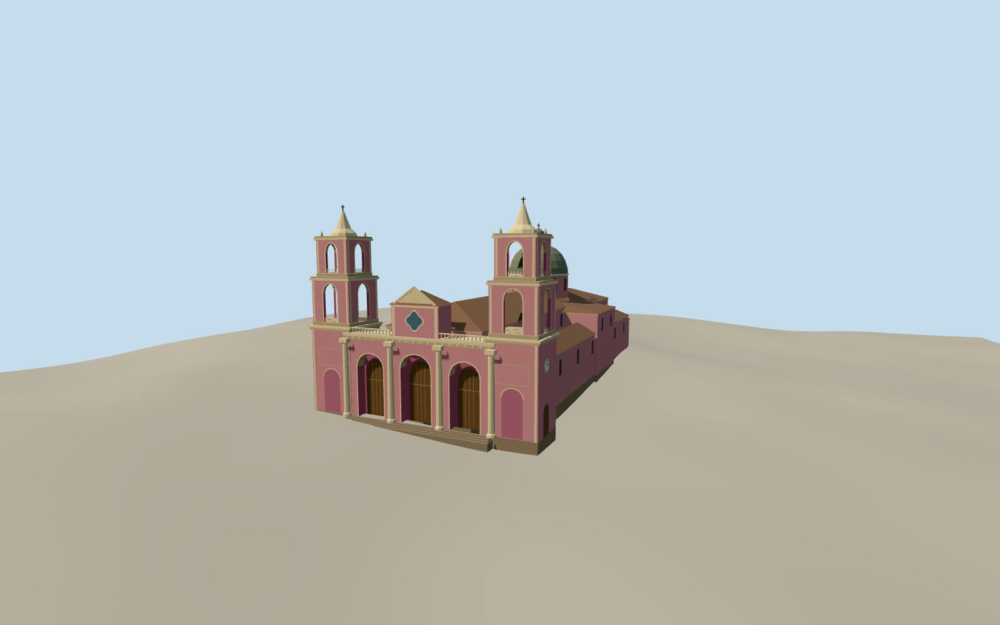

# Salta Cathedral

Salta Cathedral around 2008, with the plaza arcade, classical pink and cream front, open twin belfries, and a dome above the cruciform nave.

Authoring state: **review-in-qa.json**. Current completion evidence is in [qa.json](qa.json) and the [completion ledger](../../../../qualla-structures/batches/qualla-003.PROGRESS.md).

- [Salta Cathedral](https://qualla.com/salta-cathedral/)

The southern front is based on the exact published public-domain photo. The native upload date anchors the circa-2008 representation. The crossing and rear volumes follow the heritage description, with estimated roof color, side and rear openings, and approximate dome and tower heights.

Street grade and façade steps are approximate. The original elevation samples include a west-to-east slope across the front. The exterior depicts the basilica, with a simplified choir and attached exterior fabric.

Build: `node content/worldgen/source/places/6e/6e9/salta_cathedral/models/generate-salta-cathedral.mjs`. Add `--check` to verify exact regeneration. 6391 triangles; 5 materials; no embedded photographs.
