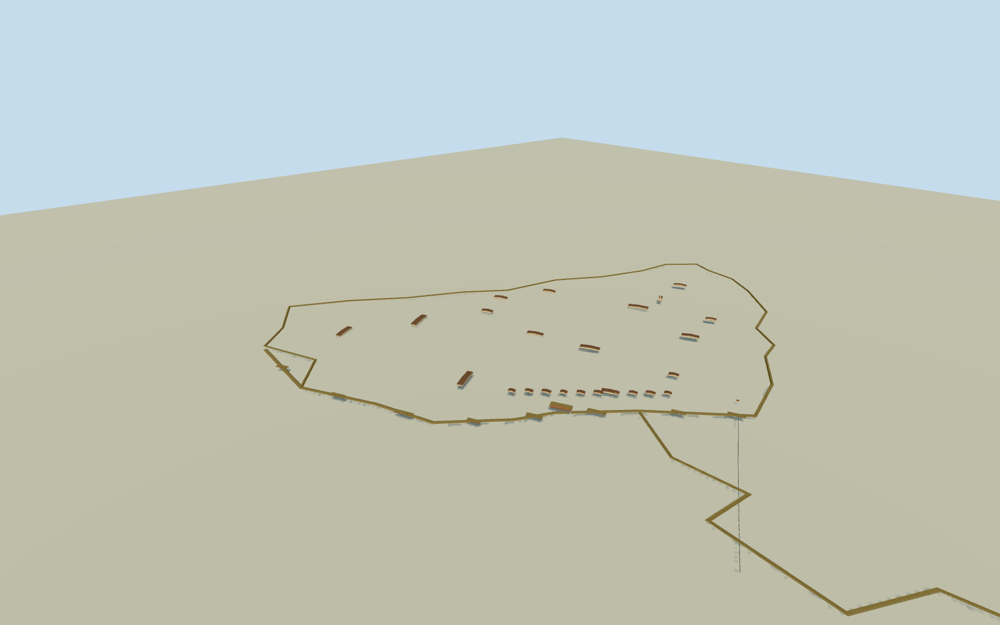

# Fortress of Humaita, Paraguay (1867)

Complete dated1867 Humaita fortress system: whole riverfront core enclosure and batteries/Londres casemate, internal mapped barracks/arsenal/hospital/stores/three-tower SanCarlos church, connected outer Quadrilateral earthworks through Espinillo/Angulo/PasoGomez/Sauce/Chichi/Curupayty and PasoPucu headquarters earthworks/watchtower. Historic plan-derived site relationships and two-site registration are estimates; no exact archaeological survey or modern-ruin reconstruction. Exclude Allied siegeworks, naval vessels/people/natural river/forests and unrelated modern town buildings.

Authoring state: **review-in-qa.json**. Current completion evidence is in [qa.json](qa.json) and the [completion ledger](../../../../qualla-structures/batches/qualla-002.PROGRESS.md).

- [Fortress of Humaita](https://qualla.com/fortress-of-humaita/)

Complete dated1867 Humaita fortress system: whole riverfront core enclosure and batteries/Londres casemate, internal mapped barracks/arsenal/hospital/stores/three-tower SanCarlos church, connected outer Quadrilateral earthworks through Espinillo/Angulo/PasoGomez/Sauce/Chichi/Curupayty and PasoPucu headquarters earthworks/watchtower. Historic plan-derived site relationships and two-site registration are estimates; no exact archaeological survey or modern-ruin reconstruction. Exclude Allied siegeworks, naval vessels/people/natural river/forests and unrelated modern town buildings.

Independent12288m129x129 original field/16641heights/six raw Terrarium zoom12tiles/frame/datum57.0507m frozen before component floors and main sections. Each whole-defense control receives its original-field level once; buildings use separate fixed horizontal sampled floors+.6m and Londres+1m. Source96m review spacing and34m output pixels are not historic ground/survey accuracy. Historical site registration and individual building extents are explicitly approximate. Never flatten/reacquire/reframe/move these floors or main parameters to improve rendering.

Two-site plan registration±500m/±20% extents, individual engineering building symbols not measured footprints.

Whole1867 architectural interpretation, not current world or an exact daily artillery inventory.

Riverfront silhouette supported by accepted1867drawing; hidden elevations/barracks/store counts/roof details/colors and exact baseline heights are estimates.

Current original DEM is independent and cannot certify1867grade, marshes or bathymetry. Earthwork ditch cuts are physical mesh only; original source heights retained.

Church scalar dimensions/tower count from transcribed30December1860report; tops/side tower height/cornices are original bounded reconstruction. Vara0.8359m approximate.

Original1869map whole plan is geographically registered by two approximate historic points; detailed drawings disagree in metric representation. All main defenses retained; individual building symbols translated as estimated major masses, not a full tent/hut/room inventory.

Allied siegeworks/river/natural banks/marshes/ships/people/modern town excluded. Historic earthworks own their ditch surfaces and narrowly scoped physical openings; source relief unchanged.

Three chain-boom strands and intrinsic anchor support are simplified, with uncertain exact historical waterline/sag. No bathymetry certificate.

Build: `node content/worldgen/source/places/6e/6en/fortress_of_humaita/models/generate-humaita.mjs`. Add `--check` to verify exact regeneration. 13012 triangles; 6 materials; no embedded photographs.
