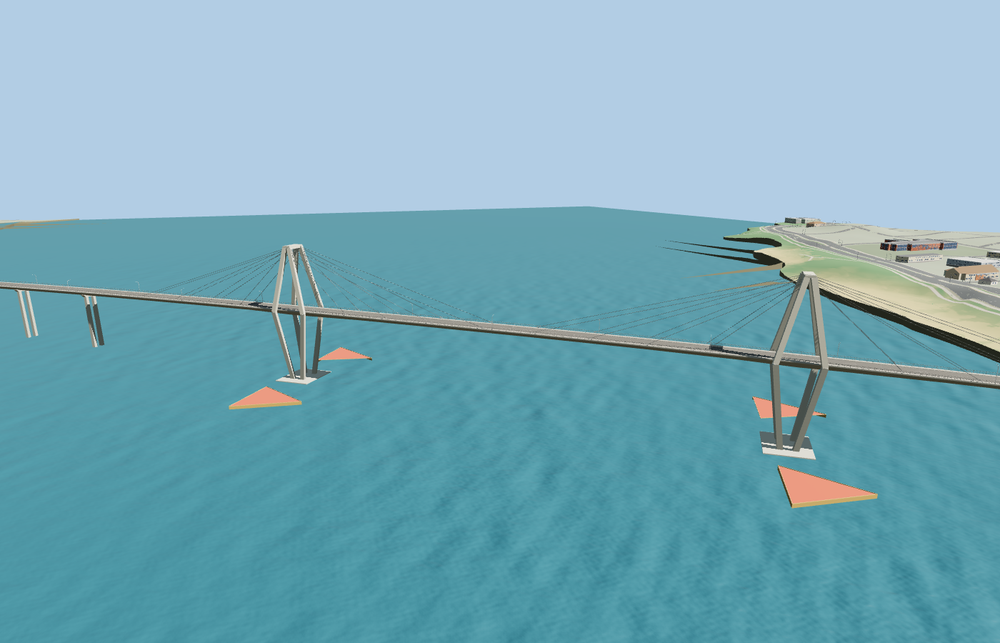

# General Belgrano Bridge

A long RN16 deck rises over the Paraná River to twin split-leg concrete pylons. Two planes of cable stays support the main spans. The approach viaduct, red triangular fenders, sidewalks and curved Corrientes landing remain distinct at viewing scale.

The 27,726-triangle source rebuilds byte for byte. Skyline, district, street and close-up use 888, 3,492, 13,194, 25,374 triangles. Skyline and district total 369,496 bytes. Six GLBs validated and 36 current views were inspected.

Twenty-three approach pier probes, two abutment probes, 40 deck probes and six landing samples pass at each level. The four red fenders sit above the sampled native water. The largest landing height difference is 0.005 m. The sampled clearance across the three main spans over mapped water is at least 34.0 m in the viewer fixture. The original highway crossing returns if the model load fails.

The authored 2.24 km crossing follows the full PMTiles RN16 bridge and approach alignment. Published bridge-length conventions exclude different portions of the mapped landings. Tower locations, approach pier spacing, deck grades and fender forms are reconstructed from exterior photographs and standard viewer terrain. The center span uses the recorded 245 m length. The bridge does not encode surveyed structural dimensions or hydraulic clearance. The current viewer river and riverbanks are retained. The amount of exposed pier and fender above water varies with host water levels.

Rebuild with `node packages/worldgen/scripts/generate-general-belgrano-bridge.mjs`. Append `--check` to compare exact bytes. Use `--ids=general_belgrano_bridge` for targeted import, LOD, placement and readiness.
