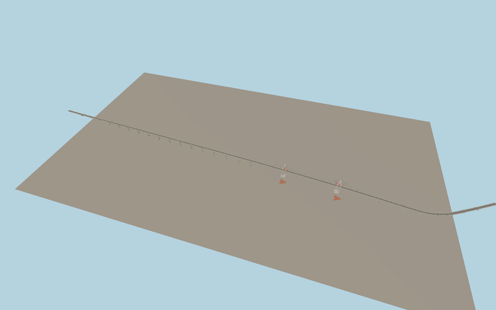

# General Belgrano Bridge

A long RN16 deck rises over the Paraná River to twin split-leg concrete pylons. Two planes of cable stays support the main spans. The approach viaduct, red triangular fenders, sidewalks and curved Corrientes landing remain distinct at viewing scale.

Run `node packages/worldgen/scripts/generate-vushtrri-stone-bridge.mjs` to rebuild the source master. Append `--check` to compare the exact bytes. Use `--ids=general_belgrano_bridge` for targeted import, LOD generation and placement.

The authored 2.24 km crossing follows the full PMTiles RN16 bridge and approach alignment. Published bridge-length conventions exclude different portions of the mapped landings.

Tower locations, approach pier spacing, deck grades and fender forms are reconstructed from exterior photographs and standard viewer terrain. The center span uses the recorded 245 m length. The bridge does not encode surveyed structural dimensions or hydraulic clearance.

The current viewer river and riverbanks are retained. The amount of exposed pier and fender above water varies with host water levels.

Original geometry follows the repository license. Map data is © OpenStreetMap contributors under ODbL-1.0 via Protomaps. Terrain samples are described in terrain-grid.json. Ordinary pictures stay local and are not redistributed or used as textures. Current acceptance is recorded in qa.json.
