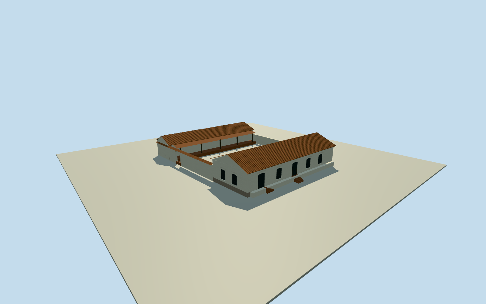

# Casa de la Independencia Museum

Whitewashed colonial corner house with raised street entries, rounded window hoods, red tile roofs, a central garden court, and the 14 de Mayo gateway.

Authoring state: **review-in-qa.json**. Current completion evidence is in [qa.json](qa.json) and the [completion ledger](../../../../qualla-structures/batches/qualla-003.PROGRESS.md).

- [Casa de la Independencia Museum](https://qualla.com/casa-de-la-independencia-museum/)

The corner façade and 14 de Mayo gateway follow exact published public-domain Qualla originals. The corner view was published in 2008 and lacks an independently established exposure date.

The older restoration is shown in early color photographs. The later recovery of the former stable property, alley paving, adjacent buildings and museum interior are outside the scope.

The mapped outline establishes the exterior extents. Internal court edges, the unphotographed rear wing and gallery, roof rise, facade dimensions, and plinth and step grades are proportioned estimates.

The 128 m original elevation field was sampled before floors and sections were chosen. No terrain leveling, masking or reference photo pixels are included.

Build: `node content/worldgen/source/places/6e/6ex/casa_de_la_independencia_museum/models/generate-house.mjs`. Add `--check` to verify exact regeneration. 2391 triangles; 6 materials; no embedded photographs.
