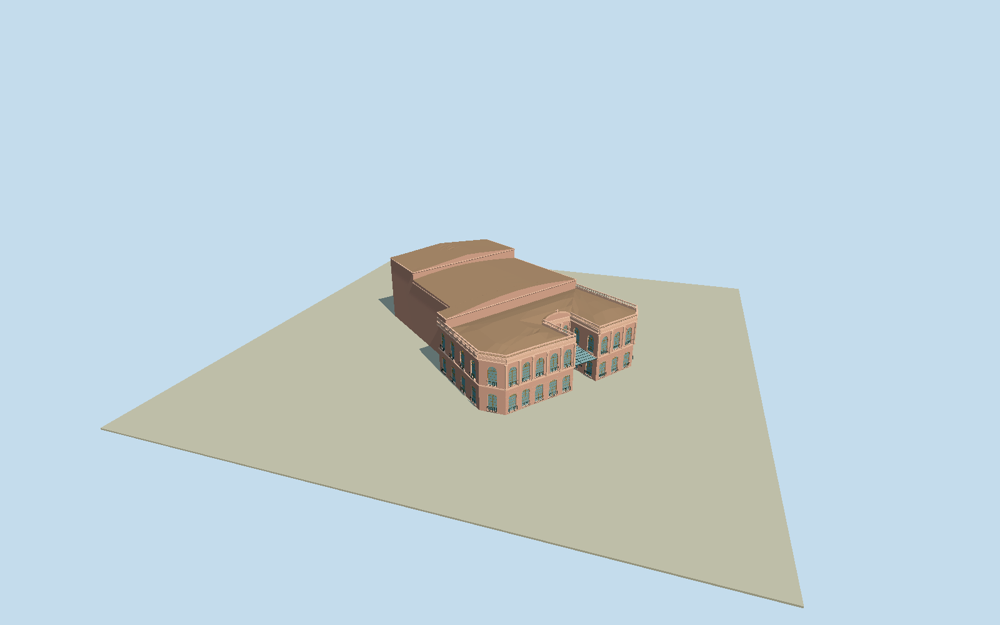

# Municipal Theatre Ignacio A. Pane

Whole surviving TeatroMunicipalIgnacioA.Pane exterior on actual17-corner named native footprintway277951940/Q9082167: dusty-pink historic street-front/flanking wings/central curved pediment, tall arched timber/glazed windows/fanlights/lower doors/guards, pilasters/cornice/pierced roof parapet and projecting glazed steel-truss canopy; whole intrinsic auditorium/stage/service envelope and included SalaBaudilioAlio position. Keep full rear/side native building massing with bounded hidden roof/height divisions, no facade-only panel or generic theatre box. Exclude separate TeatroGuarani/neighbor offices/cables/whole street/trees/people/signage and interior performance/audience rooms.

Authoring state: **review-in-qa.json**. Current completion evidence is in [qa.json](qa.json) and the [completion ledger](../../../../qualla-structures/batches/qualla-002.PROGRESS.md).

- [Municipal Theatre Ignacio A. Pane](https://qualla.com/municipal-theatre-ignacio-a-pane/)

Whole named17-corner theatre envelopeway277951940/Q9082167 includes intrinsic auditorium/stage/service body and SalaBaudilioAlio identity position; pink historic two-storey front/wings/real arched window reveals/wood fanlights/lower doors/guards, curved central pediment/pilaster-capital scrolls/pierced parapets and projecting closed-glazed steel-truss canopy with actual underside/braces. No facade-only panel or separate neighboring theatre.

Qualla-first exact sole local candidate was indoor ballet and excluded without pixels. One2048x1360 PattyP own/PD-self exact native exterior original individually inspected/SHA1matched; preserved native grant. No questionable sources, borrowed meshes/photo textures/generated bitmaps or policy/verifier changes.

Photograph is undated/cropped. Heights, opening/rail census, original capital/crest ornament and especially hidden whole auditorium/barrel/rear-stage roof partition/sections/materials are bounded original medium-fi estimates from photo/native perimeter, not surveyed construction/private interior. Native whole-building4levels does not impose four repeated historic facade storeys.

Original200m/129x129/16641-value independent source field/two raw tiles/PNG frozen before geometry/architectural sections unchanged. Floor+.06 independent; urban source artifacts/grade disagree with foundations/thresholds. Isolated/shared-flat appearance accepted only after current views plus separate unchanged original-field image; precise source/host terrain contact unverified/replacementfalse. No source flattening/fitting/reacquisition/full street or city pad, offices/cables/trees/people/performance rooms/text.

Build: `node packages/worldgen/scripts/generate-authored-places.mjs --ids=municipal_theatre_ignacio_a_pane`. Add `--check` to verify exact regeneration. 32955 triangles; 6 materials; no embedded photographs.
