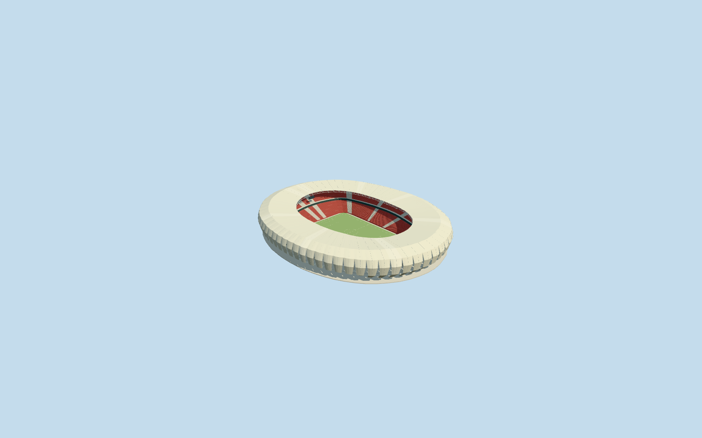
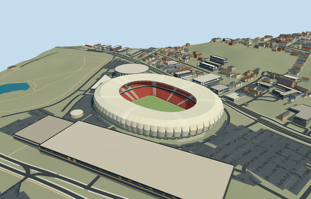

# estadio_beira_rio — Estádio Beira-Rio

Reviewed 2026-10-20 in one continuous author/build/inspect/fix round.

## Appearance

Inspected48 current portable/shared/sky-reflected medium-fi/native-Porto-Alegre views in one ordinary-picture/PMTiles/build/inspect/fix pass. Own oval envelope/open oval roof aperture, pale curved fabric petals/tapered lower gaps/continuous rounded shoulder and canopy/renderable backs, exposed radial steel/deep oval inner truss/local supports, recessed concrete-glazed frontage/decks/neutral entries, two red seating tiers/closed central hospitality belt/pale aisles/open football floor and supported displays/lights/goals are intact. Corrected display hangers to the sampled canopy edge; joined upper shoulder/crown/canopy backs and removed internal overlapping caps/hairline upper gaps while retaining actual lower gaps. No duplicate native stadium or missing side. Seats/lettering are neutral red terrace patches/aisles, no copied logos/event illumination/fireworks. Portable flat context is separate from native grade; native foreground slope can occlude part of the lower floor.

## Shared materials and browser levels

Four existing256-square graphs: concrete_plain, metal_painted, fabric_canvas and window_grid. Concrete supplies services/decks/supports/occupied floor; tinted paint supplies red tiers/pale steel/trim/neutral displays/marks/lights; shared canvas supplies pale membrane petals/roof and turf grain; window-grid supplies opaque closed recessed glazing. Roof and wall canvas slots create five near draws. Zero embedded images or unique atlas; every nearby graph read once. Metric repeats/linear palette conversion/separate POSITION and NORMAL uploads/equal reported CPU and GPU geometry bytes pass. Shared opaque canvas/glazing approximate fabric and window appearance without photo textures or exact optical transmission.

| Level | Triangles | Bytes | Draws |
| --- | ---: | ---: | ---: |
| skyline | 584 | 61480 | 1 |
| district | 3502 | 348680 | 5 |
| street | 15578 | 1526948 | 5 |
| closeup | 44874 | 4493408 | 5 |

Inspected24 noon/late Economy/High street/block/skyline/silhouette/matched-level/transition frames with viewer sky reflections. All four levels retain own oval mass/open field/measured field axis/pale canopy/red two-tier bowl. Near levels refine65 radial modules/tapered gaps/curved membranes/open steel/actual treads/aisles/frontage; far levels merge repetition and omit subpixel frame detail. Coarsest seating opening expands to keep the whole neutral pitch clear, with declared12m error allowance. Initial skyline plus district410160bytes, below3MB phone/6MB laptop targets. Synthetic neighbors are not geographic evidence. Physical ordinary-laptop/phone/tablet/dense-city timings remain pending. Levels584/3502/15578/44874 triangles; at most five draws.

## Approximate map fit

RetainedQ1050224 reference/named native Sport Club Internacional sports-centre POI35184700110378 and own sole stadium parent52776562720291 establish Beira-Rio identity; no exact-QID map field present. Separate native pitch35184700331258 establishes114.952007x77.579884m mapped field-surround axis. Own anchor[-51.235920711890785,-30.065499007635164]/heading0/native east-south; internal X[.6111607314708172,-.7915065131178995]/Z[.7915065131178995,.6111607314708172] retains that axis. Approximately282x225m own rotated body/177x117m oval roof aperture, native54 outer/49 hole vertices, separate118x82m lower surround/105x68m neutral pitch. Owned stadium parent fully removed/zero residual record or area; all395 independent resident inputs of396 originals/1370 wider records unchanged, all1369 wider independent footprints outside mask. Two adaptive mask pieces/50mm vertex guards stay within owned body. Original6m samples/native roads/4071049.1230171276m2 source water unchanged. Original datum6.435390538009338m/each petal hem0.3m above own sampled ground/individual support contacts/occupied common floor/bounded opening within90percent body handle coarse terrain. Failure retains396 originals/original ground; every level unload restores ground/water/zero live geometry. Adjacent arena/garage/site buildings and waterfront remain native, no entire waterfront/plaza slab.

## Limits

Four ordinary Hype Studio gallery photographs actually viewed: daylight interior, upward steel detail, night opening exterior and distant daylight waterfront exterior. Gallery collectively credits Hype Studio, Marcos Nagelstein, Gustavo Geyer, AP, Rodolpho Reis, Leonardo Finotti, Alexandre Sperb and SC Internacional without per-image attribution; photographs undated. Viewed only; no pixels, seat lettering, emblems, event lighting or fireworks copied. Renovated stadium modeled, no proposed complex towers or neighboring arena combined into it. Native34m height lacks qualified datum. Working anchor-relative roof maximum34m/field1.5m below original datum, field-relative crown35.5m/aperture32m/shoulder30.5m/bulge22m/low curve11m/decks8 and17m/tiers1.4..13 and16..29m are picture-led allocations. Primary designer states65 roof trusses; closeup65 radial modules follow that concept but exact fabric-panel count/connection inventory is not certified. Petal bows/widths/tip clearance,0.22m normal-offset skin/2.6m inner truss depth, row/portal/light inventory and20degree/2m fine facing are estimates. Shared opaque fabrics/glazing do not reproduce exact transmission. Native terrain/contact/bounded opening are visual fit controls, not a site survey or engineering/excavation plan. No hidden furnished rooms/access or structural certification/current-condition claim; undated photographs do not certify later changes. Physical ordinary-laptop/phone/tablet/dense-city timings remain pending.

## Selected checks

Six Khronos files: zero errors/warnings.15185 actual mesh/material/contact checks; 48 current inspected views. Scene validation/sim30 and strict selected medium-fi audit pass. Source/runtime/LOD hashes and material bindings verified.

Rebuild: node packages/worldgen/scripts/generate-additional-landmarks.mjs --ids=estadio_beira_rio; node packages/worldgen/scripts/import-structure-models.mjs --ids=estadio_beira_rio; node packages/tooling/scripts/generate-landmark-lods.mjs --ids=estadio_beira_rio --force.

Source: sha256:bd7e8057bbbd50eee545f3e229cf1508e9ffb0b1b9793ad23b0f308f8492eff5

Runtime: sha256:d83ff574950305777934afccb60c365e53c5aeef554aedc375fd57f987d5cf0e

Input: sha256:f7b712de664de1797c95c898d41af47d01355547d6b0598d371414fd7514b736

## Viewed ordinary pictures

https://www.hypestudio.com.br/en/estadio-beira-rio — https://www.hypestudio.com.br/media/resize/1920x1080/projeto/7/62d05f3f62999.jpg; Hype Studio project gallery collectively credits Hype Studio, Marcos Nagelstein, Gustavo Geyer, AP, Rodolpho Reis, Leonardo Finotti, Alexandre Sperb and SC Internacional; individual image credit unspecified; Copyright retained by rights holders; viewed only/no photograph pixels copied. Viewed only; no pixels copied.

https://www.hypestudio.com.br/en/estadio-beira-rio — https://www.hypestudio.com.br/media/resize/1920x1080/projeto/7/62d05f3decee4.jpg; Hype Studio project gallery collectively credits Hype Studio, Marcos Nagelstein, Gustavo Geyer, AP, Rodolpho Reis, Leonardo Finotti, Alexandre Sperb and SC Internacional; individual image credit unspecified; Copyright retained by rights holders; viewed only/no photograph pixels copied. Viewed only; no pixels copied.

https://www.hypestudio.com.br/en/estadio-beira-rio — https://www.hypestudio.com.br/media/resize/1920x1080/projeto/7/62d05f3c56387.jpg; Hype Studio project gallery collectively credits Hype Studio, Marcos Nagelstein, Gustavo Geyer, AP, Rodolpho Reis, Leonardo Finotti, Alexandre Sperb and SC Internacional; individual image credit unspecified; Copyright retained by rights holders; viewed only/no photograph pixels copied. Viewed only; no pixels copied.

https://www.hypestudio.com.br/en/estadio-beira-rio — https://www.hypestudio.com.br/media/resize/1920x1080/projeto/7/62d05f39dbb3f.jpg; Hype Studio project gallery collectively credits Hype Studio, Marcos Nagelstein, Gustavo Geyer, AP, Rodolpho Reis, Leonardo Finotti, Alexandre Sperb and SC Internacional; individual image credit unspecified; Copyright retained by rights holders; viewed only/no photograph pixels copied. Viewed only; no pixels copied.
