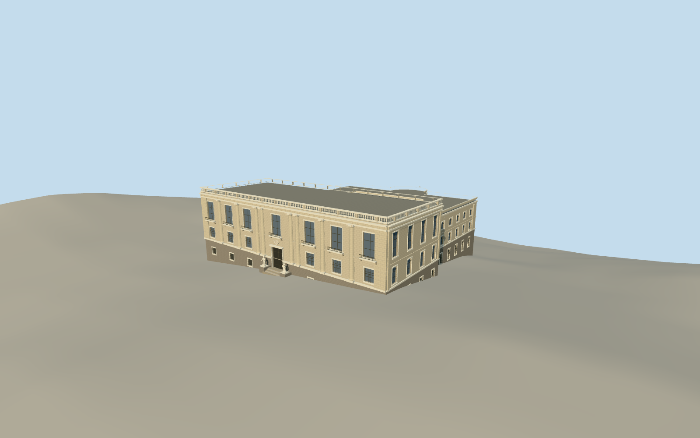

# Piratini Palace

The government and residential wings of the Piratini Palace in Porto Alegre, with the Ionic plaza façade and Landowski sculptures, open court and rounded rear of the residence.

Authoring state: **review-in-qa.json**. Current completion evidence is in [qa.json](qa.json) and the [completion ledger](../../../../qualla-structures/batches/qualla-003.PROGRESS.md).

- [Piratini Palace](https://qualla.com/piratini-palace/)

The model represents the standing exterior of the government and residential wings and their open internal courtyard. Roof furniture, floor elevations, step dimensions, grille patterns, and minor rear openings are estimated.

The original terrain sets the elevation change from the plaza to the rear. Entrance height, the local sidewalk landing, and lower wing contacts are approximate.

The documented eight engaged Ionic shafts, open balustrades, coat of arms, and Landowski sculpture locations are represented by authored geometry and simplified carving. Existing public Qualla candidates were screened first. The published interior view has assumed authorship, and the remaining exterior candidates used attribution terms or lacked confirmation of the exact original publication.

Build: `node content/worldgen/source/places/6f/6fe/piratini_palace/models/generate-piratini-palace.mjs`. Add `--check` to verify exact regeneration. 25354 triangles; 6 materials; no embedded photographs.
