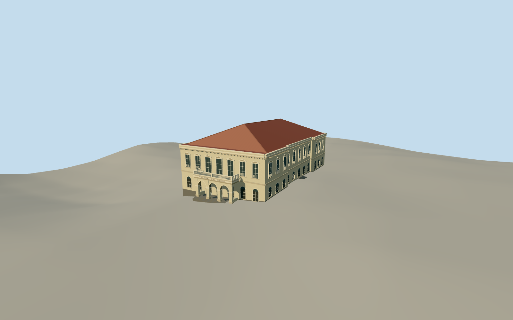

# Theatro São Pedro, Porto Alegre

The restored neoclassical theatre on Praça Marechal Deodoro with a three-arch portico, balustraded balcony, pale seven-bay facade, bracketed cornice and hipped roof.

Authoring state: **review-in-qa.json**. Current completion evidence is in [qa.json](qa.json) and the [completion ledger](../../../../qualla-structures/batches/qualla-003.PROGRESS.md).

- [São Pedro Theatre](https://qualla.com/sao-pedro-theatre/)

Wall and roof heights, window widths, the stage range and some side openings are estimated from mapped proportions, the archival elevation and written accounts.

The present exterior uses a warm off-white and cream finish based on the theatre publication and the mapped color. The adjoining Multipalco is outside the 1858 theatre scope.

Build: `node content/worldgen/source/places/6f/6fe/sao_pedro_theatre/models/generate-sao-pedro-theatre.mjs`. Add `--check` to verify exact regeneration. 19856 triangles; 6 materials; no embedded photographs.
