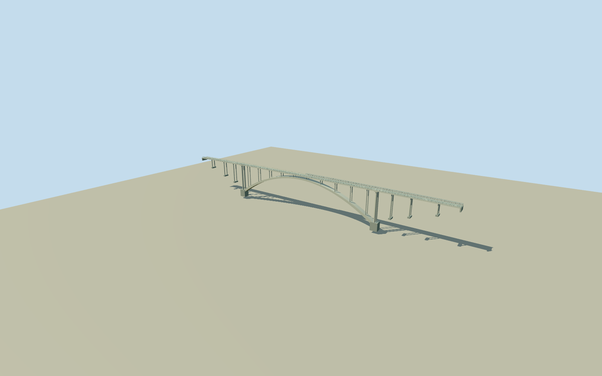

# Friendship Bridge (Brazil–Paraguay)

Whole original Friendship Bridge: both complete native national halves/full554.1388mroute,13.5mdeck/9.5mconcrete road/raised walks, single fixed three-cell box-arch exterior on circular spandrel columns, massive intrinsic springing bases and approach supports, two-course concrete rail from cleared QuallaCC0detail, native three covered side-path halves and one open half, representative curved metal pedestrian covers/open security grids. Primary owner/engineering dimensions and native whole geography; box/support/canopy fine profiles and ground contact are estimates. No newer Integration Bridge/river/city/border posts/traffic/painted lettering.

Authoring state: **review-in-qa.json**. Current completion evidence is in [qa.json](qa.json) and the [completion ledger](../../../../qualla-structures/batches/qualla-002.PROGRESS.md).

- [Friendship Bridge (Brazil-Paraguay)](https://qualla.com/friendship-bridge-brazil-paraguay/)

Both complete original national roadway halves26122712and276923865joined through original border node3838800747; full554.138829mroute/three original endpoint-border points retained, not narrowed to one country. Original Paraguay polygon875801163and Brazil polygon875833703with all nonduplicate corners/intermediate vertices retained as mapped core/side-path controls. Native mapped core width is only about10–11m, whereas owner DNITstates13.5mtotal/9.5mroad; do not silently label the narrower map polygons as full outer deck. Reconstruct structural overhangs/sidewalks to owner width around native road axis, with that discrepancy explicit. Four actual native side paths retain intermediate points and covered=yes/no tags; do not guess every segment covered. Authoritative owner text303mcleararch/78mcentralheight and state tourism53mfixed-archrise control original arch macro geometry; exact transverse arch/rib/spandrel/footing/canopy profiles remain engineering estimates. Current sole cleared photo is rail detail only, not an arch overview. Anchor is native full-route endpoint midpoint; +Xroughlyeast Paraguay-to-Brazil, +Zroughlysouth. Fixed Brazil endpoint-plus3mapproach before terrain and geometry. No new Integration Bridge or city/river/site mesh.

Exact published2012Monocletophat1234000x3000QuallaCC0own-work original controls ONLY the concrete rail/post profile/material. Full35source families inventoried without conflicts; all other city/inauguration/attribution/unrelated sources excluded. Native category search produced no additional accepted whole-bridge image. No claim of an inspected arch overview; arch/deck/support construction follows original geographic data and primary owner/engineering text, with bounded original geometry. No copied photograph/diagram/generated bitmap, painted text/national-color panels, city/river/traffic/border-post assets.

Owner gives13.5moverall/9.5mroad,303march and78mcentralheight; public technical text gives53mrise, one fixed three-cell box section and circular supports.303maxis/290mclear definitions differ; model uses303mspringing axes with estimated intrinsic springing bases, without stretching full554.1388mnative route. Closed exterior box represents three-cell structure; internal cells are not an exposed cutaway. Box9.5mouterwidth/3–6.5mdepth, supports/station/census, foundation depths,1.8mhumpback, current neutral finish and metal-cover/screen profiles remain engineering estimates.78mreported height is not asserted as normal-water clearance.

Both national polygons/all original side paths/endpoint-border axis retained in controls. Mapped core is only about10–11mwide; owner-width structural deck/walk overhangs are explicitly reconstructed around the unchanged native road. Three native covered=yeshalves are covered; Paraguay north path1090783193covered=noremains open. Exact post2016cover asymmetry/current details and footing contact are not a survey; no different newer Integration Bridge substituted.

Independent1536m129x129at12mfield/16641samples from6original Terrarium tiles; fixed Brazil dry approach before geometry. Provider149.1233m/whole relative[-1717.1609,34.8767]m; original grid/PNG unchanged without fitting/clipping/flattening. Implausible absolute minimum-1568.0376minthis inland river field is suspected composite/nodata error, not physical riverbed; never used for bridge or foundation geometry. True river/approach/footing/host contact unverified. Geographic preview only, replaceFootprint=false; compatible host terrain needed.

Build: `node packages/worldgen/scripts/generate-authored-places.mjs --ids=friendship_bridge_brazil_paraguay`. Add `--check` to verify exact regeneration. 53106 triangles; 5 materials; no embedded photographs.
