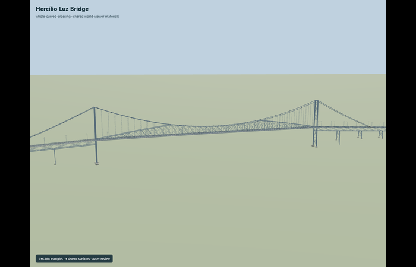
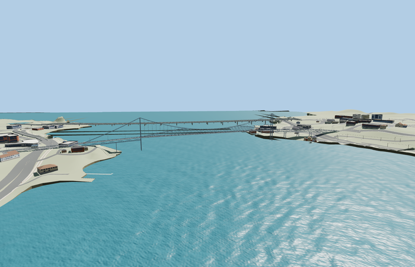

# Hercílio Luz Bridge

Reviewed2026-10-29. **Complete medium-fi static exterior and approximate native placement.**

Inspected68 current frames:10 portable,9 shared-material local stage,26 medium-fi/context/LOD and23 native PMTiles views. Complete curved crossing, both75m portals and their open road passage, paired eyebar chains, integrated two-shouldered stiffening truss, approach viaducts, both continuous exterior platforms, guard bars, grating roadway, amber studs, lamps and shore transitions. Same-pass corrections joined the handrails across the crowned deck, closed the road/walk seam and removed three generic bridge fragments with a curved replacement outline. Independent modern bridges and shoreline roads remain visible.

Four existing shared256px graphs: metal_painted on steelwork, concrete_plain on supports, metal_perforated_square on the roadway, wood_plain on the exterior platforms. The wood graph is a shared visual approximation of the photographed worn platform surface. Metric UVs, linear sRGB-derived vertex colors, fifth untextured marking material; no embedded/private images. Each graph loads once; all model/support geometries dispose. Asset-stage and synthetic context use localY0; the separate native fixture proves signed geography and approximate sea-level placement.

| Level | Triangles | Bytes | Draws |
| --- | ---: | ---: | ---: |
| skyline | 986 | 91964 | 1 |
| district | 3828 | 335084 | 4 |
| street | 15800 | 1350280 | 5 |
| closeup | 63776 | 5852232 | 5 |

Detailed source 246688 triangles,29605880 bytes. Browser triangles 986 / 3828 / 15800 / 63776, bytes 91964 / 335084 / 1350280 / 5852232, draws 1 / 4 / 5 / 5. Initial skyline+district 427048bytes. Levels meet1000/4000/16000/64000 budgets and separate GPU position/normal streams. Distance tiers aggregate lacing, hangers, chain joints, guards and approach supports; both portals, platforms and the main chain/truss silhouette remain. No physical device timing claim.

Exact-QID cached way376367899 and current named PMTiles road35185059777736 plus north cycleway35185131690790/south path35185131690791 establish the curved plan. Anchor[-48.565862446,-27.593903698], heading0.209151434435: +X ENE/Santa Catarina Island, -X WSW/mainland, -Z NNW/Baía Norte cycleway, +Z SSE/Baía Sul pedestrian path.817.152m mapped road length is distinct from the published821m bridge length.339m main span and75m tower tops are retained controls; width, tower stations225/564m, deck height, chain sag and member sections are photo/map approximations. Approximate sea-level origin0m, not a survey.

All five loaded levels replace exactly three crossing records (288to285 roads), preserve100 buildings and275 independent road records, raw road inputs, DEM, displayed ground and water. A swept136-point outline follows the curved crossing and its separate mainland cycleway mouth; no ground/building cutout. Fifteen generated road/path join probes have model support; maximum height difference 0.070603m, within the modeled8cm platform curb. Center road joins are within1cm and endpoint lane supports within5cm. The cycleway's separate6m mouth is supported by its source platform and focused geometry test; its terminal approach grading is not independently certified. Failed loading retains all288 original roads; unloading disposes all model/support geometry. Shore gradients, automatic retaining faces and generic surrounding buildings remain approximate.

## Reconstruction limits

- Original continuous medium-fi reconstruction from three ordinary photographs and standard PMTiles/Mapzen. Main span339m and tower top75m are retained reference controls; published821m overall length is distinct from the current817.1521718577533m mapped road path. No engineering survey or current traffic/accessibility certification.
- Current named road35185059777736 and north cycleway35185131690790/south path35185131690791 establish the curved mainland approach and signed plan. Width11.5m, tower stations225/564m along the road, deck grades, chain sag, anchorage positions, pier count and member sections are photo/map reconstruction controls.
- Both75m portal towers, both paired suspension-chain sides, the integrated two-shouldered main truss, complete curved approach viaducts, two side platforms, railings, road guards and current grating appearance are present. Independent quays, buildings, temporary traffic furniture and neighboring modern crossings are separate map context.
- Source preserves237k-class detailed geometry, dense guards, built-up tower/lattice details and chain joints. Browser tiers aggregate main/approach truss bays, support density, curve segments and railings. Near tiers retain genuine closed bars; no fence cards, private texture atlas or embedded images. The shared8.5cm perforated-square graph approximates finer real road grating.
- Footing controls use the ordinary mapped water mask and coarse Mapzen terrain. Sea-level0, reconstructed deck32m and selected bank grades remain approximate. Native visual placement, approach boundaries and independent-input preservation require final current review before activation. Physical-device timings are unmeasured.
- Short1m bridge-mouth paving wings and a north platform transition to its independently mapped mainland cycleway endpoint are reconstructed joins. The existing8cm platform rise is retained; street-edge probes can meet a curb rather than the road center. Native boundary fitting remains a visualization, not an accessibility/engineering grade claim.
- Short1m bridge-mouth paving wings and a north platform transition to its independently mapped mainland cycleway endpoint are reconstructed joins. The existing8cm platform rise is retained; street-edge probes can meet a curb rather than the road center. Native boundary fitting remains a visualization, not an accessibility/engineering grade claim.
- Native-fit.json and integration-review.json retain generation controls; current hash-bound acceptance is in qa.json and placement-report.json. Current map semantics and three ordinary photographs establish this static exterior, not engineering dimensions, current traffic legality or accessibility certification. Adjacent unique buildings, quays, modern bridges and their present-day structural condition are outside this model scope. Physical laptop/phone timings remain unmeasured.
