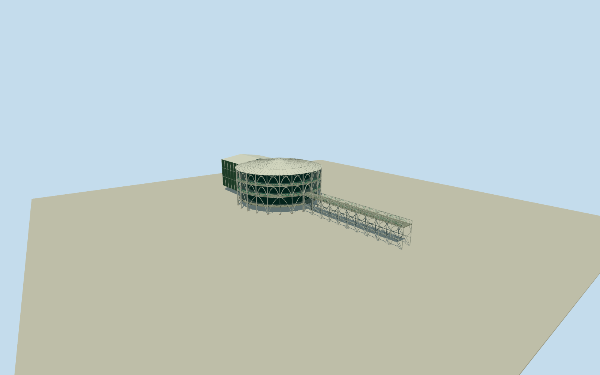

# Wire Opera House

Whole Wire Opera House exterior, circular three-level tubular steel auditorium/annular open walkways, shallow translucent polycarbonate radial roof, intrinsic north attached stage/service projection and south narrow steel-grated entry bridge with native bridge and connector centreline. Rebuild branching column bundles, repeated open arches, rail circles and lattice as medium-fi geometry. Exclude quarry/lake/waterfall/trees/park paths/parcel orground slab, detachedPedreiraPauloLeminski/musicstage/gates/artworks/statues, people/vehicles/banners/signage/interiorperformance/seating/exhibits. Keepopenarches/voids/bundledtubes ratherthanopaqueoutercylinder. Centraldarkauditoriumhasboundedactualfloor/roof,threeannularwalkwaylevels andownbridge. Rearstagewingnativefootprint; concealedtopology/roofsectionapproximate. Polycarbonateexpressedbyneutralpaleproceduralmattepanelswithradialsteelribs; photoreflectionsandgreenvegetationnotbaked. Exterioronly.

Authoring state: **review-in-qa.json**. Current completion evidence is in [qa.json](qa.json) and the [completion ledger](../../../../qualla-structures/batches/qualla-002.PROGRESS.md).

- [Wire Opera House](https://qualla.com/wire-opera-house/)

ExactoriginalnamedQ2719464way31204368all18vertices including northattachedstage; full bridgeway150298928andconnector150298906originalnodes. Mainroundbody16pointleast-squarescirclecenteranchor,maximumresidual0.018m, heading0east/southpreservesnativepositions. Photo-basedroundbody18.4632347473mradius interpolatescoarsepolygon, northwingfollowsnativefourcorners. Nativeplanhasnoheighttags:3levels/bundledcolumns/arches/shallowpolycarbonateroof/railpatterns estimatedfrom4clearedviews; stagebacksection/hiddencore/foundationsunverified. Nativebridgecentreline length45.3m retained, width4.2mestimated. Noallparcelorquarryextrusion.

FourexactpublishedQuallaownPDselforiginals individuallyinspected/nativeSHA1matched; noquestionableimage used, no generated/copiedbitmaptexture. Currentpreservedexteriorforms follow1997/2006views; currentpaint/rearroof/renovationsunverified.

LowerLODsreducecolumn/arch/rail/gratingdensity; skyline/district12bays andstreet/closeup24bays, errorsboundedfortypicaldistance. Maincircleleast-squaresfit16nativevertices residualunder0.018m,radius18.4632347473m. Native18pointwholefootprintincludesattachednorthstage. Allnativebridge/connectornodesretained andintrinsicshortjointtogalleryadded; width4.2mestimated. Structuralbaycount24/threelevels/columnbundle/archsection andconcealedrearstagevolumeestimates,notconstructiondrawings.

Wholeopenoutercolonnade/annulargalleries andcentraldarkauditoriumshellat13.8mradius, shallowradialroof,lowerownfloor andstairs. PolycarbonatehasneutralopaqueaveragepanelshadingforexteriorconsistentLODs; opticaltransmission/interiorseating/performancedevicesnotreconstructed. No exterioropaqueinfillsubstituteforopenarcade.

Bridgeintrinsiccircles/lowarches/railmotifanddecklatticefollowclearedviews; tinygratingaveragedontosolidthinloadbearingdecksurface toavoidmoiredensegeometry. Backstagehiddenwalls/roofsection/doorplacementsandfootingsapproximate; no inventedflytower.

Independent200m101x101Terrariumfield/10201values/2rawtiles fixedbeforegeometry. SourceDEMblursquarryvegetation/waterbedandisnotlakebathymetry; no sourceflattening/fitting/grounds slab. Modelhasa bounded-7.1munderstructurefromphotographicsection. Compatiblehostwater/terrain/ownfootingsnotcertified; previewonly,replaceFootprintfalse.

Build: `node packages/worldgen/scripts/generate-authored-places.mjs --ids=wire_opera_house`. Add `--check` to verify exact regeneration. 52544 triangles; 5 materials; no embedded photographs.
