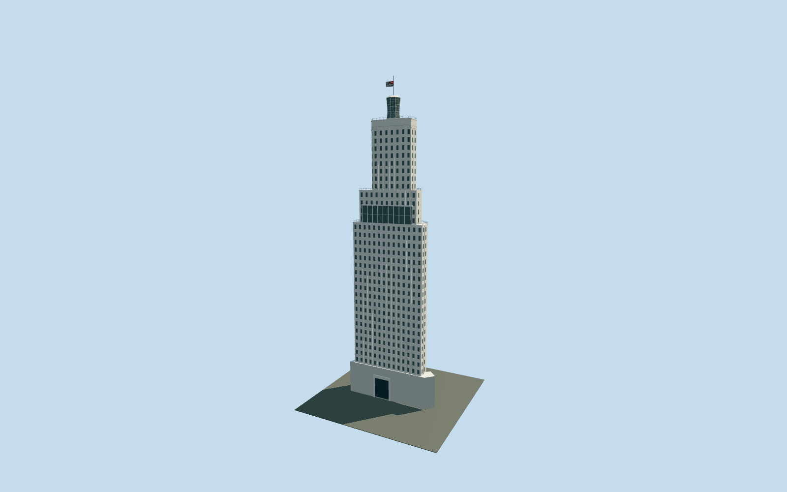

# Edifício Altino Arantes

Mapped chamfered white ceramic Art Deco tower with projecting outlook band, preserved upper-core outline, faceted glazed beacon, flag mast and northwest-facing historic entrance.

## Evidence and reconstruction

Published dimensions and reconstructed details are separated in spec.json. Primary references:

- [Reference](https://www.farolsantander.com.br/sp/sobre-o-farol)
- [Reference](https://www.farolsantander.com.br/assets/sites/2/20241204172903/Manual-de-Eventos-Farol-Santander-2025.pdf?_rsc=1mcjp)

No third-party geometry, photograph or bitmap texture is embedded. Shared surface graphs come from the central library; vertex tints carry model colors. Glazing uses PBR materials; transparent surfaces are declared per model.

## Model and axes

26,760 triangles; 63,838 vertices; 5 material groups; 2,622,452 bytes. Native bounds: -23.343, 0.000, -8.730 to 23.343, 161.220, 8.293. Source hash: `sha256:b546065d2344187367749493b1a3e437824663df64b60b60f1c51cf678b081c8`.

{"up":"+Y","longitudinal":"+X along the mapped long axis","front":"-Z toward Rua João Brícola","origin":"Ground-level center of exact-QID mapped footprint"}

The geographic proposal uses exact-QID OpenStreetMap evidence. Map-derived orientation and estimated architectural details require real-site visual review; preview eligibility is distinct from geographic/fidelity approval. Map attribution: © OpenStreetMap contributors, ODbL-1.0.

## Reproduce

Run `node packages/worldgen/scripts/generate-signature-towers.mjs --ids=edificio_altino_arantes` (or add `--check`). The generator preserves manually edited masters by checking their baseline hashes. Import through the standard authored-model workflow with optimization disabled; then capture all QA cameras, including shared-surface views.

## Pending work

- Exterior reconstruction from operator dimensions, dated photos/plans and attributed OSM perimeter/upper part. Exact1119window correspondence, minor rooftop fixtures and interiors are excluded.
- Shared5cm mosaic approximates smaller ceramic pieces; no photographs or separate baked texture copies. Setback heights and projecting outlook band are reconstructed. Convex collision is exterior only.
- The datum for adjoining streets and podium has not been surveyed. Host terrain supplies nativeY0; mapped address entrance faces -Z.

This bundle follows the medium-fi standard. Medium-fi appearance and geographic fit are reviewed separately. Hash-bound visual acceptance is recorded separately after capture inspection.
