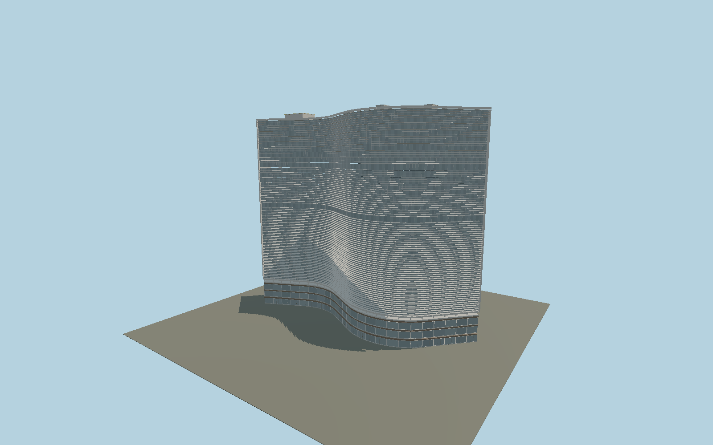

# Edifício Copan

Individually mapped S-shaped Copan with three brise blades per floor, separate glazed and perforated rear facades, real cobogo openings, open helical stair flights, a rounded lift tower, framed retail glazing, shared mosaic and separately assembled roof platform. Repeated details share GPU-instanced geometry.

## Identity and geometry

Catalog edificio_copan, [Q632566](https://www.wikidata.org/wiki/Q632566). Exact-QID map footprint for horizontal envelope; IBGE 115 m and 32 residential storeys for overall stack. Detailed floor/roof datums, brises, openings and podium are reconstructed and require dimensioned as-built evidence.

Centre of mapped exact-QID ground envelope; ground contact is provisional. Principal brise face follows the signed native map outline indices 0–64; +Y is up; +Y is up. The geographic proposal identifies its anchor and orientation evidence separately from remaining terrain and azimuth uncertainty.

Source facts and measured references are recorded in spec.json. References: [1](https://www.oscarniemeyer.org.br/obra/pro042), [2](https://revistas.usp.br/posfau/article/download/162808/160906), [3](https://concrejato.com.br/portfolio/copan/), [4](https://agenciadenoticias.ibge.gov.br/agencia-noticias/2012-agencia-de-noticias/noticias/35605-copan-recenseamento-no-maior-edificio-residencial-da-america-latina), [5](https://gestaourbana.prefeitura.sp.gov.br/noticias/prefeitura-de-sao-paulo-avanca-em-revitalizacao-do-centro-com-investimento-historico-para-requalificacao-do-edificio-copan/), [6](https://www.openstreetmap.org/way/8100248). Reference pages and images are not redistributed.

## Original source and shared materials

Geometry is authored in `packages/worldgen/scripts/copan-model.mjs`. Shared material graphs with metric repeat UV0 and original vertex tints; GLB PBR fallback remains self-contained. No per-model texture duplication. No third-party mesh or photograph is embedded.

225,758 triangles; 405,234 vertices; 7 material groups; 3,092,480 source bytes. Source hash: `sha256:e5eef1e89db408cf31505f6b711250f47d04b88879c3e4fe13f2fd3d4295be0a`. Geometry validation checks finite Float32 coordinates, indices, triangle area and winding before export.

Regenerate with `node packages/worldgen/scripts/generate-heritage-towers.mjs edificio_copan`; add `--check` for reproducibility. The generator refuses to overwrite a master whose hash differs from source.json. Import uses `--no-optimize` to preserve facade recesses.

## Remaining detail and review

- The original eleven-part GPU-instanced source assembly is preserved byte-for-byte and remains reconstructable from copan-model.mjs. Browser levels use four groups: shared ceramic mosaic, concrete and painted metal plus opaque glass. The principal S-curve, separate southern glass/screen blocks, lift capsule, three stair positions, 32-floor stack and roof platform remain. Near brise blades keep their outer 0.115 m lips with double-sided midplanes rather than hidden inner faces. Close-up retains all three blades per ordinary floor, original open transfer bands and 6 by 4 geometric perforations per panel; street retains blades with a coarser curve and 2 by 1 perforations every other floor; district has coarse eight-floor bands and 1 by 1 screens; skyline replaces dense fins with a closed midpoint facade proxy. Far podiums are closed shells. Near rear gallery glazing closes previously exposed gaps inside the mapped residential envelope; it is an approximate architectural closure, without a surveyed shop inventory. Close-up stairs retain twenty individual flat treads per reconstructed turn with continuous narrow handrail strips and alternate open pickets; the preserved source retains closed individual tread slabs, and precise stair risers, handedness and rail inventory remain unsurveyed. Street uses eight segments and district four; skyline uses small capped stair proxies whose external half-width remains within the one metre envelope allowance. All curves are deterministic adaptive polylines. Source white/gray ceramic finishes are the intended architecture, without temporary protection netting or a claim that restoration is complete. The modeled gallery follows the mapped residential envelope; the wider executed cinema/commercial site, neighboring bank and curved corner terraces require a separate site model and are excluded from this residential-block asset. Floor levels, transfer bands, screen dimensions, roof equipment and doors are reconstructions, not measured as-built details. Published height/level and plan-scale differences remain explicit. Flat grade is approximate. Physical phone/laptop and dense-city timings remain pending.

Named near/far cameras are included for lit visual review. A valid export is not maximum-fidelity certification.
