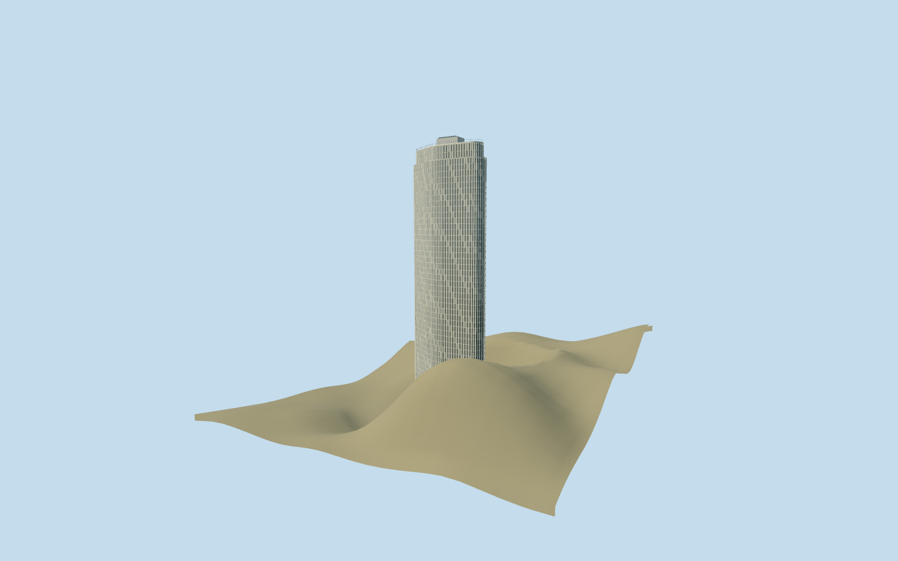

# Edifício Itália

Budgeted Italia tower preserves mapped curved outline, projecting sunshade rhythm, restaurant and roof; distance tiers merge repeating windows and louvers.

## Evidence and reconstruction

Published dimensions and reconstructed details are separated in spec.json. Primary references:

- [Reference](https://www.edificioitalia.com.br/)
- [Reference](https://www.edificioitalia.com.br/imprensa)
- [Reference](https://www.edificioitalia.com.br/post/roz%C5%A1i%C5%99ujte-svoji-komunitu-na-blogu)

No third-party geometry, photograph or bitmap texture is embedded. Shared surface graphs come from the central library; vertex tints carry model colors. Glazing uses PBR materials; transparent surfaces are declared per model.

## Model and axes

27,418 triangles; 82,254 vertices; 4 material groups; 3,292,976 bytes. Native bounds: -27.232, 0.000, -13.758 to 27.256, 165.000, 13.758. Source hash: `sha256:e94ca61523b47f87c09352bbd12153489ed910c62712a18ad7f4b56cba98a14c`.

{"up":"+Y","longitudinal":"+X along the mapped building long axis","front":"+Z","origin":"Ground-level center of exact-QID mapped footprint frame"}

Retain the existing exact-QID curved asymmetric tower part and signed long-axis frame,165m authored height and151m terrace. Inspected street exterior picture supports concrete grid and selected louver/window states. Standard viewer PMTiles checks the curved tower and streets, with off-footprint[-70,0] supplying approximate ground; raw terrain retained separate from radius40m bounded preview contact correction. The standalone tower excludes adjacent club/theatre blocks. Exact shutter state, roof details and thresholds remain reconstructed; no surveyed fit claimed.

## Reproduce

Run `node packages/worldgen/scripts/generate-signature-towers.mjs --ids=edificio_italia` (or add `--check`). The generator preserves manually edited masters by checking their baseline hashes. Import through the standard authored-model workflow with optimization disabled; then capture all QA cameras, including shared-surface views.

## Pending work

- Retain the existing exact-QID curved asymmetric tower part and signed long-axis frame,165m authored height and151m terrace. Inspected street exterior picture supports concrete grid and selected louver/window states. Standard viewer PMTiles checks the curved tower and streets, with off-footprint[-70,0] supplying approximate ground; raw terrain retained separate from radius40m bounded preview contact correction. The standalone tower excludes adjacent club/theatre blocks. Exact shutter state, roof details and thresholds remain reconstructed; no surveyed fit claimed.
- Three shared granite/concrete/painted-metal graphs plus opaque glass PBR; no embedded photographs. Perimeter simplification bounded2.4/1/.35/.1m; detail grid is reconstructed. Picture crops roof, retained authored dimensions control it. Physical-device timing pending.

This bundle follows the medium-fi standard. Medium-fi appearance and geographic fit are reviewed separately. Hash-bound visual acceptance is recorded separately after capture inspection.
