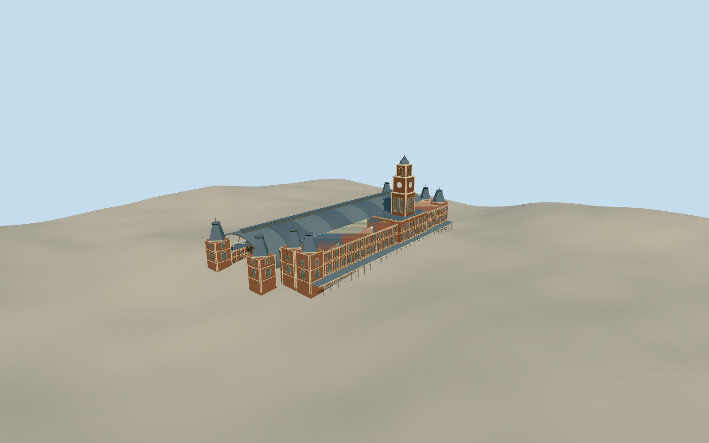

# Museum of the Portuguese Language

Luz Station and the Museum of the Portuguese Language, with ornate brick wings, pale arched dressings, a tall clock tower, mansard pavilions and vaulted railway platforms.

Authoring state: **review-in-qa.json**. Current completion evidence is in [qa.json](qa.json) and the [completion ledger](../../../../qualla-structures/batches/qualla-003.PROGRESS.md).

- [Museum of the Portuguese Language](https://qualla.com/museum-of-the-portuguese-language/)
- [Luz Station](https://qualla.com/luz-station/)

Train shed span and length follow the architectural survey. Relative vertical datums and yaw are placed from the mapped envelope and original terrain. Clock tower footprint, precise pavilion heights, pattern of window and metal details and current rear details are approximate.

Only the standing shared building and its attached shed and street canopy are represented. Train service equipment, office interiors and nearby detached transit structures are outside scope.

Build: `node content/worldgen/source/places/6g/6gy/museum_of_the_portuguese_language/models/generate-museum-of-the-portuguese-language.mjs`. Add `--check` to verify exact regeneration. 18546 triangles; 6 materials; no embedded photographs.
