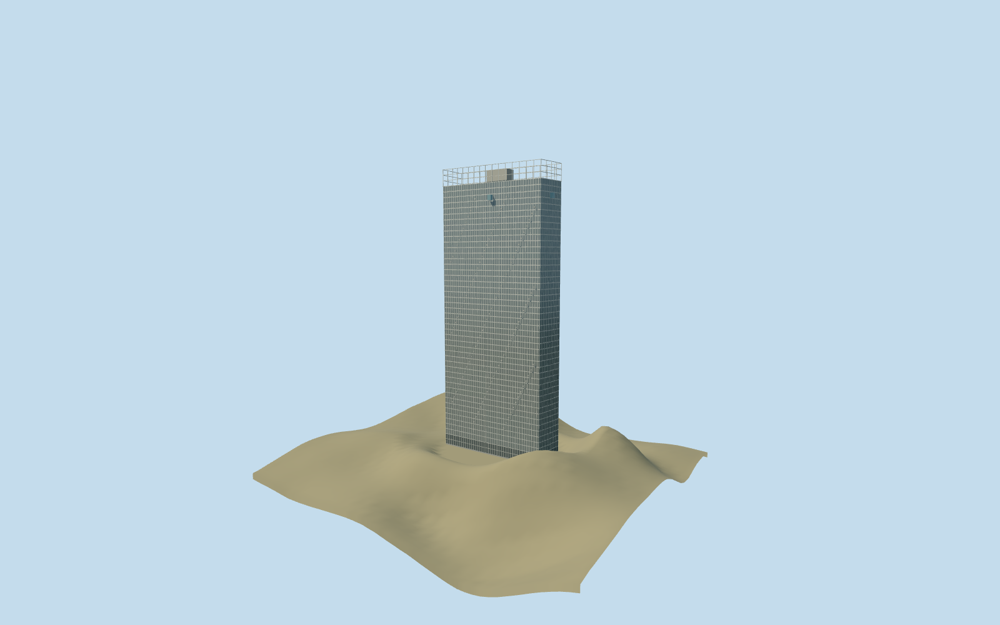

# Mirante do Vale

Mirante do Vale compact exterior: mapped thin slab, metal/glass window grid, floor bands, scattered AC and observation box impressions, with pictured exposed roof structure. Original source master independently preserved.

## Evidence and reconstruction

Published dimensions and reconstructed details are separated in spec.json. Primary references:

- [Reference](https://www.sampasky.com.br/sobre-nos)
- [Reference](https://www.farolsantander.com.br/assets/sites/2/20241204172903/Manual-de-Eventos-Farol-Santander-2025.pdf?_rsc=1mcjp)

No third-party geometry, photograph or bitmap texture is embedded. Shared surface graphs come from the central library; vertex tints carry model colors. Glazing uses PBR materials; transparent surfaces are declared per model.

## Model and axes

21,172 triangles; 63,516 vertices; 4 material groups; 2,543,448 bytes. Native bounds: -36.275, 0.000, -11.475 to 35.275, 170.000, 11.475. Source hash: `sha256:cb89fa38dd8a1f48e1a7f589183f2108048db3fa93d0fc8a44fb071c1d651a3e`.

{"up":"+Y","longitudinal":"+X along the mapped building long axis","front":"+Z","origin":"Ground-level center of exact-QID mapped footprint frame"}

One inspected facade picture establishes the narrow gray slab, dense window/AC grid and exposed upper roof frame. Preserve original170m source height, existing69.938�18.472m mapped perimeter and clipped southeast end. Standard viewer PMTiles confirms the exact-QID slab and surrounding downtown roads. Native long axis retained; observation boxes at150m are existing authored approximations, not certified by this older picture. PMTiles off-footprint point[-60,0]755.7122m sets approximate ground contact; center788.1688m contains urban building imprint. Bounded preview contacts preserve raw samples. Roof frame is a picture-led reconstruction; exact current roof occupancy, AC/window states, box bay offsets and thresholds remain unverified.

## Reproduce

Run `node packages/worldgen/scripts/generate-signature-towers.mjs --ids=N0138` (or add `--check`). The generator preserves manually edited masters by checking their baseline hashes. Import through the standard authored-model workflow with optimization disabled; then capture all QA cameras, including shared-surface views.

## Pending work

- One inspected facade picture establishes the narrow gray slab, dense window/AC grid and exposed upper roof frame. Preserve original170m source height, existing69.938�18.472m mapped perimeter and clipped southeast end. Standard viewer PMTiles confirms the exact-QID slab and surrounding downtown roads. Native long axis retained; observation boxes at150m are existing authored approximations, not certified by this older picture. PMTiles off-footprint point[-60,0]755.7122m sets approximate ground contact; center788.1688m contains urban building imprint. Bounded preview contacts preserve raw samples. Roof frame is a picture-led reconstruction; exact current roof occupancy, AC/window states, box bay offsets and thresholds remain unverified.
- Three shared stone/concrete/painted-metal graphs reused; glass uses opaque PBR parameters without photographic textures. Low tiers merge window and floor grids and omit AC/louvers; closeup restores representative AC louvers. Roof frame, current observation boxes and local ground contacts remain approximations. Physical-device timings unmeasured.

This bundle follows the medium-fi standard. Medium-fi appearance and geographic fit are reviewed separately. Hash-bound visual acceptance is recorded separately after capture inspection.
