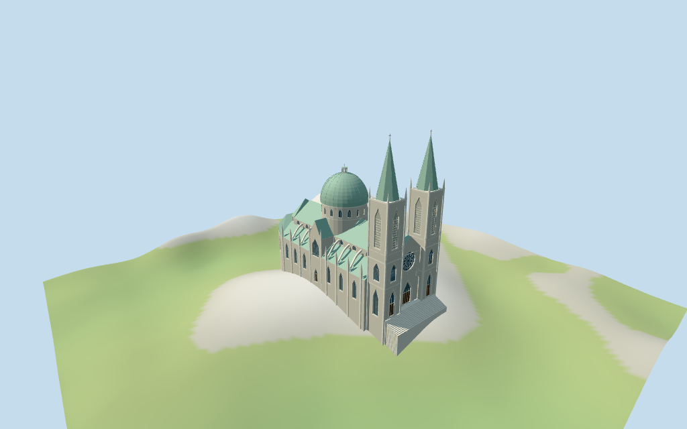

# São Paulo Cathedral

Individual São Paulo Cathedral: twin pale Gothic square towers with tall pointed fields/louvered upper stages, corner shafts/pinnacles, steep green octagonal spires and92m crosses. Deep pointed front timber/glass portals, large geometric circular rose and steep central stone gable; broad entrance stairs. Pale buttressed nave/aisles and gabled transepts, faceted southern apse and pale green copper roof family. Broad ribbed green dome and small actual open lantern/cross at70m. Four existing shared stone/continuous limestone/copper/wood graphs, metric UVs, linear tints and four browser levels. Fine carving/sculptural identity/tracery, interiors and exact urban ground/threshold joins are approximate or excluded.

## Evidence and reconstruction

Published dimensions and reconstructed details are separated in spec.json. Primary references:

- [Reference](https://commons.wikimedia.org/wiki/File:Vista_a%C3%A9rea_de_la_Catedral_metropolitana_de_S%C3%A3o_Paulo_13.jpg)
- [Reference](https://commons.wikimedia.org/wiki/File:Catedral_da_S%C3%A9_-_S%C3%A3o_Paulo,_Brasil.jpg)
- [Reference](https://commons.wikimedia.org/wiki/File:Catedral_da_S%C3%A9_-_Banespa.jpg)

Four existing cached256-square coursed limestone,continuous limestone,oxidized copper and plain-wood graphs. Metric UVs,linear pale-stone/green-copper/wood tints and flat architectural normals; glazing/louver/metal accents use local PBR colors. No embedded images,unique facade maps or baked shadows.

## Model and axes

15,915 triangles; 47,745 vertices; 6 material groups; 1,913,452 bytes. Native bounds: -55.773, -16.084, -23.578 to 64.800, 92.600, 23.728. Source hash: `sha256:e602d4d430499c7e8d6dffbaaf0a665fcca9ea49083f6b91a285a3a5cc10ab49`.

{"x":"north-northeast from southern apse toward twin-tower facade","y":"up","z":"east-southeast across nave/towers"}

Standard viewer DEM datum791.873583m; estimated floor0.6m, raw whole perimeter-15.73..-0.36m. Coarse urban DEM has about15.4m variation across the whole; source samples remain retained. Footings crossY=0 and extend below raw terrain; local front stairs are approximate. No source preview flattening or host DEM change. Runtime foundation exposure/base clipping,exact plaza/street/door contact,absolute altitude and walking remain unverified. No road replacement.

## Reproduce

Run `node packages/worldgen/scripts/generate-additional-landmarks.mjs --ids=N0384` (or add `--check`). The generator preserves manually edited masters by checking their baseline hashes. Import through the standard authored-model workflow with optimization disabled; then capture all QA cameras, including shared-surface views.

## Pending work

- Retained exact-QID way/8093737/Q1050668 matches current main35184380182569 (16 vertices rather than earlier26). Whole and five component controls retain all56 current vertices/tags rigidly with no rescale. Main envelope height26m, two tower parts92m, nave/cross40m and dome70m remain verbatim. Existing Wikidata height92m/length111m/width46m facts are preserved; measurement datums/scope are unspecified. Mapped whole about111.5m long/46.1m wide agrees closely. Native+X north-northeast twin-tower/rose front versus-X faceted southern apse signs retained heading1.153725362049rad. Map heights are interpreted as overall cap/ridge/tip levels above an estimated floor, not measured eaves or independent vertical surveys. Modeled tower crosses92m, nave/cross ridge40m, dome/lantern cross70m and lower aisle roof26m preserve those controls. Picture estimates subdivide these into aisle walls19m, nave/cross walls30m, front central wall32m/gable40m, tower lower32m/upper62m, steep spires89m/crosses92m; drum40..48m, green dome65m/lantern68.5m/cross70m. Portal/rose proportions, side/rear window rhythm, buttresses/pinnacles, flying arches, roof contours, small chapels and lantern details are estimates. No survey/engineering accuracy claimed.
- Standard viewer DEM datum791.873583m; estimated floor0.6m, raw whole perimeter-15.73..-0.36m. Coarse urban DEM has about15.4m variation across the whole; source samples remain retained. Footings crossY=0 and extend below raw terrain; local front stairs are approximate. No source preview flattening or host DEM change. Runtime foundation exposure/base clipping,exact plaza/street/door contact,absolute altitude and walking remain unverified. No road replacement.
- Medium-fi exterior from inspected2025 full front,2026 low-angle front detail and older undated elevated city overview plus standard viewer PMTiles/DEM. An interior picture with a misleading lateral title was excluded. Raw height controls and existing dimension facts retained; measurement datum and internal eave/stage levels remain approximate. Hidden side/rear window rhythm,buttresses/flying arches,apse roofs/chapel functions,current finish,fine sculpture/tracery,inscriptions and interiors are estimated,simplified or excluded. Physical phone/laptop timings pending.
- Skyline retains twin green spires,central pointed facade,gabled nave/transepts,faceted apse and broad green dome/lantern;small fields/ornament omitted. District adds shared surfaces,flat fields and actual deep main portal recesses/open lantern. Street adds recessed glazing,geometric rose,shutter rows,buttresses/flying arches and broad stone figures;closeup/master refine profiles,tracery and ribs. Synthetic cottages are fixtures.

This bundle follows the medium-fi standard. Medium-fi appearance and geographic fit are reviewed separately. Hash-bound visual acceptance is recorded separately after capture inspection.

## Additional geographic data

©OpenStreetMap contributors; Protomaps; Mapzen/USGS terrain tiles.
