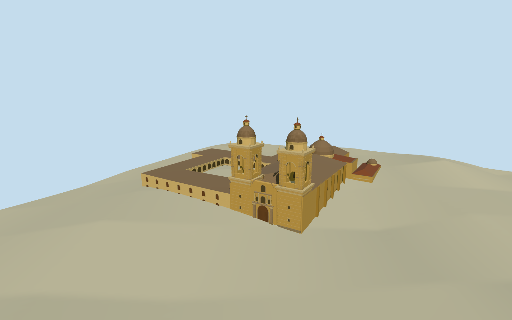

# Basilica and Convent of San Francisco, Lima

Lima’s Basilica of San Francisco and convent, with twin Baroque bells towers, ochre walls, nave cupola and an open two-tiered cloister.

Authoring state: **review-in-qa.json**. Current completion evidence is in [qa.json](qa.json) and the [completion ledger](../../../../qualla-structures/batches/qualla-004.PROGRESS.md).

- [Basilica and Convent of San Francisco, Lima](https://qualla.com/basilica-and-convent-of-san-francisco-lima/)

Draft exterior: approximate photographic proportions and simplified ornament. It is not a survey, photogrammetric reconstruction or approved current geographic replacement.

Three published 1868 albumen prints show the front towers and portal, side silhouette with the nave dome, and two tiers of arcades at the principal cloister. Numerical map measurements anchor the horizontal plan.

Terrain sampling/contact, geographic alignment and site activation remain pending. Runtime LODs are produced by the registered after-import pipeline and require visual review.

Reference photos remain in the local Qualla corpus; only provenance, paths and hashes are retained here.

Build: `node content/worldgen/source/places/6m/6mc/basilica_and_convent_of_san_francisco_lima/models/generate-basilica-and-convent-of-san-francisco-lima.mjs`. Add `--check` to verify exact regeneration. 13293 triangles; 7 materials; no embedded photographs.
