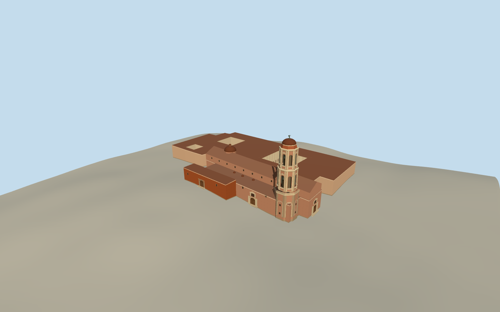

# Basilica and Convent of Santo Domingo, Lima

The standing Santo Domingo basilica and Veracruz chapel in Lima, its 46 m Rococo bell tower and three open convent cloisters.

Authoring state: **review-in-qa.json**. Current completion evidence is in [qa.json](qa.json) and the [completion ledger](../../../../qualla-structures/batches/qualla-003.PROGRESS.md).

- [Basilica and Convent of Santo Domingo, Lima](https://qualla.com/basilica-and-convent-of-santo-domingo-lima/)

Represents the standing basilica, Veracruz chapel, bell tower and three enclosed convent courts. Details of the porticos and tower follow the verified historical architectural record.

The documented tower height and mapped outlines anchor the exterior. The tower footprint within the corner, dormers, cloister bay counts, rear openings and minor courtyard details are estimated.

Restored wall tints are approximated from documented contemporary site colors. Tower carving, gallery marbling and tile patterns are simplified. The original local elevation field is preserved, with approximate thresholds.

Build: `node content/worldgen/source/places/6m/6mc/basilica_and_convent_of_santo_domingo_lima/models/generate-santo-domingo-lima.mjs`. Add `--check` to verify exact regeneration. 12938 triangles; 5 materials; no embedded photographs.
