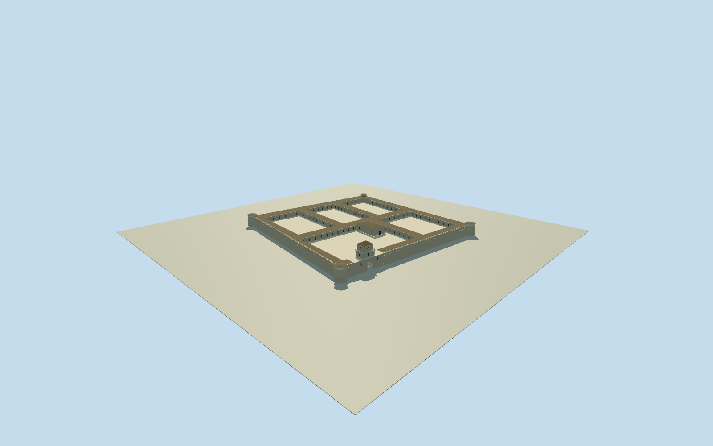

# Fort of Santa Catalina, Lima (whole fort,1898–1900)

Complete FortSantaCatalina in explicit1898–1900Garreaudphase, before1903clockand1963avenuecut: whole irregularrectangularbatteredcrenellatedenclosure/fourlowcornerbastions/fiveopeninteriorcourts/completebarrackandservice ranges/closedroofs/intrinsicSantaBárbarachapel/fullneoclassicalgatehouse/two-tier squaretower/roundopenings/hippedcap andcoveredbastiongallery. Current9controlNEsurvivingturret442262160 and14controlcollegeboundary410089525 areapproximatehistoric sitecontext only, never currentcollegeorparcelmassextrusion. Entirehiddenhistoricplan/roof/sections/registration/grade bounded estimates. Exclude laterclockhands/currentonlysurvivingslice/avenue/shopopposite/neighbors/people/cannons-bollards/cart/copiedfigurativeart/interiors.

Authoring state: **review-in-qa.json**. Current completion evidence is in [qa.json](qa.json) and the [completion ledger](../../../../qualla-structures/batches/qualla-002.PROGRESS.md).

- [Fort of Santa Catalina, Lima](https://qualla.com/fort-of-santa-catalina-lima/)

Q5870608nativeWikipedia matches exact namedGarreaudhistoricfort plate. Current9controlNEbastion442262160 provides approximate oldcorner/site context; adjacent14controlcollege410089525 nothistoricfortmeasuredplan. Oldirregularrectangle/fourbastions/fivecourts/chapel from1978INCtext, allhiddenhistoricplan/roof/sections/registration±25m/bearing±12degrees bounded estimates. Wholeoldphysicalfort required; later1903clock/current1963streetcut/college/oppositeshops excluded. All1077every-statusreservations clear.

Entire historicfort/fourcornerturrets/fivecourts/intrinsicchapel/fullhiddenbarrack-serviceranges/closedroofs required. Currenttinyretainedslice orphoto-onlygatefacade not a substitute.

ExactGarreaudoriginal/explicitPD-old-70/1898–1900albumplate/bytes bound. BNPprimarycreator/albumcontext andINCtextphase/topology only; no copyrightmodernplans/maps/photos or copiedfigurativeart.

Squaretower alreadyin1898–1900photo; circularopenings are not proof of1903clockhands. Use coherent historicblankroundopenings/cap, no modernclockface or1963avenuecut.

Original independent512mfield/frame before allfloorlevels/mainsections/geometry. Neverflatten/reacquire/reframe/refit afterrender. ModernurbanDEM cannot certify1899grade.

Wholehiddenhistoricplan/roof/sections/window-slot-court census/registration/finish/grade bounded estimates, exactmetric survey notrequired.

Whole170m irregularsquare/5court sizes/internal service range widths/chapelposition/roof sections/cornerbastions beyond photographedNE are bounded estimates. Fullhistoricfort retained ratherthan currentfifth-sizedslice orfrontfaçade. Courtyardpaving isintrinsicfortstructure, not a surroundingterrainpad.

Entrygate/tower/galleriedbastion/longarchedslotwall follow exactGarreaudplate. Towerroundopenings remain plain/dark;1903clockhands/digits notretrojected. Simplecolonialchapel built from primarytopologicalfact, with estimatedwholeplainbody/roof andno copiedartwork.

Paleadobe/plaster/timberroof/tile colors interpreted from monochromeoriginal. Otherphotophases/unknownauthor/modernofficialcopyrightimages or plans notadopted. Opposite shop/streetside carts/people/cannonbollards/broadsitewalls unrelatedtofort excluded.

Registration±25m/bearing±12degrees and exacthistoricgrade estimated. Modernrelief roughly−5.3..9.94mrelative acrossoriginalfield mayconcealfoundations. Do notalteroriginalfield/floors/mainsections afterrender.

Build: `node content/worldgen/source/places/6m/6mc/fort_of_santa_catalina_lima/models/generate-house.mjs`. Add `--check` to verify exact regeneration. 59183 triangles; 6 materials; no embedded photographs.
