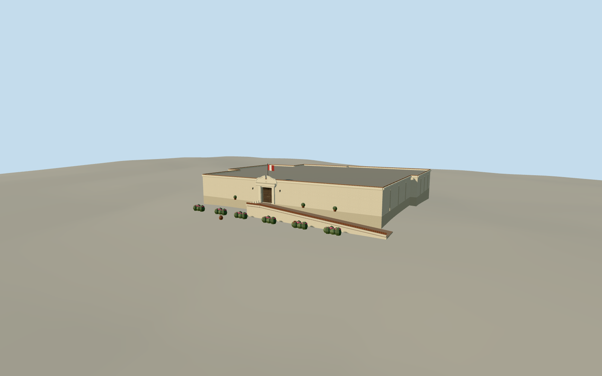

# Larco Museum

The white viceregal mansion of Lima’s Museo Larco, its raised garden approach, split curved portal and warm terracotta coping.

Authoring state: **review-in-qa.json**. Current completion evidence is in [qa.json](qa.json) and the [completion ledger](../../../../qualla-structures/batches/qualla-003.PROGRESS.md).

- [Larco Museum](https://qualla.com/larco-museum/)

The roof and blind rear elevations are estimated below the parapets. The sole cleared photo documents the fronts closest to the landscaped garden, with portions hidden by vegetation.

The wall height, projected door relief, ramp grade and small planting layouts are approximate. The reconstruction covers the main house and immediate approach.

Build: `node content/worldgen/source/places/6m/6mc/larco_museum/models/generate-larco-museum.mjs`. Add `--check` to verify exact regeneration. 5198 triangles; 6 materials; no embedded photographs.
