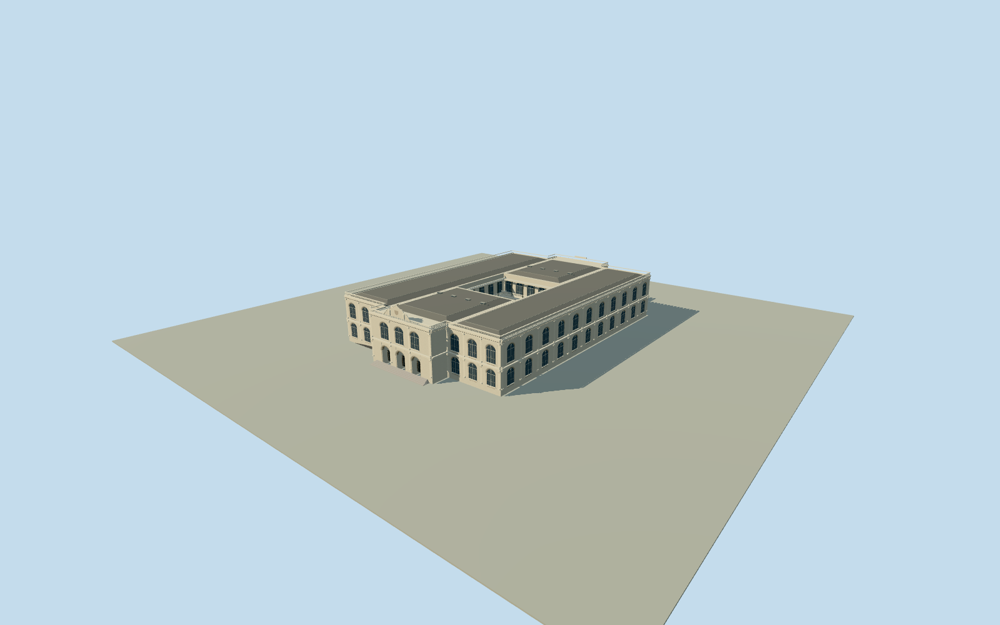

# Lima Art Museum

The oyster-white neorenaissance Exhibition Palace in Lima, with round-headed twin windows, strong cornices, two projecting porticos and an iron-columned central court.

Authoring state: **review-in-qa.json**. Current completion evidence is in [qa.json](qa.json) and the [completion ledger](../../../../qualla-structures/batches/qualla-003.PROGRESS.md).

- [Lima Art Museum](https://qualla.com/lima-art-museum/)

Facade and roof heights, side bay spacing, relief sculpture and colors are interpretations. The terrace and plinth adapt to mapped grade.

Central courtyard width comes from a Universidad de San Martín de Porres measured study. Selected interior galleries, site parking, neighboring buildings and park monuments are outside the modeled exterior.

Current museum restoration report controls the standing building. The archival photograph predates that work.

Build: `node content/worldgen/source/places/6m/6mc/lima_art_museum/models/generate-lima-art-museum.mjs`. Add `--check` to verify exact regeneration. 52279 triangles; 6 materials; no embedded photographs.
