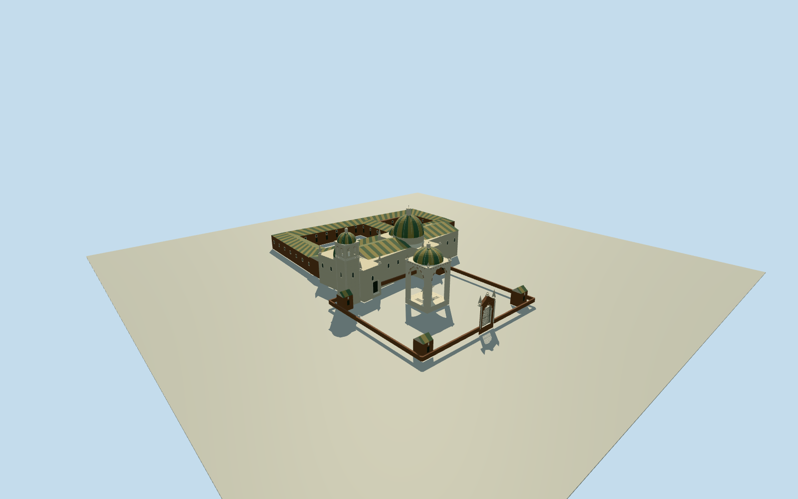

# Basilica of Our Lady of Copacabana (depicted1877)

Complete church/shrine complex in the explicit1877publication-depicted historical appearance: whole basilica nave/transept/apse/rear-camarin/chapter and connected cloister/service bodies, closedgreen-yellowtiledroofs/church dome/chapel domes/pinnacles and tall independentbelfry; intrinsic open forecourt with separate90foot stone domed canopy/threecrosses, archedironentrygate/heavyboundarywalls/four cornerchambers. Native current18controlchurch/current16controlwalledreligiouscourt supply approximateoldsite context only, never extrude wholegrounds as a building. Exactoldconnectedcloister/hiddenbody/roof registration/heights estimated; primary90footcanopyheight is available but allfloors/mainsections remainunselected untiloriginalfield. Excludeestate/village/plazahouses/trees/people/market/herds/copiedfigurativeart and laterrestorations; do not mistake stonecourtcanopy forchurchfront.

Authoring state: **review-in-qa.json**. Current completion evidence is in [qa.json](qa.json) and the [completion ledger](../../../../qualla-structures/batches/qualla-002.PROGRESS.md).

- [Basilica of Our Lady of Copacabana](https://qualla.com/basilica-of-our-lady-of-copacabana/)

Actual whole currentchurchway628685969/Q4867361/18controls as approximatehistoricalsitecontext, not measured1877walls. Separate16control religiouscourtyard/wallway71069911 is OPENsitecontext only, not solidbuildingvolume. Oldcloister/servicewing and independentbelfry/canopy/gate registration will be bounded±15m/±15degrees estimates. Sourceframeheading0/+Xeast/+Zsouth remainsfixed beforeoriginalfield/allfloors/mainsections; primary90footcanopy is distinctfromchurchdome.

Full physicalchurch/shrinecomplex includingintrinsicstonecourtcanopy/belfry/closedroofs/hiddenconnectedcloister/rearbody; do not substitute facade-only or extrudedreligiousgrounds.

Primarycanopy90footheight andcourt/churchdistinction available; nativecurrentfootprints not historicalsurvey. Hiddenold topology/roof/sections/baycensus bounded estimates.

Original independent256mfield/frame beforeallfloors/mainparameters/geometry; neverflatten/reacquire/reframe orfitsections to renders.

Use onlyexact1877USoriginal. Yale1855originalclearbutdifferentphase/unselected, standalone319scan sameplate notadditionalfamily; bookauthornotinventedengraver.

Primary90footdomedstonecourtcanopy is separately modeled with four realarchedopenings/closed dome underside/three plainalabaster-colored crosses/graduatedbase. Its horizontalwidth/archspring/heightallocation andcrossforms estimated; bookauthor not assumed plateengraver.

Main church retains full current18control extent as approximatehistoricalcontext, whole nave/transept/apse/rearcamarin/chapels/closedroofs and domes. Oldcloistertwo-court ranges/connectingwings are bounded hiddenplan/roof estimates, not surveyed1877walls.

Primary green/yellowtiles inform roofpalette; stripe/checkerlayout, exposedbrick/plasterfinish and all finerornament are estimates from uncoloredengraving. Figurative saints/angels/surfacemurals and village trees/people/market/animals excluded.

Heavyboundarywalls/irongate/fourcornerbrickchambers intrinsic to shrine forecourt, not solidreligiousestate geometry. No broadcourt floor/sitepad; sourceDEMhistoricgrade approximate and may conceal some lowerarchitecture.

Build: `node content/worldgen/source/places/6m/6mn/basilica_of_our_lady_of_copacabana/models/generate-house.mjs`. Add `--check` to verify exact regeneration. 39201 triangles; 6 materials; no embedded photographs.
