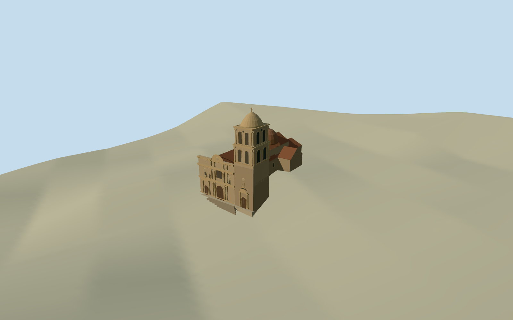

# Basilica of San Francisco, La Paz

Andean Baroque stone church in La Paz with one belfry, a carved portal and a tiled crossing dome.

Authoring state: **review-in-qa.json**. Current completion evidence is in [qa.json](qa.json) and the [completion ledger](../../../../qualla-structures/batches/qualla-004.PROGRESS.md).

- [Basilica of San Francisco, La Paz](https://qualla.com/basilica-of-san-francisco-la-paz/)

Draft exterior: approximate photographic proportions and simplified ornament. It is not a survey, photogrammetric reconstruction or approved current geographic replacement.

The dated stereograph establishes the richly carved portal, crest and paired arches on each of the belfry stages. The conservation and university studies document the stonework, central crossing dome and one later stone tower.

Terrain sampling/contact, geographic alignment and site activation remain pending. Runtime LODs are produced by the registered after-import pipeline and require visual review.

Reference photos remain in the local Qualla corpus; only provenance, paths and hashes are retained here.

Build: `node content/worldgen/source/places/6m/6mp/basilica_of_san_francisco_la_paz/models/generate-basilica-of-san-francisco-la-paz.mjs`. Add `--check` to verify exact regeneration. 7812 triangles; 6 materials; no embedded photographs.
