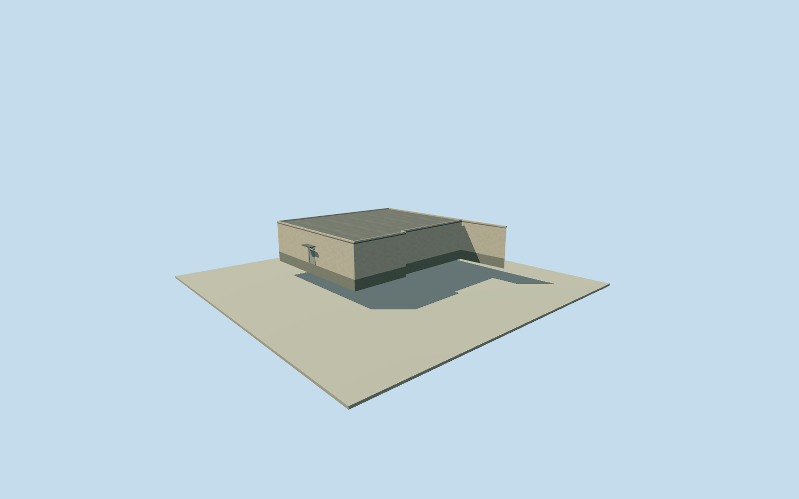

# Litoral central block 1 eastern roof sections

Complete407.2318985993m² eastern source roof extension to Litoral central block1, preserving all7derived corners and subtracting the bound accepted roof. This intrinsic section does not complete the whole prison. Exact full2023extent, use, room census and physical interface remain unverified. Original Microsoft ML Buildings2026WKB and record/hash retained via Overture2026-10-21 under ODbL. Eight original2023qualified numeric outside points median4.5m support the section; the learned relative height is not surveyed, and does not verify its whole2023extent. Nominal15m horizontal and3m height modeling allowances are estimates, not measured error bounds. Original material-neighbor floor is chosen after own field and before geometry. All facade, roof profile, materials/openings/finish, grade and2023continuity remain estimates. All appearance imagery unused; Qualla first unrelated portrait excluded. No Google footprint confidence or per-building accuracy probability applies to this Microsoft record. Entire complete source-set difference retained with7original derived corners and407.2318985993m² outside the accepted roof. Full original Microsoft/Overture WKB and bound accepted mask remain unchanged. No site or yard polygon adopted as roof. Eight original qualified2023height/presence samples median4.5m support this eastern extension; learned relative height is not survey. Full source geometry comes from2026inference and does not verify complete2023roof extent or continuity. No source footprint confidence or measured accuracy applies. Initial absolute floor 10.0402m transferred from material-overlap accepted neighbor after own field, before geometry. Local floor 2.5474m is an original interface estimate, not a surveyed vertical tie. Source field/frame/floor and main sections frozen before first render; no grade fitting, masking, flattening, cutout or relocation. Full source roof complement is a closed volume. Doors/window census, bars, canopy, stucco, roof membrane, concrete/foundation and exact roof section are original estimates. Four authored detail levels retain every derived corner and major section; higher levels refine openings/bars. Original15m horizontal/3m height allowances are modeling estimates, not measured error bounds. All source imagery, photos, map pixels, plans and figures unused. Qualla first single unrelated portrait excluded. Source outlines and numeric heights do not establish room function, floor census, surveyed grade, precise historic condition or ownership. No original accepted member geometry, field, floor, pose or QA changed. Whole prison remains unfinished.

Authoring state: **review-in-qa.json**. Current completion evidence is in [qa.json](qa.json) and the [completion ledger](../../../../qualla-structures/batches/qualla-002.PROGRESS.md).

- [Litoral Penitentiary](https://qualla.com/litoral-penitentiary/)

Complete407.2318985993m² eastern source roof extension to Litoral central block1, preserving all7derived corners and subtracting the bound accepted roof. This intrinsic section does not complete the whole prison. Exact full2023extent, use, room census and physical interface remain unverified. Original Microsoft ML Buildings2026WKB and record/hash retained via Overture2026-10-21 under ODbL. Eight original2023qualified numeric outside points median4.5m support the section; the learned relative height is not surveyed, and does not verify its whole2023extent. Nominal15m horizontal and3m height modeling allowances are estimates, not measured error bounds. Original material-neighbor floor is chosen after own field and before geometry. All facade, roof profile, materials/openings/finish, grade and2023continuity remain estimates. All appearance imagery unused; Qualla first unrelated portrait excluded. No Google footprint confidence or per-building accuracy probability applies to this Microsoft record.

Entire complete source-set difference retained with7original derived corners and407.2318985993m² outside the accepted roof. Full original Microsoft/Overture WKB and bound accepted mask remain unchanged. No site or yard polygon adopted as roof.

Eight original qualified2023height/presence samples median4.5m support this eastern extension; learned relative height is not survey. Full source geometry comes from2026inference and does not verify complete2023roof extent or continuity. No source footprint confidence or measured accuracy applies.

Initial absolute floor 10.0402m transferred from material-overlap accepted neighbor after own field, before geometry. Local floor 2.5474m is an original interface estimate, not a surveyed vertical tie. Source field/frame/floor and main sections frozen before first render; no grade fitting, masking, flattening, cutout or relocation.

Full source roof complement is a closed volume. Doors/window census, bars, canopy, stucco, roof membrane, concrete/foundation and exact roof section are original estimates. Four authored detail levels retain every derived corner and major section; higher levels refine openings/bars. Original15m horizontal/3m height allowances are modeling estimates, not measured error bounds.

All source imagery, photos, map pixels, plans and figures unused. Qualla first single unrelated portrait excluded. Source outlines and numeric heights do not establish room function, floor census, surveyed grade, precise historic condition or ownership. No original accepted member geometry, field, floor, pose or QA changed. Whole prison remains unfinished.

Build: `node content/worldgen/source/places/6p/6px/litoral_central_block_1_eastern_roof_sections/models/generate-house.mjs`. Add `--check` to verify exact regeneration. 1881 triangles; 6 materials; no embedded photographs.
