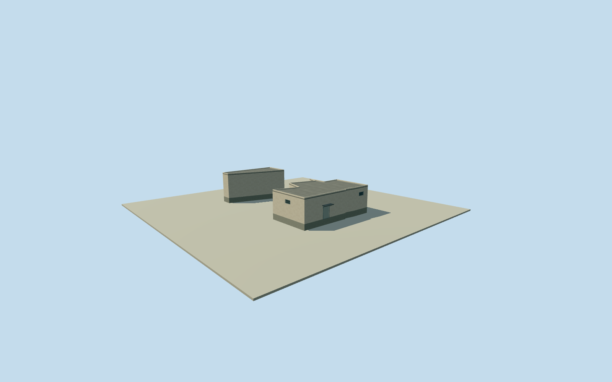

# Litoral central link roof sections

Complete intrinsic uncovered roof section(s) of original numerical 6792W3X4+H9H4 adjoining existing Litoral halls, preserving all 13/6derived outline corners and every source remainder. Existing bodies cover the bound subtracted areas and remain unchanged. Exact building/room function, physical join, boundary alignment and2023condition unverified; this asset is not a whole-prison or independent-building proxy. Original full-precision Google WKT and exact polygon-set difference retained, source confidence0.8470 is a model rank, not an accuracy probability. Existing source masks exclude perimeter/site rings; no roof is made from a yard boundary. Own original field must precede floor/mainsections. All images unused, Qualla first single unrelated portrait. Plan/height/finish/floor census/interface/grade estimates explicit; historical2023continuity unverified. Every complete exact original source-set difference piece retained, 13/6corners with areas169.8639/57.3767m². Original full Google polygon and bound accepted roof masks preserved. These are intrinsic adjoining roof sections; no standalone independent new-building identity claimed. Initial floor selected after own field, before geometry: median of bound accepted neighboring absolute floor values10.8932/11.0032/11.1196m gives11.0032m; own source datum11m gives local floor0.0032m. This is an original interface approximation, not a surveyed common datum or post-render grade/height fit. Numerical2023learned outside-section source samples per piece 3/1; medians4.5/5.5m. Relative heights are source estimates, not floor census or survey. Initial roof/sections derive from these nominal heights;3m height/component and10m horizontal allowances, or5m height for sparse/absent sections, are modeling allowances, not measured error bounds. Original source confidence0.8470 is an automated rank, not a probability or proof of each small boundary strip. All full-source/mask boundaries and exact2023continuity remain approximate. The tiny0.2154m²triangular P9Q8remainder has no qualified height observations. Where present it is preserved as a0.12m roof-edge slab adjoining the bound nearest accepted roof section, with upper surface0.16m above its original absolute roof, no new tall wall/room/door/floor or claimed source height. Other end and main sections remain complete closed volumes. Facade/window/entry/canopy/roof material/color/section profiles, compartment use and precise2023condition are conservative original estimates. Patches meet accepted bodies with unmeasured interfaces; no repair to or duplicate of existing model bodies. No interiors or source-photo texture. Own original256m129x129 source field/raw tile acquired before floors/mainsections. Source field/frame/initial floors/sections frozen without masks, flattening, cutout, fitting or relocation. Coarse contact and exact historic grade/vertical tie remain unsurveyed. All images, plans, figures, artwork and source pixels unused. Qualla-first single unrelated portrait excluded. Four complete authored levels retain all intrinsic pieces and major outline/roof/entry/opening census; near levels refine opening recesses and bars. Whole prison remains unfinished.

Authoring state: **review-in-qa.json**. Current completion evidence is in [qa.json](qa.json) and the [completion ledger](../../../../qualla-structures/batches/qualla-002.PROGRESS.md).

- [Litoral Penitentiary](https://qualla.com/litoral-penitentiary/)

Complete intrinsic uncovered roof section(s) of original numerical 6792W3X4+H9H4 adjoining existing Litoral halls, preserving all 13/6derived outline corners and every source remainder. Existing bodies cover the bound subtracted areas and remain unchanged. Exact building/room function, physical join, boundary alignment and2023condition unverified; this asset is not a whole-prison or independent-building proxy. Original full-precision Google WKT and exact polygon-set difference retained, source confidence0.8470 is a model rank, not an accuracy probability. Existing source masks exclude perimeter/site rings; no roof is made from a yard boundary. Own original field must precede floor/mainsections. All images unused, Qualla first single unrelated portrait. Plan/height/finish/floor census/interface/grade estimates explicit; historical2023continuity unverified.

Every complete exact original source-set difference piece retained, 13/6corners with areas169.8639/57.3767m². Original full Google polygon and bound accepted roof masks preserved. These are intrinsic adjoining roof sections; no standalone independent new-building identity claimed.

Initial floor selected after own field, before geometry: median of bound accepted neighboring absolute floor values10.8932/11.0032/11.1196m gives11.0032m; own source datum11m gives local floor0.0032m. This is an original interface approximation, not a surveyed common datum or post-render grade/height fit.

Numerical2023learned outside-section source samples per piece 3/1; medians4.5/5.5m. Relative heights are source estimates, not floor census or survey. Initial roof/sections derive from these nominal heights;3m height/component and10m horizontal allowances, or5m height for sparse/absent sections, are modeling allowances, not measured error bounds.

Original source confidence0.8470 is an automated rank, not a probability or proof of each small boundary strip. All full-source/mask boundaries and exact2023continuity remain approximate.

The tiny0.2154m²triangular P9Q8remainder has no qualified height observations. Where present it is preserved as a0.12m roof-edge slab adjoining the bound nearest accepted roof section, with upper surface0.16m above its original absolute roof, no new tall wall/room/door/floor or claimed source height. Other end and main sections remain complete closed volumes.

Facade/window/entry/canopy/roof material/color/section profiles, compartment use and precise2023condition are conservative original estimates. Patches meet accepted bodies with unmeasured interfaces; no repair to or duplicate of existing model bodies. No interiors or source-photo texture.

Own original256m129x129 source field/raw tile acquired before floors/mainsections. Source field/frame/initial floors/sections frozen without masks, flattening, cutout, fitting or relocation. Coarse contact and exact historic grade/vertical tie remain unsurveyed.

All images, plans, figures, artwork and source pixels unused. Qualla-first single unrelated portrait excluded. Four complete authored levels retain all intrinsic pieces and major outline/roof/entry/opening census; near levels refine opening recesses and bars. Whole prison remains unfinished.

Build: `node content/worldgen/source/places/6p/6px/litoral_central_link_roof_sections/models/generate-house.mjs`. Add `--check` to verify exact regeneration. 1429 triangles; 6 materials; no embedded photographs.
