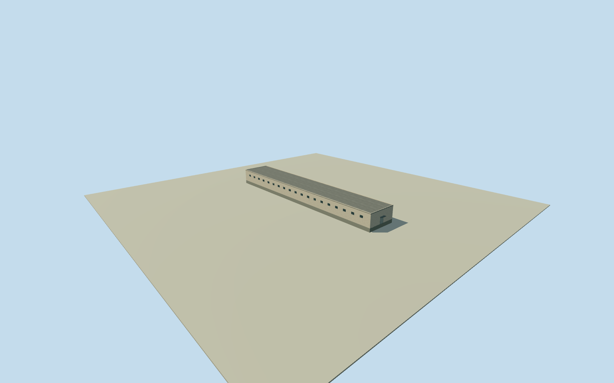

# Litoral central south hall

Whole independent long four-corner roofed hall south of the central Litoral pavilion area, inside the original named prison perimeter. Every original numerical footprint corner is retained. Exact service/cell use and pavilion assignment unverified. Adjacent bodies and open yards remain separate. Qualla-first published corpus has one unrelated portrait; every image remains unused. Source is the original Google v3 numerical row6792W3X4+FC47. Overture repeats the same source, not independent confirmation. Confidence0.7764 is below the0.780 tile80%-precision threshold; no80%-precision claim or survey precision is assigned. Shape, height, roof profile, facade, materials, entrances, floor census, exact function and2023 continuity remain approximate. Initial original exterior height will be explicitly estimated, without relabeling absent/zero height observations. Nominal15m horizontal/5m height/3m component allowances are not measured bounds. Whole original four-corner long hall with all exterior walls, complete closed flat roof, shallow parapet and foundation. Floor0.25m, foundation-1.2m, wall eave5.13m, main roof5.25m, parapet5.47m. Main5m above-floor roof height is an original visualization estimate, not a survey, numerical height observation, inferred floor census or statistic. No positive source height is claimed. Nominal5m height and3m component allowances are not measured error bounds. Full original Google v3 numerical footprint FC47, detection confidence0.7764 below0.780 tile80%-precision threshold. Overture repeats the same source; it is not independent verification. Retain15m nominal horizontal allowance and explicit uncertain building boundary/date continuity. Source corners remain unchanged. Original estimated plain light rendered walls, flat waterproofed roof and parapet, closed short-side entrance and high barred windows on long walls. Exact wall material, colors, window/door census, entry face, roof profile, floor count, condition and body function remain unverified. SNAI repair facts for Pavilions6/7 are not assigned to this unnamed hall. No interiors, people or security systems. Own original256m129x129 field acquired before initial floor and main sections. Frame, source field, floor and main sections frozen. No masking, flattening, cutout, terrain fitting or outline/grade repositioning. Host contact and vertical datum remain approximate. Four complete authored levels retain every original corner, whole body/closed roof/foundation, estimated entrance and window census. Near levels add shallow recesses, frames and sparse bars. Every photograph, source pixel, map image, diagram, plan and photo texture remains unused. Qualla first single portrait is unrelated architecture evidence. Approximate2023preview/currentWorldEligiblefalse. Parent prison and adjacent roofs remain separate and unfinished.

Authoring state: **review-in-qa.json**. Current completion evidence is in [qa.json](qa.json) and the [completion ledger](../../../../qualla-structures/batches/qualla-002.PROGRESS.md).

- [Litoral Penitentiary](https://qualla.com/litoral-penitentiary/)

Whole independent long four-corner roofed hall south of the central Litoral pavilion area, inside the original named prison perimeter. Every original numerical footprint corner is retained. Exact service/cell use and pavilion assignment unverified. Adjacent bodies and open yards remain separate. Qualla-first published corpus has one unrelated portrait; every image remains unused. Source is the original Google v3 numerical row6792W3X4+FC47. Overture repeats the same source, not independent confirmation. Confidence0.7764 is below the0.780 tile80%-precision threshold; no80%-precision claim or survey precision is assigned. Shape, height, roof profile, facade, materials, entrances, floor census, exact function and2023 continuity remain approximate. Initial original exterior height will be explicitly estimated, without relabeling absent/zero height observations. Nominal15m horizontal/5m height/3m component allowances are not measured bounds.

Whole original four-corner long hall with all exterior walls, complete closed flat roof, shallow parapet and foundation. Floor0.25m, foundation-1.2m, wall eave5.13m, main roof5.25m, parapet5.47m. Main5m above-floor roof height is an original visualization estimate, not a survey, numerical height observation, inferred floor census or statistic. No positive source height is claimed. Nominal5m height and3m component allowances are not measured error bounds.

Full original Google v3 numerical footprint FC47, detection confidence0.7764 below0.780 tile80%-precision threshold. Overture repeats the same source; it is not independent verification. Retain15m nominal horizontal allowance and explicit uncertain building boundary/date continuity. Source corners remain unchanged.

Original estimated plain light rendered walls, flat waterproofed roof and parapet, closed short-side entrance and high barred windows on long walls. Exact wall material, colors, window/door census, entry face, roof profile, floor count, condition and body function remain unverified. SNAI repair facts for Pavilions6/7 are not assigned to this unnamed hall. No interiors, people or security systems.

Own original256m129x129 field acquired before initial floor and main sections. Frame, source field, floor and main sections frozen. No masking, flattening, cutout, terrain fitting or outline/grade repositioning. Host contact and vertical datum remain approximate.

Four complete authored levels retain every original corner, whole body/closed roof/foundation, estimated entrance and window census. Near levels add shallow recesses, frames and sparse bars. Every photograph, source pixel, map image, diagram, plan and photo texture remains unused. Qualla first single portrait is unrelated architecture evidence. Approximate2023preview/currentWorldEligiblefalse. Parent prison and adjacent roofs remain separate and unfinished.

Build: `node content/worldgen/source/places/6p/6px/litoral_central_south_hall/models/generate-house.mjs`. Add `--check` to verify exact regeneration. 5484 triangles; 6 materials; no embedded photographs.
