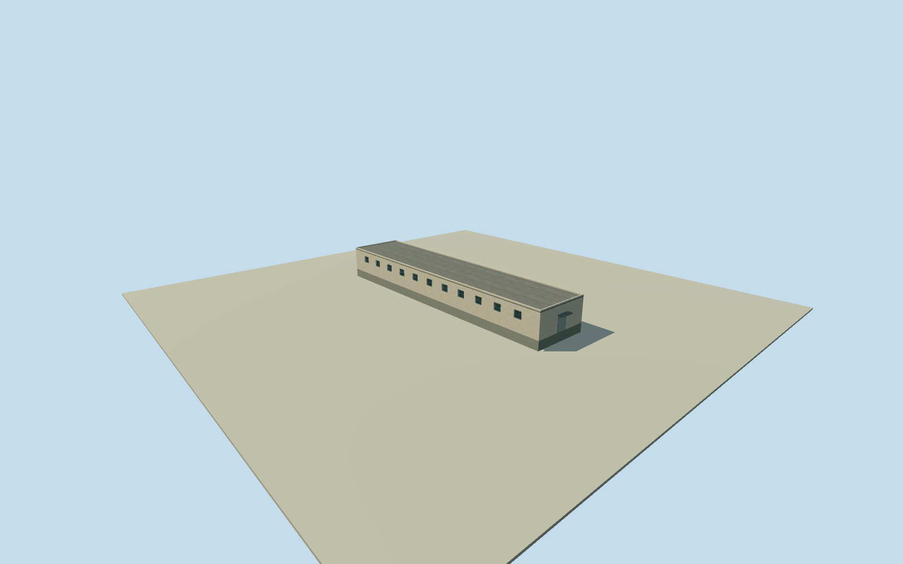

# Litoral inner block07

Whole separately mapped inner roofed block inside the original named Litoral Penitentiary perimeter, within the named prison site; individual use and precise compound attribution unverified. All original full-precision numerical roof controls, complete walls and closed roof retained. Specific building function is unverified; open yards and other roofs remain separate. All imagery unused after Qualla-first inventory. Original Google v3 CSV/WKT footprint meets official tile90380-percent precision threshold.780, a ranking threshold and not per-building probability or survey. Original2023 numerical height observations have0 passing samples and supply no height. Author-chosen nominal visualization height 4m has at least4m uncertainty; it is not a measured or dataset-provided height. Retain7m horizontal and2m component uncertainty. Original OSM way46012320 is explicitly named Penitenciaría del Litoral/barrierwall/amenityprison; every roof corner lies inside that original numerical perimeter. Current site mapping does not establish exact2023 continuity. Actual function, facade/opening census, finish, flat roof section, small details and condition are estimates. Low roofs receive estimated opening/canopy heights that stay below their chosen eave. No source image fetched or viewed. When fewer than3 values pass, height is only a nominal visualization estimate with at least4m uncertainty; it does not establish statistical precision, physical height or floor census. Whole original Google Open Buildings v3 google-open-buildings:6792W3W4+XJ7F / original CSV record 6792W3W4+XJ7F numerical roof footprint, inside original named Litoral prison perimeter. Source footprint is an automated estimate, not survey; 7 m horizontal uncertainty. Author-chosen nominal visualization height 4 m with at least4 m uncertainty; source numerical height median is absent and no measured height is claimed. Compound is contextual and is not roofed over. Zero passing observations supply no source height. Nominal4m is only an author visualization estimate with at least4m uncertainty. Whole original numerical roof, every source corner, complete exterior walls, closed flat roof, foundation and one estimated closed entry/canopy. No passing numerical height samples: source median is absent. Nominal4m relative roof height is a conservative author estimate for visualization, not a measured or dataset-provided value, statistical precision or floor census. Retain4m height uncertainty and7m horizontal uncertainty. Original OSM numerical named prison perimeter establishes site context; building function within the named prison site is unverified. Exact facade, openings/floor census, finish, roof section and2023 continuity are estimates with2m component uncertainty. All imagery unused after Qualla-first inventory; original Google/OSM numerical data credited ODbL. Own original256m/129x129/16641-value field and 2 raw tiles fixed before floor.25m/foundation-1.2m/eave 4.13m/roof 4.25m. No field masking, flattening, replacement or floor/main-section refit. Precise grade/contact and vertical tie unverified. All four LODs retain every original corner, whole walls/roof/base, estimated window census and closed entry. Near levels use physical recesses and sparse bars; low-roof openings/canopy are proportionally reduced below the chosen eave. Sparse details are author estimates, not an observed architectural census. Approximate2023-12-31 historical preview/current-world eligible false. Open yards, other site bodies and whole prison remain unfinished; no yard roof or parent proxy.

Authoring state: **review-in-qa.json**. Current completion evidence is in [qa.json](qa.json) and the [completion ledger](../../../../qualla-structures/batches/qualla-002.PROGRESS.md).

- [Litoral Penitentiary](https://qualla.com/litoral-penitentiary/)

Whole separately mapped inner roofed block inside the original named Litoral Penitentiary perimeter, within the named prison site; individual use and precise compound attribution unverified. All original full-precision numerical roof controls, complete walls and closed roof retained. Specific building function is unverified; open yards and other roofs remain separate. All imagery unused after Qualla-first inventory. Original Google v3 CSV/WKT footprint meets official tile90380-percent precision threshold.780, a ranking threshold and not per-building probability or survey. Original2023 numerical height observations have0 passing samples and supply no height. Author-chosen nominal visualization height 4m has at least4m uncertainty; it is not a measured or dataset-provided height. Retain7m horizontal and2m component uncertainty. Original OSM way46012320 is explicitly named Penitenciaría del Litoral/barrierwall/amenityprison; every roof corner lies inside that original numerical perimeter. Current site mapping does not establish exact2023 continuity. Actual function, facade/opening census, finish, flat roof section, small details and condition are estimates. Low roofs receive estimated opening/canopy heights that stay below their chosen eave. No source image fetched or viewed. When fewer than3 values pass, height is only a nominal visualization estimate with at least4m uncertainty; it does not establish statistical precision, physical height or floor census.

Whole original Google Open Buildings v3 google-open-buildings:6792W3W4+XJ7F / original CSV record 6792W3W4+XJ7F numerical roof footprint, inside original named Litoral prison perimeter. Source footprint is an automated estimate, not survey; 7 m horizontal uncertainty. Author-chosen nominal visualization height 4 m with at least4 m uncertainty; source numerical height median is absent and no measured height is claimed. Compound is contextual and is not roofed over.

Zero passing observations supply no source height. Nominal4m is only an author visualization estimate with at least4m uncertainty. Whole original numerical roof, every source corner, complete exterior walls, closed flat roof, foundation and one estimated closed entry/canopy. No passing numerical height samples: source median is absent. Nominal4m relative roof height is a conservative author estimate for visualization, not a measured or dataset-provided value, statistical precision or floor census. Retain4m height uncertainty and7m horizontal uncertainty.

Original OSM numerical named prison perimeter establishes site context; building function within the named prison site is unverified. Exact facade, openings/floor census, finish, roof section and2023 continuity are estimates with2m component uncertainty. All imagery unused after Qualla-first inventory; original Google/OSM numerical data credited ODbL.

Own original256m/129x129/16641-value field and 2 raw tiles fixed before floor.25m/foundation-1.2m/eave 4.13m/roof 4.25m. No field masking, flattening, replacement or floor/main-section refit. Precise grade/contact and vertical tie unverified.

All four LODs retain every original corner, whole walls/roof/base, estimated window census and closed entry. Near levels use physical recesses and sparse bars; low-roof openings/canopy are proportionally reduced below the chosen eave. Sparse details are author estimates, not an observed architectural census.

Approximate2023-12-31 historical preview/current-world eligible false. Open yards, other site bodies and whole prison remain unfinished; no yard roof or parent proxy.

Build: `node content/worldgen/source/places/6p/6px/litoral_inner_block_07/models/generate-house.mjs`. Add `--check` to verify exact regeneration. 3308 triangles; 6 materials; no embedded photographs.
