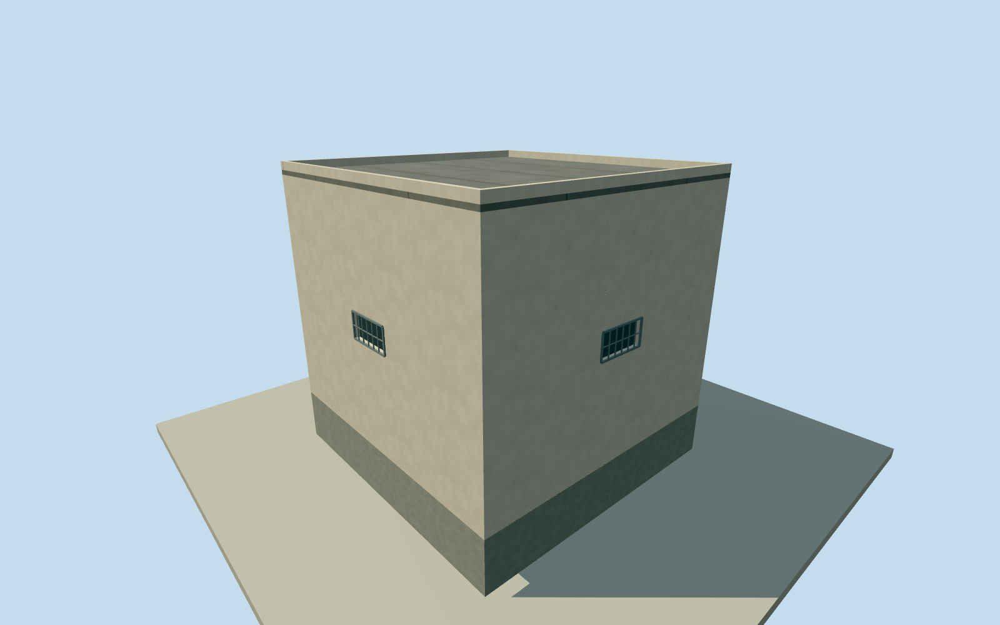

# Litoral Pavilion 12 east-service block

Whole independently placed east-service roofed block inside Pavilion 12 of the Litoral Penitentiary. All four full-precision numerical roof controls, complete walls and closed roof. The pavilion compound includes yards and multiple other buildings; those are not filled or substituted by this block. All imagery unused. Qualla-first corpus contains only an unrelated architectural-reference portrait. Structured Overture / Microsoft building coordinates and numerical height samples establish this roofed body; original SNAI 2023 report describes repairs of Pavilions 6 and 7 collectively; it does not identify this particular body or its individual exterior census. This block’s exterior details are conservative estimates. Exact height is a learned estimate, not survey: median 6.5 m, at least 4 m uncertainty; four passing observations supply only a nominal visualization value, not statistical height precision or a physical height/floor census. Floor census, facade, roof section, paint, small detail and precise 2023 condition are estimates. No photograph, satellite image, map image, plan, figure or texture fetched or viewed. Original height observations are2021, used as a nominal end2023preview with unverified temporal continuity. Whole original Overture GERS 835d7368-39ef-470f-a172-5c52f719b8f3 / Microsoft ML Buildings original structured record  numerical roof footprint, within original named Pavilion 12 compound. Source footprint is an automated estimate, not survey; 8 m horizontal uncertainty. Numerical 2021 relative height median 6.5 m, at least4 m uncertainty; only four observations pass. Compound is contextual and is not roofed over. Whole original four-corner roofed block, all exterior walls, closed flat roof and full foundation. Numerical relative roof height is 6.5 m (median of 4 selected source samples); height uncertainty at least 4 m and no surveyed floor census. Only 4 of 4 inside-roof samples exceed the .7 presence threshold; this sparse estimate is not a precise height measurement. Source height data has effective 4 m resolution, although distributed at 0.5 m; samples are spaced 4 m. Source confidence is a relative score, not a probability. The2021height source supports a nominal end2023 preview only; temporal continuity remains unverified. The original SNAI 2023 written report records repairs to Pavilions 6 and 7 elsewhere on site; those repair facts are not assigned to Pavilion12. It does not identify this specific body or its individual exterior census. This record does not specify these individual blocks, facade layout, color, material, floor count or roof section. This model uses estimated plain light rendered walls, flat waterproofed roof, shallow parapet, simple closed entrance/canopy and high barred window recesses. No internal rooms, inmates or security systems modeled. Exact exterior details and current condition are unverified, with 2 m component uncertainty. Original own 256 m field, 129 x 129 / 16641 heights, 1 raw terrain tiles and datum 11.7946 m fixed before floor .25 m, foundation -1.2 m, wall eave 6.63 m and closed main roof 6.75 m. A .22 m parapet is an estimated small detail. No field/frame/floor/main section masking, flattening, replacement or refitting. Datum/grade/contact approximate; foundation is an estimated closing extension. All four LODs retain every original corner, whole walls/roof/base, closed entrance and estimated window census. Exterior openings use an estimated roughly 4 m rhythm on long walls; this is not an observed opening or floor census. Far levels use flat window cues; near levels use shallow physical recesses/backings, frames and sparse bars. Bar/frame spacing and hidden wall finish are original conservative estimates, not photographic/surveyed reconstruction. Every photograph, satellite image, map image, figure, plan and photographic texture unused. Qualla-first corpus contained only a portrait; no architectural imagery adopted. Overture/Microsoft numerical footprint and numerical height data credited under ODbL; no dataset photograph or source pixels used for appearance. Approximate 2023-12-31 historical preview, current-world eligible false. Contemporary/2023 continuity, numerical detection boundaries and precise body use remain approximate. Adjacent blocks, open yards, full Pavilion 12 and whole Litoral prison remain separate and unfinished; no courtyard filled as a roof.

Authoring state: **review-in-qa.json**. Current completion evidence is in [qa.json](qa.json) and the [completion ledger](../../../../qualla-structures/batches/qualla-002.PROGRESS.md).

- [Litoral Penitentiary](https://qualla.com/litoral-penitentiary/)

Whole independently placed east-service roofed block inside Pavilion 12 of the Litoral Penitentiary. All four full-precision numerical roof controls, complete walls and closed roof. The pavilion compound includes yards and multiple other buildings; those are not filled or substituted by this block. All imagery unused. Qualla-first corpus contains only an unrelated architectural-reference portrait. Structured Overture / Microsoft building coordinates and numerical height samples establish this roofed body; original SNAI 2023 report describes repairs of Pavilions 6 and 7 collectively; it does not identify this particular body or its individual exterior census. This block’s exterior details are conservative estimates. Exact height is a learned estimate, not survey: median 6.5 m, at least 4 m uncertainty; four passing observations supply only a nominal visualization value, not statistical height precision or a physical height/floor census. Floor census, facade, roof section, paint, small detail and precise 2023 condition are estimates. No photograph, satellite image, map image, plan, figure or texture fetched or viewed. Original height observations are2021, used as a nominal end2023preview with unverified temporal continuity.

Whole original Overture GERS 835d7368-39ef-470f-a172-5c52f719b8f3 / Microsoft ML Buildings original structured record  numerical roof footprint, within original named Pavilion 12 compound. Source footprint is an automated estimate, not survey; 8 m horizontal uncertainty. Numerical 2021 relative height median 6.5 m, at least4 m uncertainty; only four observations pass. Compound is contextual and is not roofed over.

Whole original four-corner roofed block, all exterior walls, closed flat roof and full foundation. Numerical relative roof height is 6.5 m (median of 4 selected source samples); height uncertainty at least 4 m and no surveyed floor census. Only 4 of 4 inside-roof samples exceed the .7 presence threshold; this sparse estimate is not a precise height measurement. Source height data has effective 4 m resolution, although distributed at 0.5 m; samples are spaced 4 m. Source confidence is a relative score, not a probability. The2021height source supports a nominal end2023 preview only; temporal continuity remains unverified.

The original SNAI 2023 written report records repairs to Pavilions 6 and 7 elsewhere on site; those repair facts are not assigned to Pavilion12. It does not identify this specific body or its individual exterior census. This record does not specify these individual blocks, facade layout, color, material, floor count or roof section. This model uses estimated plain light rendered walls, flat waterproofed roof, shallow parapet, simple closed entrance/canopy and high barred window recesses. No internal rooms, inmates or security systems modeled. Exact exterior details and current condition are unverified, with 2 m component uncertainty.

Original own 256 m field, 129 x 129 / 16641 heights, 1 raw terrain tiles and datum 11.7946 m fixed before floor .25 m, foundation -1.2 m, wall eave 6.63 m and closed main roof 6.75 m. A .22 m parapet is an estimated small detail. No field/frame/floor/main section masking, flattening, replacement or refitting. Datum/grade/contact approximate; foundation is an estimated closing extension.

All four LODs retain every original corner, whole walls/roof/base, closed entrance and estimated window census. Exterior openings use an estimated roughly 4 m rhythm on long walls; this is not an observed opening or floor census. Far levels use flat window cues; near levels use shallow physical recesses/backings, frames and sparse bars. Bar/frame spacing and hidden wall finish are original conservative estimates, not photographic/surveyed reconstruction.

Every photograph, satellite image, map image, figure, plan and photographic texture unused. Qualla-first corpus contained only a portrait; no architectural imagery adopted. Overture/Microsoft numerical footprint and numerical height data credited under ODbL; no dataset photograph or source pixels used for appearance.

Approximate 2023-12-31 historical preview, current-world eligible false. Contemporary/2023 continuity, numerical detection boundaries and precise body use remain approximate. Adjacent blocks, open yards, full Pavilion 12 and whole Litoral prison remain separate and unfinished; no courtyard filled as a roof.

Build: `node content/worldgen/source/places/6p/6px/litoral_pavilion_12_east_service_block/models/generate-house.mjs`. Add `--check` to verify exact regeneration. 588 triangles; 6 materials; no embedded photographs.
