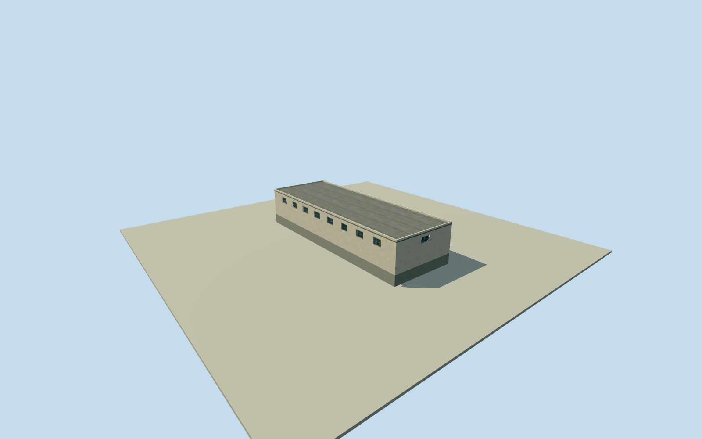

# Litoral Pavilion 6 north block

Whole independently placed north roofed block inside Pavilion 6 of the Litoral Penitentiary. All four full-precision numerical roof controls, complete walls and closed roof. The pavilion compound includes yards and multiple other buildings; those are not filled or substituted by this block. All imagery unused. Qualla-first corpus contains only an unrelated architectural-reference portrait. Structured Overture / Google building coordinates and numerical height samples establish this roofed body; original SNAI 2023 written repair record establishes Pavilion 6/7 context and exterior doors/windows/canopies/roof waterproofing. Exact height is a learned estimate, not survey: median 4 m, at least 3 m uncertainty. Floor census, facade, roof section, paint, small detail and precise 2023 condition are estimates. No photograph, satellite image, map image, plan, figure or texture fetched or viewed. Whole original Overture GERS 233589aa-12fe-4f99-bd67-42d4ad3affb2 / Google record 6792W3W4+V926 numerical roof footprint, within original named Pavilion 6 compound. Source footprint is an automated estimate, not survey; 3 m horizontal uncertainty. Numerical 2023 relative height median 4 m, 3 m uncertainty. Compound is contextual and is not roofed over. Whole original four-corner roofed block, all exterior walls, closed flat roof and full foundation. Numerical relative roof height is 4 m (median of 7 selected source samples); height uncertainty at least 3 m and no surveyed floor census. Only 7 of 17 inside-roof samples exceed the .7 presence threshold; this sparse estimate is not a precise height measurement. Source height data has effective 4 m resolution, although distributed at 0.5 m; samples are spaced 4 m. Source confidence is a relative score, not a probability. The original SNAI 2023 written report records repairs to Pavilion 6/7 doors, windows, canopies, roof waterproofing and paint. It does not specify these individual blocks, facade layout, color, material, floor count or roof section. This model uses estimated plain light rendered walls, flat waterproofed roof, shallow parapet, simple closed entrance/canopy and high barred window recesses. No internal rooms, inmates or security systems modeled. Exact exterior details and current condition are unverified, with 2 m component uncertainty. Original own 256 m field, 129 x 129 / 16641 heights, 2 raw terrain tiles and datum 9.1312 m fixed before floor .25 m, foundation -1.2 m, wall eave 4.13 m and closed main roof 4.25 m. A .22 m parapet is an estimated small detail. No field/frame/floor/main section masking, flattening, replacement or refitting. Datum/grade/contact approximate; foundation is an estimated closing extension. All four LODs retain every original corner, whole walls/roof/base, closed entrance and window census. Far levels use flat window cues; near levels use shallow physical recesses/backings, frames and sparse bars. Bar/frame spacing and hidden wall finish are original conservative estimates, not photographic/surveyed reconstruction. Every photograph, satellite image, map image, figure, plan and photographic texture unused. Qualla-first corpus contained only a portrait; no architectural imagery adopted. Overture/Google numerical footprint and numerical height data credited under ODbL; no dataset photograph or source pixels used for appearance. Approximate 2023-12-31 historical preview, current-world eligible false. Contemporary/2023 continuity, numerical detection boundaries and precise body use remain approximate. Adjacent blocks, open yards, full Pavilion 6 and whole Litoral prison remain separate and unfinished; no courtyard filled as a roof.

Authoring state: **review-in-qa.json**. Current completion evidence is in [qa.json](qa.json) and the [completion ledger](../../../../qualla-structures/batches/qualla-002.PROGRESS.md).

- [Litoral Penitentiary](https://qualla.com/litoral-penitentiary/)

Whole independently placed north roofed block inside Pavilion 6 of the Litoral Penitentiary. All four full-precision numerical roof controls, complete walls and closed roof. The pavilion compound includes yards and multiple other buildings; those are not filled or substituted by this block. All imagery unused. Qualla-first corpus contains only an unrelated architectural-reference portrait. Structured Overture / Google building coordinates and numerical height samples establish this roofed body; original SNAI 2023 written repair record establishes Pavilion 6/7 context and exterior doors/windows/canopies/roof waterproofing. Exact height is a learned estimate, not survey: median 4 m, at least 3 m uncertainty. Floor census, facade, roof section, paint, small detail and precise 2023 condition are estimates. No photograph, satellite image, map image, plan, figure or texture fetched or viewed.

Whole original Overture GERS 233589aa-12fe-4f99-bd67-42d4ad3affb2 / Google record 6792W3W4+V926 numerical roof footprint, within original named Pavilion 6 compound. Source footprint is an automated estimate, not survey; 3 m horizontal uncertainty. Numerical 2023 relative height median 4 m, 3 m uncertainty. Compound is contextual and is not roofed over.

Whole original four-corner roofed block, all exterior walls, closed flat roof and full foundation. Numerical relative roof height is 4 m (median of 7 selected source samples); height uncertainty at least 3 m and no surveyed floor census. Only 7 of 17 inside-roof samples exceed the .7 presence threshold; this sparse estimate is not a precise height measurement. Source height data has effective 4 m resolution, although distributed at 0.5 m; samples are spaced 4 m. Source confidence is a relative score, not a probability.

The original SNAI 2023 written report records repairs to Pavilion 6/7 doors, windows, canopies, roof waterproofing and paint. It does not specify these individual blocks, facade layout, color, material, floor count or roof section. This model uses estimated plain light rendered walls, flat waterproofed roof, shallow parapet, simple closed entrance/canopy and high barred window recesses. No internal rooms, inmates or security systems modeled. Exact exterior details and current condition are unverified, with 2 m component uncertainty.

Original own 256 m field, 129 x 129 / 16641 heights, 2 raw terrain tiles and datum 9.1312 m fixed before floor .25 m, foundation -1.2 m, wall eave 4.13 m and closed main roof 4.25 m. A .22 m parapet is an estimated small detail. No field/frame/floor/main section masking, flattening, replacement or refitting. Datum/grade/contact approximate; foundation is an estimated closing extension.

All four LODs retain every original corner, whole walls/roof/base, closed entrance and window census. Far levels use flat window cues; near levels use shallow physical recesses/backings, frames and sparse bars. Bar/frame spacing and hidden wall finish are original conservative estimates, not photographic/surveyed reconstruction.

Every photograph, satellite image, map image, figure, plan and photographic texture unused. Qualla-first corpus contained only a portrait; no architectural imagery adopted. Overture/Google numerical footprint and numerical height data credited under ODbL; no dataset photograph or source pixels used for appearance.

Approximate 2023-12-31 historical preview, current-world eligible false. Contemporary/2023 continuity, numerical detection boundaries and precise body use remain approximate. Adjacent blocks, open yards, full Pavilion 6 and whole Litoral prison remain separate and unfinished; no courtyard filled as a roof.

Build: `node content/worldgen/source/places/6p/6px/litoral_pavilion_6_north_block/models/generate-house.mjs`. Add `--check` to verify exact regeneration. 2492 triangles; 6 materials; no embedded photographs.
