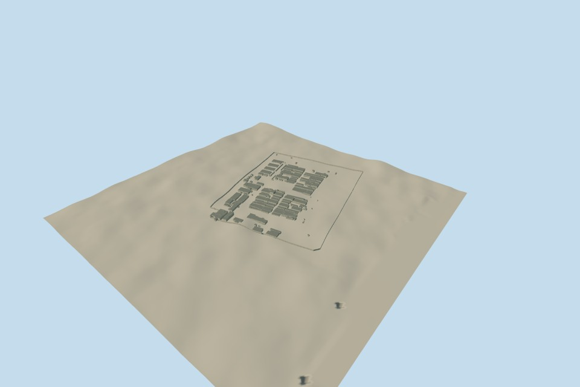

# Litoral Penitentiary

Approximate 2023 ensemble of 176 independently reviewed geographic component models, covering the twelve pavilion settings, intrinsic service/perimeter structures and separate roof bodies. Every retained local numerical source envelope is accounted for, with open compound yards preserved. Each asset retains its own source frame, heading, datum, four detail levels and existing approval. This is complete approximate source coverage, not a measured census or a claim that every inferred body is historically confirmed.

Three later Microsoft ML Buildings outlines are represented with explicitly estimated closed exteriors. The complete original WKB shapes are retained: one 16-corner south-central body and two four-corner central/eastern bodies. Their 5.5 m above-floor roof heights, wall/roof materials, openings and details are original visualization estimates with 5 m height and 15 m horizontal allowances. Native height, confidence, source-image date, physical presence and exact 2023 continuity are unverified. The lack of qualified earlier numerical height/presence observations is not absence proof. Overture republishes Microsoft and does not independently verify its predictions.

All original Google/OSM roof observations are represented or explicitly classified. Alternate overlapping source outlines remain source differences, without invented duplicate buildings. The overlapping WR8H/WR5R pair forms one united roof, with shared area represented once. One separate 270.96 m² automatic outline is 98.5% outside the generalized prison ring and overlaps its edge by only 4.057 m²; that edge is retained as external source context, rather than invented as a tiny prison room. This numerical scope classification does not establish legal ownership or prove absence.

Every source photograph, satellite pixel, map illustration, plan and figure is unused. The published Qualla corpus was screened first; its single unrelated portrait was excluded from architectural use. Original numerical data retain their provider, license and exact control hashes. Historical body identity, height, facade, roof, condition and source-date uncertainties remain documented per model.

The original 1024 m perimeter terrain field, collection frame and previously accepted model fields/floors/sections/poses remain unchanged. The collection field was reused before assembly transforms; it did not predate every individual model. Coarse source grade can partly bury or expose foundations, wall edges and lower walls, with faint perimeter edges in the north-up view. No masks, flattening, artificial plinth, fitted heights or relocation were applied. Absolute live-host registration remains unverified and dated model previews remain disabled for current-world replacement.

Two current 176-component group views were personally inspected. The earlier 173 individual approvals were preserved without new individual renders, geometry rays or geometry changes. Three new component models received their own current views, original fields, four-LOD and geometry checks, and same-pass story annotations. There is no aggregate GLB or duplicate collection placement.

[Qualla story](https://qualla.com/litoral-penitentiary/)

Regenerate the assembly with `node content/worldgen/source/places/6p/6px/litoral_penitentiary/generate-collection-scene.mjs`; add `--check` to verify saved outputs.
