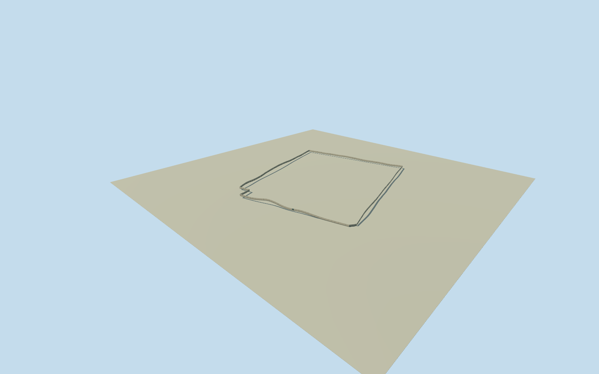

# Litoral perimeter wall

Original OSM way46012320, explicitly named Penitenciaría del Litoral and tagged barrier=wall/amenity=prison. Eight original wall-path controls retained, not a roof or a courtyard cap. Horizontal uncertainty5m; height, thickness, condition and precise2023 continuity estimated. Whole separately mapped Litoral exterior perimeter wall: every original OSM way control, complete wall around an open interior and one nearby mapped gate represented closed. No compound yard, roof, pavilion building, nearby separate prison or whole-prison proxy is filled in. Qualla-first reference inventory contains no cleared architectural image for this wall; every photograph and source image unused. Original OSM way46012320 explicitly carries amenity=prison, barrier=wall, name Penitenciaría del Litoral and Wikidata Q108830348. Its current numerical outline is not a survey or proof of end-2023 continuity. Original node11224443220 is a mapped gate 1.202m from the wall centerline, projected onto edge4 under5m horizontal uncertainty; exact opening census and gate dimensions remain unverified. Wall height/thickness/finish, coping, piers and gate width/height are estimates. Keep the complete original path; choose an independent source field before any floor or main wall sections. Whole original closed mapped perimeter wall only, every original eight controls retained at all four LODs. Interior remains open; no giant ground/roof polygon, no separate nearby prison, no courtyard or building substituted by the wall. Wall height4.5m, thickness.4m, floor offset.25m, foundation depth1.2m, coping.15m and plain pale rendered finish are author estimates, not measurements. Height uncertainty at least3m, component uncertainty2m, horizontal uncertainty5m. One original mapped gate1.202m from the line is projected onto its recorded edge under that uncertainty;6m gate width and4.5m height estimated. Unknown gates/opening census, towers, equipment and security systems are not invented. Own original1024m field,129x129/16641 source heights/8m review step, frozen before wall floor/profile/main sections. Grade-following base profiles are chosen from that field before authoring; all sections and all four LOD profiles are frozen here. The source DEM is coarse and has no surveyed vertical tie. Exact threshold, local grade, contact and historical ground condition remain unverified. No terrain masking, flattening, replacement or later frame/floor/section refit. Four LODs retain the whole closed wall and original corners plus the one closed gate. Grade-profile sample spacings80/40/20/10m reduce in the distance; their actual deviation against the authored near profile is bound to runtime error budgets. Near levels add estimated sparse square piers; no observed pier census is claimed. Original numerical OSM map records used under ODbL; all imagery unused after Qualla-first inventory. Current source is not proof of2023 continuity; approximate2023-12-31 historical preview, current-world eligible false. Whole Litoral site remains unfinished.

Authoring state: **review-in-qa.json**. Current completion evidence is in [qa.json](qa.json) and the [completion ledger](../../../../qualla-structures/batches/qualla-002.PROGRESS.md).

- [Litoral Penitentiary](https://qualla.com/litoral-penitentiary/)

Original OSM way46012320, explicitly named Penitenciaría del Litoral and tagged barrier=wall/amenity=prison. Eight original wall-path controls retained, not a roof or a courtyard cap. Horizontal uncertainty5m; height, thickness, condition and precise2023 continuity estimated.

Whole separately mapped Litoral exterior perimeter wall: every original OSM way control, complete wall around an open interior and one nearby mapped gate represented closed. No compound yard, roof, pavilion building, nearby separate prison or whole-prison proxy is filled in. Qualla-first reference inventory contains no cleared architectural image for this wall; every photograph and source image unused. Original OSM way46012320 explicitly carries amenity=prison, barrier=wall, name Penitenciaría del Litoral and Wikidata Q108830348. Its current numerical outline is not a survey or proof of end-2023 continuity. Original node11224443220 is a mapped gate 1.202m from the wall centerline, projected onto edge4 under5m horizontal uncertainty; exact opening census and gate dimensions remain unverified. Wall height/thickness/finish, coping, piers and gate width/height are estimates. Keep the complete original path; choose an independent source field before any floor or main wall sections.

Whole original closed mapped perimeter wall only, every original eight controls retained at all four LODs. Interior remains open; no giant ground/roof polygon, no separate nearby prison, no courtyard or building substituted by the wall.

Wall height4.5m, thickness.4m, floor offset.25m, foundation depth1.2m, coping.15m and plain pale rendered finish are author estimates, not measurements. Height uncertainty at least3m, component uncertainty2m, horizontal uncertainty5m. One original mapped gate1.202m from the line is projected onto its recorded edge under that uncertainty;6m gate width and4.5m height estimated. Unknown gates/opening census, towers, equipment and security systems are not invented.

Own original1024m field,129x129/16641 source heights/8m review step, frozen before wall floor/profile/main sections. Grade-following base profiles are chosen from that field before authoring; all sections and all four LOD profiles are frozen here. The source DEM is coarse and has no surveyed vertical tie. Exact threshold, local grade, contact and historical ground condition remain unverified. No terrain masking, flattening, replacement or later frame/floor/section refit.

Four LODs retain the whole closed wall and original corners plus the one closed gate. Grade-profile sample spacings80/40/20/10m reduce in the distance; their actual deviation against the authored near profile is bound to runtime error budgets. Near levels add estimated sparse square piers; no observed pier census is claimed.

Original numerical OSM map records used under ODbL; all imagery unused after Qualla-first inventory. Current source is not proof of2023 continuity; approximate2023-12-31 historical preview, current-world eligible false. Whole Litoral site remains unfinished.

Build: `node content/worldgen/source/places/6p/6px/litoral_perimeter_wall/models/generate-house.mjs`. Add `--check` to verify exact regeneration. 8868 triangles; 4 materials; no embedded photographs.
