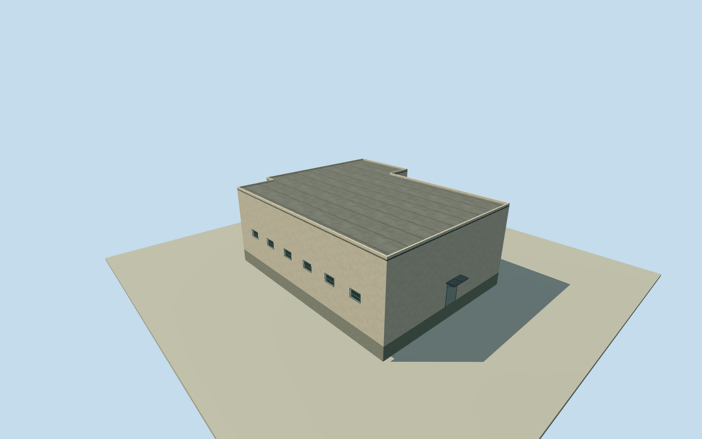

# Litoral south block 01

Whole separately mapped south roofed block inside the original named Litoral Penitentiary perimeter, outside the twelve named pavilion compounds. All original full-precision numerical roof controls, complete walls and closed roof retained. Specific building function is unverified; open yards and other roofs remain separate. All imagery unused after Qualla-first inventory. Original Google v3 CSV/WKT footprint meets official tile90390-percent precision threshold.870, a ranking threshold and not per-building probability or survey. Original2023 relative-height median 7.5m from 17 selected samples; at least3m height uncertainty. Retain5m horizontal and2m component uncertainty. Original OSM way46012320 is explicitly named Penitenciaría del Litoral/barrierwall/amenityprison; every roof corner lies inside that original numerical perimeter. Current site mapping does not establish exact2023 continuity. Actual function, facade/opening census, finish, flat roof section, small details and condition are estimates. Low roofs receive estimated opening/canopy heights that stay below their chosen eave. No source image fetched or viewed. Whole original Google Open Buildings v3 google-open-buildings:6792W3W4+92J6 / original CSV record 6792W3W4+92J6 numerical roof footprint, inside original named Litoral prison perimeter. Source footprint is an automated estimate, not survey; 5 m horizontal uncertainty. Numerical 2023 relative height median 7.5 m, 3 m uncertainty. Compound is contextual and is not roofed over. Whole original numerical roof, every source corner, complete exterior walls, closed flat roof, foundation and one estimated closed entry/canopy. Relative-height median 7.5m from 17 selected of 29 inside-roof samples at effective4m resolution. This is a learned estimate, not survey; retain3m height uncertainty and5m horizontal uncertainty. Original OSM numerical named prison perimeter establishes site context; building function outside pavilion compounds is unverified. Exact facade, openings/floor census, finish, roof section and2023 continuity are estimates with2m component uncertainty. All imagery unused after Qualla-first inventory; original Google/OSM numerical data credited ODbL. Own original256m/129x129/16641-value field and 2 raw tiles fixed before floor.25m/foundation-1.2m/eave 7.63m/roof 7.75m. No field masking, flattening, replacement or floor/main-section refit. Precise grade/contact and vertical tie unverified. All four LODs retain every original corner, whole walls/roof/base, estimated window census and closed entry. Near levels use physical recesses and sparse bars; low-roof openings/canopy are proportionally reduced below the chosen eave. Sparse details are author estimates, not an observed architectural census. Approximate2023-12-31 historical preview/current-world eligible false. Open yards, other site bodies and whole prison remain unfinished; no yard roof or parent proxy.

Authoring state: **review-in-qa.json**. Current completion evidence is in [qa.json](qa.json) and the [completion ledger](../../../../qualla-structures/batches/qualla-002.PROGRESS.md).

- [Litoral Penitentiary](https://qualla.com/litoral-penitentiary/)

Whole separately mapped south roofed block inside the original named Litoral Penitentiary perimeter, outside the twelve named pavilion compounds. All original full-precision numerical roof controls, complete walls and closed roof retained. Specific building function is unverified; open yards and other roofs remain separate. All imagery unused after Qualla-first inventory. Original Google v3 CSV/WKT footprint meets official tile90390-percent precision threshold.870, a ranking threshold and not per-building probability or survey. Original2023 relative-height median 7.5m from 17 selected samples; at least3m height uncertainty. Retain5m horizontal and2m component uncertainty. Original OSM way46012320 is explicitly named Penitenciaría del Litoral/barrierwall/amenityprison; every roof corner lies inside that original numerical perimeter. Current site mapping does not establish exact2023 continuity. Actual function, facade/opening census, finish, flat roof section, small details and condition are estimates. Low roofs receive estimated opening/canopy heights that stay below their chosen eave. No source image fetched or viewed.

Whole original Google Open Buildings v3 google-open-buildings:6792W3W4+92J6 / original CSV record 6792W3W4+92J6 numerical roof footprint, inside original named Litoral prison perimeter. Source footprint is an automated estimate, not survey; 5 m horizontal uncertainty. Numerical 2023 relative height median 7.5 m, 3 m uncertainty. Compound is contextual and is not roofed over.

Whole original numerical roof, every source corner, complete exterior walls, closed flat roof, foundation and one estimated closed entry/canopy. Relative-height median 7.5m from 17 selected of 29 inside-roof samples at effective4m resolution. This is a learned estimate, not survey; retain3m height uncertainty and5m horizontal uncertainty.

Original OSM numerical named prison perimeter establishes site context; building function outside pavilion compounds is unverified. Exact facade, openings/floor census, finish, roof section and2023 continuity are estimates with2m component uncertainty. All imagery unused after Qualla-first inventory; original Google/OSM numerical data credited ODbL.

Own original256m/129x129/16641-value field and 2 raw tiles fixed before floor.25m/foundation-1.2m/eave 7.63m/roof 7.75m. No field masking, flattening, replacement or floor/main-section refit. Precise grade/contact and vertical tie unverified.

All four LODs retain every original corner, whole walls/roof/base, estimated window census and closed entry. Near levels use physical recesses and sparse bars; low-roof openings/canopy are proportionally reduced below the chosen eave. Sparse details are author estimates, not an observed architectural census.

Approximate2023-12-31 historical preview/current-world eligible false. Open yards, other site bodies and whole prison remain unfinished; no yard roof or parent proxy.

Build: `node content/worldgen/source/places/6p/6px/litoral_south_block_01/models/generate-house.mjs`. Add `--check` to verify exact regeneration. 1768 triangles; 6 materials; no embedded photographs.
