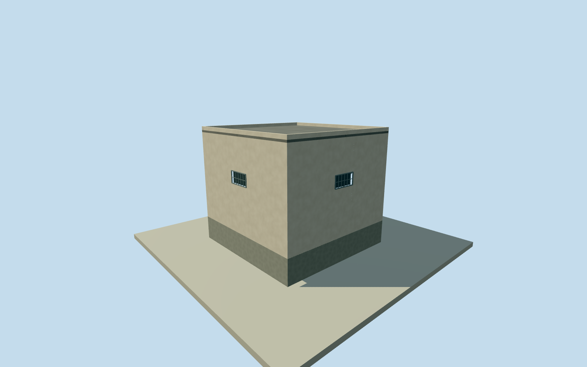

# Litoral southeast small building

Whole independent four-corner small building in southeastern Litoral site, inside original named prison46012320. Every original Overture WKB corner retained; adjacent bodies/open yards remain separate. Microsoft ML Buildings numeric geometry republished by Overture2026-10-21, ODbL-1.0; original source height, confidence, image date, floor count and exact function absent. Google detection thresholds do not apply. Overture is not independent confirmation of its provider. Original nominal height/detail/roof estimates will be recorded explicitly,15m horizontal/5m height/3m component allowances are not measured bounds. Historical2023continuity is unverified. Qualla-first single unrelated portrait and all other appearance images unused. Whole original WKB four-corner body preserved, with closed walls/flat roof/parapet/foundation. Floor0.25m, foundation-1.2m, eave5.63m, roof5.75m, parapet5.97m;5.5m above-floor height is an original visualization estimate, not a measured or whole-body learned height. All facade/roof/color/window/door/canopy/floor census/body use and2023condition are explicit estimates. Microsoft ML Buildings republished by Overture2026-10-21, source version2026-08-11, ODbL-1.0. Exact original WKB coordinate values retained; source-record native height, source image date and confidence absent. No Google score or tile-precision threshold assigned. Original2021single learned5.5m point remains a sparse lead, not proof of whole2023height or continuity. The native record sourceDatasetHash labels the retained full-record extraction JSON hash, not the remote complete GeoParquet partition bytes. Actual adopted single full record and its WKB are preserved in required source files and bound by SHA256. 15m horizontal/5m height/3m component/30degree facing allowances are original modeling estimates, not survey error bounds. No claim of measured roof pitch, floor count or historical ground contact. Own original256m129x129 source field and two raw tiles acquired before floor/mainsections. Original field/frame/floor/mainsections frozen without masks, flattening, cutout, fitting or relocation. Coarse host grade and exact vertical tie remain unsurveyed. Four levels retain whole body/roof/foundation and estimated one closed entry/three high barred windows. Near levels refine shallow physical opening recesses, frames/bars/canopy supports. Every image/plan/figure/art/photographic texture unused; Qualla first portrait unrelated architecture. Whole prison remains unfinished; no yard or compound roof.

Authoring state: **review-in-qa.json**. Current completion evidence is in [qa.json](qa.json) and the [completion ledger](../../../../qualla-structures/batches/qualla-002.PROGRESS.md).

- [Litoral Penitentiary](https://qualla.com/litoral-penitentiary/)

Whole independent four-corner small building in southeastern Litoral site, inside original named prison46012320. Every original Overture WKB corner retained; adjacent bodies/open yards remain separate. Microsoft ML Buildings numeric geometry republished by Overture2026-10-21, ODbL-1.0; original source height, confidence, image date, floor count and exact function absent. Google detection thresholds do not apply. Overture is not independent confirmation of its provider. Original nominal height/detail/roof estimates will be recorded explicitly,15m horizontal/5m height/3m component allowances are not measured bounds. Historical2023continuity is unverified. Qualla-first single unrelated portrait and all other appearance images unused.

Whole original WKB four-corner body preserved, with closed walls/flat roof/parapet/foundation. Floor0.25m, foundation-1.2m, eave5.63m, roof5.75m, parapet5.97m;5.5m above-floor height is an original visualization estimate, not a measured or whole-body learned height. All facade/roof/color/window/door/canopy/floor census/body use and2023condition are explicit estimates.

Microsoft ML Buildings republished by Overture2026-10-21, source version2026-08-11, ODbL-1.0. Exact original WKB coordinate values retained; source-record native height, source image date and confidence absent. No Google score or tile-precision threshold assigned. Original2021single learned5.5m point remains a sparse lead, not proof of whole2023height or continuity.

The native record sourceDatasetHash labels the retained full-record extraction JSON hash, not the remote complete GeoParquet partition bytes. Actual adopted single full record and its WKB are preserved in required source files and bound by SHA256.

15m horizontal/5m height/3m component/30degree facing allowances are original modeling estimates, not survey error bounds. No claim of measured roof pitch, floor count or historical ground contact.

Own original256m129x129 source field and two raw tiles acquired before floor/mainsections. Original field/frame/floor/mainsections frozen without masks, flattening, cutout, fitting or relocation. Coarse host grade and exact vertical tie remain unsurveyed.

Four levels retain whole body/roof/foundation and estimated one closed entry/three high barred windows. Near levels refine shallow physical opening recesses, frames/bars/canopy supports. Every image/plan/figure/art/photographic texture unused; Qualla first portrait unrelated architecture. Whole prison remains unfinished; no yard or compound roof.

Build: `node content/worldgen/source/places/6p/6px/litoral_southeast_small_building/models/generate-house.mjs`. Add `--check` to verify exact regeneration. 588 triangles; 6 materials; no embedded photographs.
