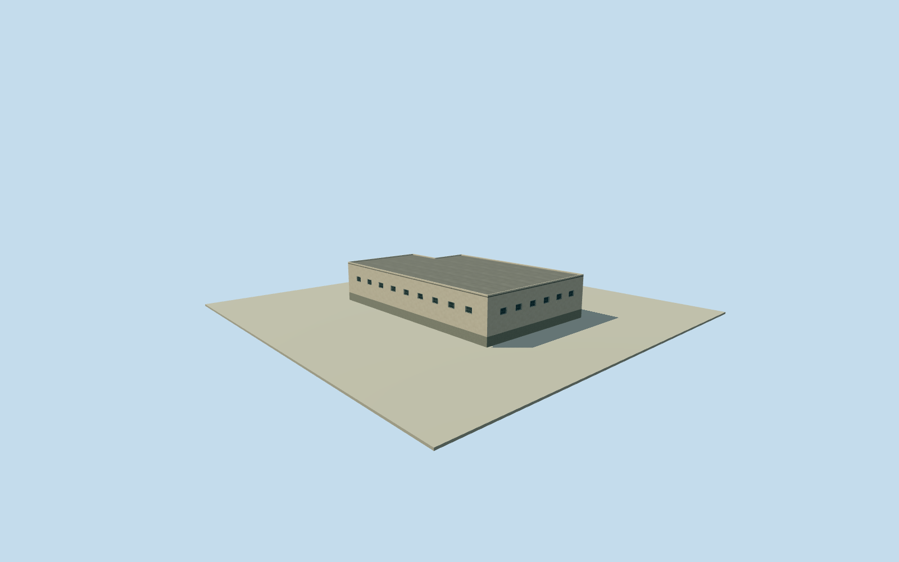

# Litoral southeastern boundary building

Complete original numerical small roof body or its whole uncovered sections: 6792W3W4+FPVP predominantly inside the generalized named Litoral setting and crossing its southern boundary, preserving all 6derived outline corners and every source remainder. Where source overlap exists, accepted bodies cover the bound subtracted areas and remain unchanged. Sources with no overlap retain their entire roof outline. Exact building/room function, physical join, boundary alignment and2023condition unverified; this asset is not a whole-prison or independent-building proxy. Original full-precision Google WKT and exact polygon-set difference retained, source confidence0.7950 is a model rank, not an accuracy probability. Existing source masks exclude perimeter/site rings; no roof is made from a yard boundary. Own original field must precede floor/mainsections. All images unused, Qualla first single unrelated portrait. Original source inside fraction 0.9830666365039524; full original roof retained without perimeter clipping. Native wall/perimeter is not a surveyed roof boundary or institutional ownership census. Physical site membership, plan/height/finish/floor census/interface/grade and historical2023continuity remain estimates. Complete original roof retained across generalized named-site boundary; inside fraction0.9830666365039524. Exact source outline, physical site membership, institutional ownership, historic continuity and native boundary alignment remain estimates. The site polygon is never a roof clipping mask. Every complete exact original source-set difference piece retained, 6corners with areas727.8092m². Original full Google polygon and bound accepted roof masks preserved. These are intrinsic adjoining roof sections; no standalone independent new-building identity claimed. Initial local floor0.25m plinth selected after own original field and before geometry. Absolute floor10.1334m. No bound accepted neighbor exists, so no interface floor or surveyed datum transfer is claimed; this is an original visualization estimate. Numerical2023qualified outside-section source samples per piece 20; medians5.5m. Available relative heights are learned estimates; sections with no qualified source samples use explicit original3.5m above-floor modeling height, not an observation, floor census or survey. Initial roof/sections derive from these nominal heights;3m height/component and10m horizontal allowances, or5m height for sparse/absent sections, are modeling allowances, not measured error bounds. Original source confidence0.7950 is an automated rank, not a probability or proof of each small boundary strip. All full-source/mask boundaries and exact2023continuity remain approximate. All current complete source difference pieces exceed10m² and are complete closed volumes. Sparse numerical height samples retain5m modeling allowances; they do not prove precise roof levels or floor census. Facade/window/entry/canopy/roof material/color/section profiles, compartment use and precise2023condition are conservative original estimates. Patches meet accepted bodies with unmeasured interfaces; no repair to or duplicate of existing model bodies. No interiors or source-photo texture. Own original256m129x129 source field/raw tile acquired before floors/mainsections. Source field/frame/initial floors/sections frozen without masks, flattening, cutout, fitting or relocation. Coarse contact and exact historic grade/vertical tie remain unsurveyed. All images, plans, figures, artwork and source pixels unused. Qualla-first single unrelated portrait excluded. Four complete authored levels retain all intrinsic pieces and major outline/roof/entry/opening census; near levels refine opening recesses and bars. Whole prison remains unfinished.

Authoring state: **review-in-qa.json**. Current completion evidence is in [qa.json](qa.json) and the [completion ledger](../../../../qualla-structures/batches/qualla-002.PROGRESS.md).

- [Litoral Penitentiary](https://qualla.com/litoral-penitentiary/)

Complete original numerical small roof body or its whole uncovered sections: 6792W3W4+FPVP predominantly inside the generalized named Litoral setting and crossing its southern boundary, preserving all 6derived outline corners and every source remainder. Where source overlap exists, accepted bodies cover the bound subtracted areas and remain unchanged. Sources with no overlap retain their entire roof outline. Exact building/room function, physical join, boundary alignment and2023condition unverified; this asset is not a whole-prison or independent-building proxy. Original full-precision Google WKT and exact polygon-set difference retained, source confidence0.7950 is a model rank, not an accuracy probability. Existing source masks exclude perimeter/site rings; no roof is made from a yard boundary. Own original field must precede floor/mainsections. All images unused, Qualla first single unrelated portrait. Original source inside fraction 0.9830666365039524; full original roof retained without perimeter clipping. Native wall/perimeter is not a surveyed roof boundary or institutional ownership census. Physical site membership, plan/height/finish/floor census/interface/grade and historical2023continuity remain estimates.

Complete original roof retained across generalized named-site boundary; inside fraction0.9830666365039524. Exact source outline, physical site membership, institutional ownership, historic continuity and native boundary alignment remain estimates. The site polygon is never a roof clipping mask.

Every complete exact original source-set difference piece retained, 6corners with areas727.8092m². Original full Google polygon and bound accepted roof masks preserved. These are intrinsic adjoining roof sections; no standalone independent new-building identity claimed.

Initial local floor0.25m plinth selected after own original field and before geometry. Absolute floor10.1334m. No bound accepted neighbor exists, so no interface floor or surveyed datum transfer is claimed; this is an original visualization estimate.

Numerical2023qualified outside-section source samples per piece 20; medians5.5m. Available relative heights are learned estimates; sections with no qualified source samples use explicit original3.5m above-floor modeling height, not an observation, floor census or survey. Initial roof/sections derive from these nominal heights;3m height/component and10m horizontal allowances, or5m height for sparse/absent sections, are modeling allowances, not measured error bounds.

Original source confidence0.7950 is an automated rank, not a probability or proof of each small boundary strip. All full-source/mask boundaries and exact2023continuity remain approximate.

All current complete source difference pieces exceed10m² and are complete closed volumes. Sparse numerical height samples retain5m modeling allowances; they do not prove precise roof levels or floor census.

Facade/window/entry/canopy/roof material/color/section profiles, compartment use and precise2023condition are conservative original estimates. Patches meet accepted bodies with unmeasured interfaces; no repair to or duplicate of existing model bodies. No interiors or source-photo texture.

Own original256m129x129 source field/raw tile acquired before floors/mainsections. Source field/frame/initial floors/sections frozen without masks, flattening, cutout, fitting or relocation. Coarse contact and exact historic grade/vertical tie remain unsurveyed.

All images, plans, figures, artwork and source pixels unused. Qualla-first single unrelated portrait excluded. Four complete authored levels retain all intrinsic pieces and major outline/roof/entry/opening census; near levels refine opening recesses and bars. Whole prison remains unfinished.

Build: `node content/worldgen/source/places/6p/6px/litoral_southeastern_boundary_building/models/generate-house.mjs`. Add `--check` to verify exact regeneration. 3490 triangles; 6 materials; no embedded photographs.
