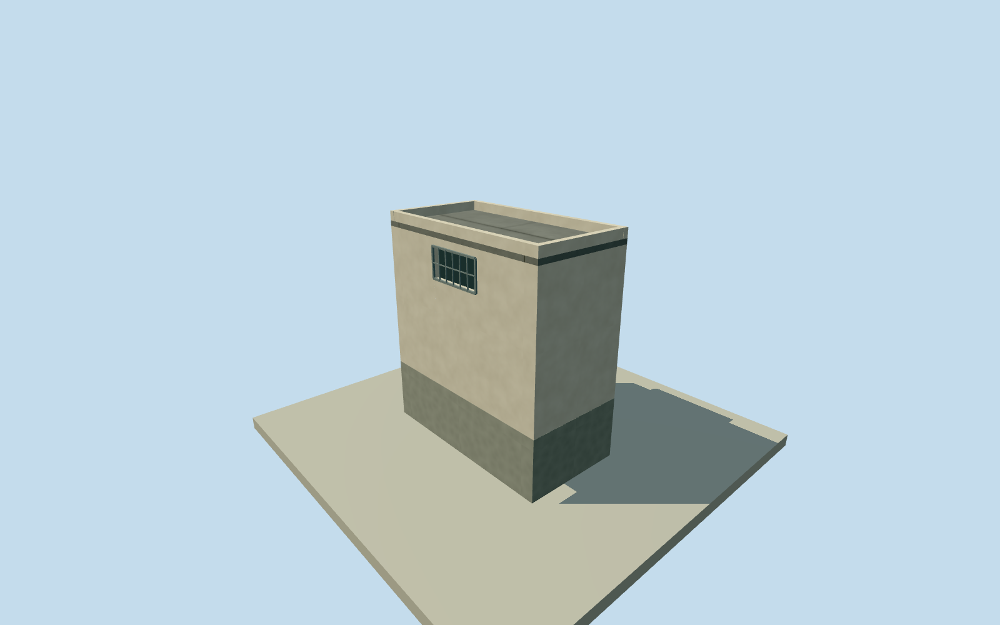

# Litoral southeastern inner low annex

Complete original numerical small roof body or its whole uncovered sections: 6792W3W4+VV2Q inside the named Litoral setting, preserving all 4derived outline corners and every source remainder. Where source overlap exists, accepted bodies cover the bound subtracted areas and remain unchanged. Sources with no overlap retain their entire roof outline. Exact building/room function, physical join, boundary alignment and2023condition unverified; this asset is not a whole-prison or independent-building proxy. Original full-precision Google WKT and exact polygon-set difference retained, source confidence0.6881 is a model rank, not an accuracy probability. Existing source masks exclude perimeter/site rings; no roof is made from a yard boundary. Own original field must precede floor/mainsections. All images unused, Qualla first single unrelated portrait. Source footprint score0.6881 is below0.780tile ranking threshold; no tile80%-precision or per-building probability claim. Retain15m original horizontal modeling allowance, not measured error bound. Full source shapes lie predominantly within the generalized named prison perimeter. The southwest boundary body crosses that approximate line: full original building retained, not clipped to a yard/perimeter; exact ownership and physical boundary membership remain estimates. No qualified original2023numeric relative height observation exists. Nominal3.5m above-floor height will be an original modeling estimate with5m allowance, not an observation or verified2023presence. Plan/height/finish/floor census/interface/grade and2023continuity remain estimates. Original footprint score0.6881 is below0.780tile ranking threshold. No tile80%-precision or per-building probability is claimed. Retain15m nominal horizontal modeling allowance, not measured error bound. Named-site relation and exact roof outline remain estimates; one southwest boundary source is69.96percent inside the generalized perimeter and is retained as a whole building. Its exact ownership/membership is not surveyed; no source roof is clipped to the perimeter.  No qualified original2023relative height observation exists. Initial3.5m above-floor heights are original modeling estimates with5m allowances, not source measurements or verified2023presence. Every complete exact original source-set difference piece retained, 4corners with areas11.3909m². Original full Google polygon and bound accepted roof masks preserved. These are intrinsic adjoining roof sections; no standalone independent new-building identity claimed. Initial local floor0.25m plinth selected after own original field and before geometry. Absolute floor12.25m. No accepted neighbor overlaps at least1percent of this source footprint, so no interface floor or surveyed datum transfer is claimed; this is an original visualization estimate. Numerical2023qualified outside-section source samples per piece 0; mediansabsentm. Available relative heights are learned estimates; These complete sections have no qualified samples and use an explicit original3.5m modeling estimate; roof-only joins instead follow their bound accepted roof and have no nominal room height. No floor census or survey is claimed. Initial roof/sections derive from these nominal heights;3m height/component and15m horizontal allowances, or5m height for sparse/absent sections, are modeling allowances, not measured error bounds. Original source confidence0.6881 is an automated rank, not a probability or proof of each small boundary strip. All full-source/mask boundaries and exact2023continuity remain approximate. Complete source parts at least10m² retain closed-volume walls/roofs/foundations; a smaller triangular source remnant is only a0.12m closed roof join tied to the bound accepted roof, without an invented wall/room/floor. No source height or floor census is available. Original3.5m full-volume modeling heights retain5m allowances; they do not prove precise roof levels or floor census. Facade/window/entry/canopy/roof material/color/section profiles, compartment use and precise2023condition are conservative original estimates. Patches meet accepted bodies with unmeasured interfaces; no repair to or duplicate of existing model bodies. No interiors or source-photo texture. Own original256m129x129 source field/raw tile acquired before floors/mainsections. Source field/frame/initial floors/sections frozen without masks, flattening, cutout, fitting or relocation. Coarse contact and exact historic grade/vertical tie remain unsurveyed. All images, plans, figures, artwork and source pixels unused. Qualla-first single unrelated portrait excluded. Four complete authored levels retain all intrinsic pieces and major outline/roof/entry/opening census; near levels refine opening recesses and bars. Whole prison remains unfinished.

Authoring state: **review-in-qa.json**. Current completion evidence is in [qa.json](qa.json) and the [completion ledger](../../../../qualla-structures/batches/qualla-002.PROGRESS.md).

- [Litoral Penitentiary](https://qualla.com/litoral-penitentiary/)

Complete original numerical small roof body or its whole uncovered sections: 6792W3W4+VV2Q inside the named Litoral setting, preserving all 4derived outline corners and every source remainder. Where source overlap exists, accepted bodies cover the bound subtracted areas and remain unchanged. Sources with no overlap retain their entire roof outline. Exact building/room function, physical join, boundary alignment and2023condition unverified; this asset is not a whole-prison or independent-building proxy. Original full-precision Google WKT and exact polygon-set difference retained, source confidence0.6881 is a model rank, not an accuracy probability. Existing source masks exclude perimeter/site rings; no roof is made from a yard boundary. Own original field must precede floor/mainsections. All images unused, Qualla first single unrelated portrait. Source footprint score0.6881 is below0.780tile ranking threshold; no tile80%-precision or per-building probability claim. Retain15m original horizontal modeling allowance, not measured error bound. Full source shapes lie predominantly within the generalized named prison perimeter. The southwest boundary body crosses that approximate line: full original building retained, not clipped to a yard/perimeter; exact ownership and physical boundary membership remain estimates. No qualified original2023numeric relative height observation exists. Nominal3.5m above-floor height will be an original modeling estimate with5m allowance, not an observation or verified2023presence. Plan/height/finish/floor census/interface/grade and2023continuity remain estimates.

Original footprint score0.6881 is below0.780tile ranking threshold. No tile80%-precision or per-building probability is claimed. Retain15m nominal horizontal modeling allowance, not measured error bound. Named-site relation and exact roof outline remain estimates; one southwest boundary source is69.96percent inside the generalized perimeter and is retained as a whole building. Its exact ownership/membership is not surveyed; no source roof is clipped to the perimeter.  No qualified original2023relative height observation exists. Initial3.5m above-floor heights are original modeling estimates with5m allowances, not source measurements or verified2023presence.

Every complete exact original source-set difference piece retained, 4corners with areas11.3909m². Original full Google polygon and bound accepted roof masks preserved. These are intrinsic adjoining roof sections; no standalone independent new-building identity claimed.

Initial local floor0.25m plinth selected after own original field and before geometry. Absolute floor12.25m. No accepted neighbor overlaps at least1percent of this source footprint, so no interface floor or surveyed datum transfer is claimed; this is an original visualization estimate.

Numerical2023qualified outside-section source samples per piece 0; mediansabsentm. Available relative heights are learned estimates; These complete sections have no qualified samples and use an explicit original3.5m modeling estimate; roof-only joins instead follow their bound accepted roof and have no nominal room height. No floor census or survey is claimed. Initial roof/sections derive from these nominal heights;3m height/component and15m horizontal allowances, or5m height for sparse/absent sections, are modeling allowances, not measured error bounds.

Original source confidence0.6881 is an automated rank, not a probability or proof of each small boundary strip. All full-source/mask boundaries and exact2023continuity remain approximate.

Complete source parts at least10m² retain closed-volume walls/roofs/foundations; a smaller triangular source remnant is only a0.12m closed roof join tied to the bound accepted roof, without an invented wall/room/floor. No source height or floor census is available. Original3.5m full-volume modeling heights retain5m allowances; they do not prove precise roof levels or floor census.

Facade/window/entry/canopy/roof material/color/section profiles, compartment use and precise2023condition are conservative original estimates. Patches meet accepted bodies with unmeasured interfaces; no repair to or duplicate of existing model bodies. No interiors or source-photo texture.

Own original256m129x129 source field/raw tile acquired before floors/mainsections. Source field/frame/initial floors/sections frozen without masks, flattening, cutout, fitting or relocation. Coarse contact and exact historic grade/vertical tie remain unsurveyed.

All images, plans, figures, artwork and source pixels unused. Qualla-first single unrelated portrait excluded. Four complete authored levels retain all intrinsic pieces and major outline/roof/entry/opening census; near levels refine opening recesses and bars. Whole prison remains unfinished.

Build: `node content/worldgen/source/places/6p/6px/litoral_southeastern_inner_low_annex/models/generate-house.mjs`. Add `--check` to verify exact regeneration. 316 triangles; 6 materials; no embedded photographs.
