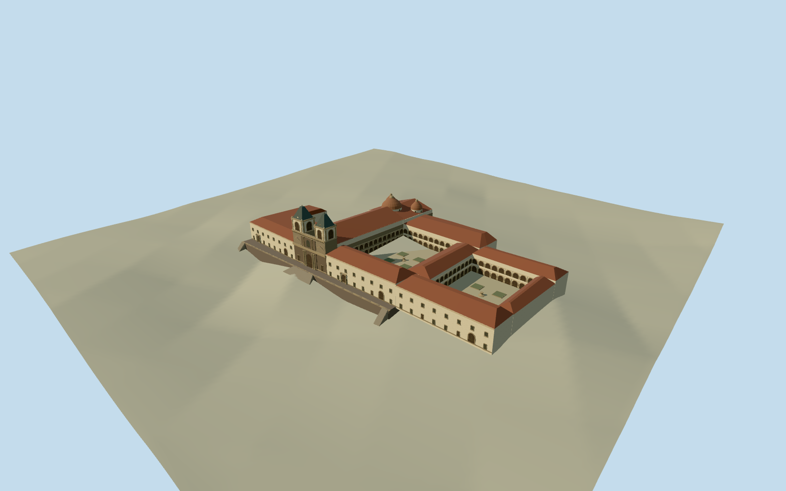

# Basilica and Convent of San Francisco, Quito

Quito’s San Francisco basilica with its carved plaza façade, paired campaniles, tiled roofs and the two connected convent courts.

Authoring state: **review-in-qa.json**. Current completion evidence is in [qa.json](qa.json) and the [completion ledger](../../../../qualla-structures/batches/qualla-004.PROGRESS.md).

- [Basilica and Convent of San Francisco, Quito](https://qualla.com/basilica-and-convent-of-san-francisco-quito/)

Draft exterior: approximate photographic proportions and simplified ornament. It is not a survey, photogrammetric reconstruction or approved current geographic replacement.

The 1909 photograph establishes the colonial facade and present tower proportions. The convent museum and national conservation files describe the two principal court galleries, tiled roof ranges and long raised atrium.

Terrain sampling/contact, geographic alignment and site activation remain pending. Runtime LODs are produced by the registered after-import pipeline and require visual review.

Reference photos remain in the local Qualla corpus; only provenance, paths and hashes are retained here.

Build: `node content/worldgen/source/places/6r/6rb/basilica_and_convent_of_san_francisco_quito/models/generate-basilica-and-convent-of-san-francisco-quito.mjs`. Add `--check` to verify exact regeneration. 29234 triangles; 8 materials; no embedded photographs.
