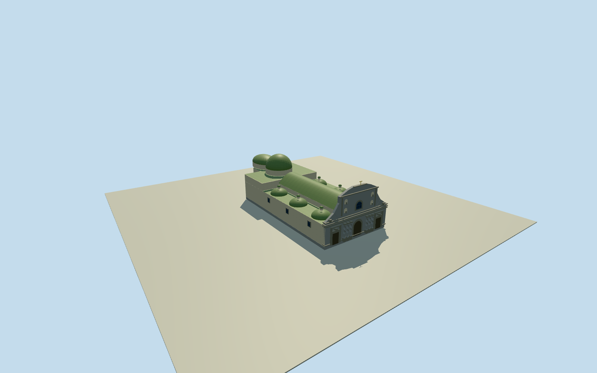

# La Compañía, Quito — complete church and six chapel domes

Complete nine-control physical church, main barrel vault, six chapel cupolas and lanterns, crossing drum/hemisphere, oblong presbytery vault and intrinsic rear/sacristy envelope. Three-door Baroque facade with six5m Solomonic columns, two registers, upper window, niches, volutes and broken pediment/crown. Municipal written architectural facts and original numeric body/roof parts; all imagery unused, estimated hidden details/sections/finish/grade.

Authoring state: **review-in-qa.json**. Current completion evidence is in [qa.json](qa.json) and the [completion ledger](../../../../qualla-structures/batches/qualla-002.PROGRESS.md).

- [Church of La Compañía, Quito](https://qualla.com/church-of-la-compania-quito/)

Whole physical La Compania Quito church in approximate2004appearance: complete original nine-control outer envelope, nave, both three-chapel aisles with all six cupolas/lanterns, crossing drum/hemispherical dome, oblong presbytery vault, integral sacristy/rear envelope, whole three-door two-register Baroque facade with six5m Solomonic columns, full side/rear walls and all roofs. Municipal original written architecture and original numeric parts only; all imagery unused. Separate monastery/college/neighbors excluded; no facade-only or lostbell-tower proxy.

Comprehensive original bilingual municipal architectural inventory entry77, PDF119-120/printed117-118, written architectural facts only: Latin-cross nave/barrel/lunettes, six lateralcupolas/lanterns, crossinghemisphere/drum, oblongpresbyteryvault, vaultednorthernrear sacristy, three-door/two-registerstonefacade/six5mSolomoniccolumns/volutes/choirwindow/niches/splitpediment/monstrance. All images, photographs, diagrams and uncertain1855watercolour unused; no rightsrepair.

Nine unique original outer controls and five original native nave/rear/crossing/aisle parts retained. Current numeric10/14/16/20m tags help approximate2004mass registration, not a measured historicalsection. Both complete three-chapel aisles and allsixcupolas/lanterns plus crossinghemisphere, navebarrel, presbyteryovalvault and integralrear/sacristy envelope are present; no losthistoricbell-tower, proposedviewinglift/tower, separatecollege/monastery or adjacentchurch proxy.

Independent256m/16641height/two-raw-tile original field datum2828.9129m/range2821.5609..2842.578m fixed BEFORE floor and mainsections. Frontcontact originaledge midpoint; flat floor0.25m/foundation-1m fixed once. Sourceurbanrelief is approximate and can bury/expose wallbases and entrances; not a2004groundsurvey or vertical datum conversion. Original field/frame/floors/sections never cut, masked, flattened, refetched, reframed or refit for screenshots.

Estimated naveeaves10m/crown14m, aislecupolabase8m/top10.4m/lantern11.5m, crossingdrumbase13.6m/top14m/hemispheretop20.3m, presbyteryovalvault14..17.4m, rearwalls11.4m. Exactdrumheight/roofbuild-up/chapelspacing/lanternwindows/hidden sacristy roof/doorwindow census and all finish/colors are bounded estimates from written architecture and nativeparts, not photograph calibration. Nominal3m component plan/3m roof-height uncertainty and20percent ornamental section uncertainty.

Six mainSolomonicshafts each5m high with partlystraightlowerthird and twistedupperportion; bases/capitals/pilasters/cornices/brokenpediment/uppervolutes/centralwindow/niches provide three-dimensional medium-fi expression. Exact carving, sculptural poses, inscriptions, stonejointcensus and relief are simplified original procedural estimates; no artwork replica or exact ornament claim. Grayandesiteface/limebody/mutedglazedroof finishes are explicit estimates, not adopted imagecolors.

Historical2004 exterior proposal only, currentWorldEligible false. Whole churchsurfaces and all majorroofs retained in everyLOD, with reducedcurvature/twist/trim. Interiors and separatecloisters excluded; entrance doors are closed. Ground contact and vertical registration remain unverified.

Build: `node content/worldgen/source/places/6r/6rb/church_of_la_compania_quito/models/generate-house.mjs`. Add `--check` to verify exact regeneration. 14373 triangles; 6 materials; no embedded photographs.
