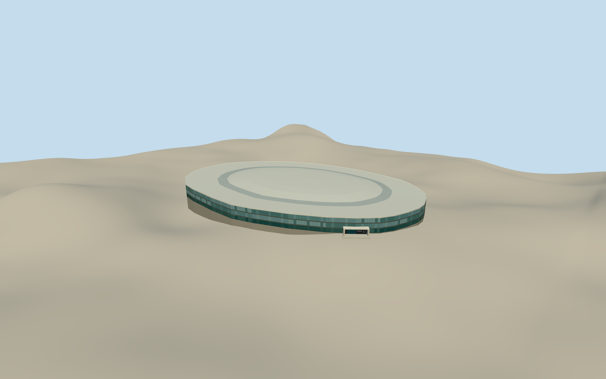

# National Museum of Ecuador

The National Museum of Ecuador occupies the Edificio de los Espejos in Quito. Its low oval of smoked mirrored glass wraps the Casa de la Cultura’s museum and theatres beneath a pale roof.

Authoring state: **review-in-qa.json**. Current completion evidence is in [qa.json](qa.json) and the [completion ledger](../../../../qualla-structures/batches/qualla-003.PROGRESS.md).

- [National Museum of Ecuador](https://qualla.com/national-museum-of-ecuador/)

The mapped envelope and approximate 10 m height control the low oval form. Curtain wall rhythm, roof curvature and service elevations are approximations based on the documented forms.

The museum entrance and lower service plinth are approximate placements. The sloping original DEM supplies terrain context and is preserved without flattening.

Build: `node content/worldgen/source/places/6r/6rb/national_museum_of_ecuador/models/generate-national-museum-of-ecuador.mjs`. Add `--check` to verify exact regeneration. 4738 triangles; 4 materials; no embedded photographs.
