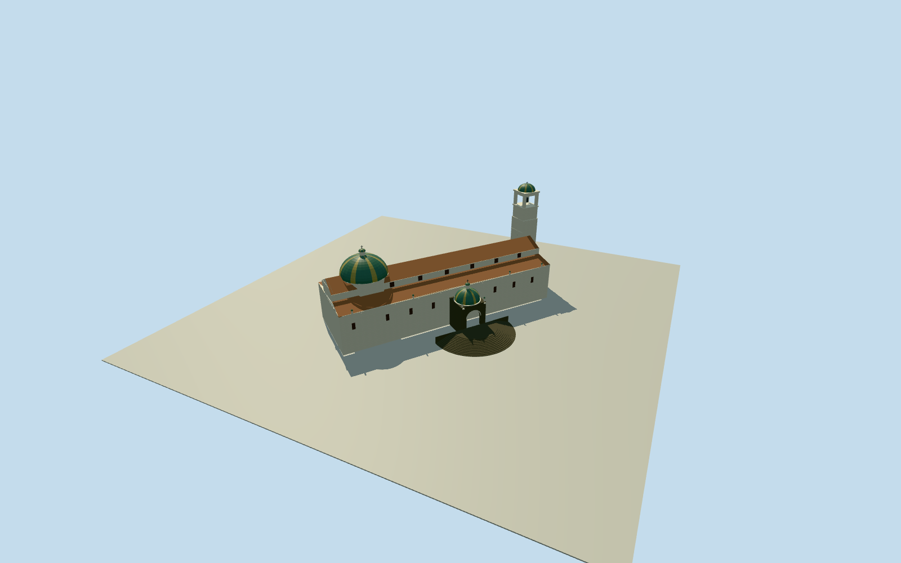

# Quito Metropolitan Cathedral

Whole11-control surviving Quito cathedral: three-aisle tiled roof/clerestory, presbytery hexagonal drum/cupola/lantern, full38.78mwestern intrinsic tower/open belfry, exact mapped lateral stoneportico/openarchedentry/greenroof and intrinsic semicircular accesssteps. FirstsignedphotographerPD-self original documents limited2004lateralappearance; hidden vertical/roof/windowsections original explicit estimates. No neighboring ElSagrariochurch, NationalBasilica or cityplaza monument.

Authoring state: **review-in-qa.json**. Current completion evidence is in [qa.json](qa.json) and the [completion ledger](../../../../qualla-structures/batches/qualla-002.PROGRESS.md).

- [Quito Metropolitan Cathedral](https://qualla.com/quito-metropolitan-cathedral/)

Actual complete named cathedralway253234080/Q5758380/11perimetercontrols including mapped lateralporticoandwesternbell-towerprojection. SeparateElSagrarioway159408376/Q6446453 not substituted or included. No wholecathedralproperty/cityblock extrusion.

Whole surviving Catedral Metropolitana de Quito on actual11controlway253234080/Q5758380: all main walls/three-aisle pitched roof, eastern presbytery cupola, western intrinsic shared bell-tower projection, mapped projecting lateral domed portico and semicircular access steps. Do not include independent adjacent ElSagrariochurch159408376/Q6446453, its parishhouse, the citypalace/plaza monument or a whole city block. Original medium-fi section/opening/detail estimates remain explicit.

Originalfield frozenfirst. Original exteriorsection estimate: cathedralfloor+2.4mabove fixedplazaapproach, base-.5mrelativeapproach, lowerwall/eaves11.2mabovefloor/upperclerestory15.2m/mainridge18.2m. Mainapsehexdrum17mabovefloor/dome6.5mrise/lantern. Porticowall8mabovefloor/archedentry5.8mhigh/greenhalf-dome4mrise/lantern. Wholebell-towertop38.78maboveapproach from2022primaryresearch, original stage splits/shape estimated.12curvedentrytreads rise2.4m/outerradius14m/innerradius7.5m. Every verticalsection/windowcensus/roofdivision/finialandcurrentcontact notobservedinacceptedphoto isexplicitestimate. Fixedbeforegeometry, neveradjusttosourcefield orrenders. Geographicpreview/replacementfalse.

Accepted640x480nightphoto is limited/noisy and shows only lateralportico/partialbroadside. Wholeactualnativeplan and originalresearchtowerheight retained; hiddenpresbyteryroof/drums/towerstages/daylightcolors/windowcensus/finials andsemicircularstairs are explicitlyoriginalmedium-fiestimates. Sculpture/inscriptions/clockdetail/interiorchapels/museumdisplays not reproduced. No currentrestoration/survey/photogrammetry claim.

Originalfield/frame/floor/mainsections frozen beforegeometry. UnclassifiedurbanDEM mayinclude roof/canopyartifact; actual thresholds/grade/contact remainunverified. Physicalcathedral/stepcutout only, geographicpreview/replacementfalse. No photographicpixels embedded.

Build: `node content/worldgen/source/places/6r/6rb/quito_metropolitan_cathedral/models/generate-quito-cathedral.mjs`. Add `--check` to verify exact regeneration. 11161 triangles; 6 materials; no embedded photographs.
