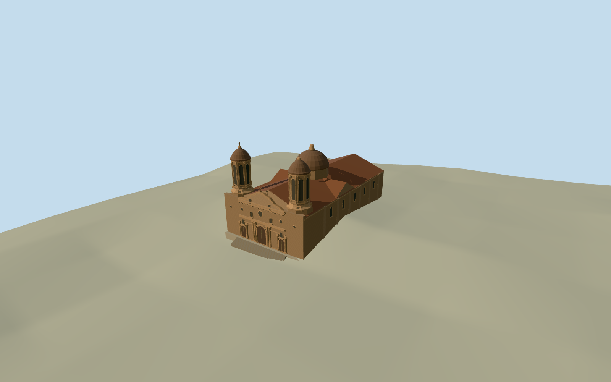

# Cathedral Basilica of Potosí

Potosí’s nineteenth-century stone cathedral with paired octagonal bell towers, three south portals and a tiled crossing dome.

Authoring state: **review-in-qa.json**. Current completion evidence is in [qa.json](qa.json) and the [completion ledger](../../../../qualla-structures/batches/qualla-004.PROGRESS.md).

- [The Cathedral That Rose From Its Own Collapse](https://qualla.com/cathedral-basilica-of-potosi/)

Draft exterior: approximate photographic proportions and simplified ornament. It is not a survey, photogrammetric reconstruction or approved current geographic replacement.

The dated 1908 photograph establishes the paired domed belfries and curving south frontage. The authors of the 2017 building survey record three nave doors, the octagonal belfry sections, tiled roofs and the crossing dome.

Terrain sampling/contact, geographic alignment and site activation remain pending. Runtime LODs are produced by the registered after-import pipeline and require visual review.

Reference photos remain in the local Qualla corpus; only provenance, paths and hashes are retained here.

Build: `node content/worldgen/source/places/6s/6s9/cathedral_basilica_of_potosi/models/generate-cathedral-basilica-of-potosi.mjs`. Add `--check` to verify exact regeneration. 9346 triangles; 6 materials; no embedded photographs.
