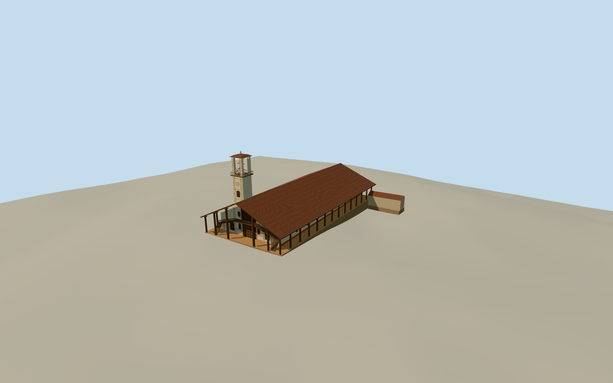

# St. Ignatius Cathedral, San Ignacio de Velasco

The reconstructed mission cathedral with a broad tiled gable, timber veranda and choir stairs, patterned facade, square belfry and rear range.

Authoring state: **review-in-qa.json**. Current completion evidence is in [qa.json](qa.json) and the [completion ledger](../../../../qualla-structures/batches/qualla-003.PROGRESS.md).

- [St. Ignatius Cathedral, San Ignacio de Velasco](https://qualla.com/st-ignatius-cathedral-san-ignacio-de-velasco/)

The model depicts the reconstructed cathedral in 2022 and the mapped attached rear range. Decorative painting and wood carving are simplified geometric interpretations.

The rear and side fenestration, bell tower dimensions and gallery framing are estimated from the map and plaza photograph.

The original terrain remains unchanged. The plaza floor and foundation contact down the side slope use approximate vertical registration.

Build: `node content/worldgen/source/places/6t/6th/st_ignatius_cathedral_san_ignacio_de_velasco/models/generate-san-ignacio-velasco.mjs`. Add `--check` to verify exact regeneration. 13812 triangles; 5 materials; no embedded photographs.
