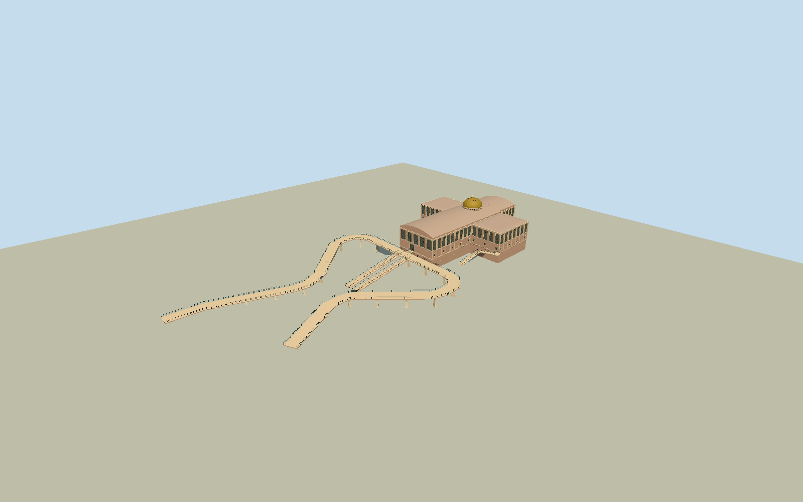

# Basilica of the Eternal Father, Trindade

Whole surviving1974/1994 existing Basilica of the Eternal Father/Q10368270 exterior on actual cruciform13-corner buildingway131382347, tall modernist nave/shallow barrel end/vertical recessed window and pier bays/transept arms/central gilded dome-drum/cross. Include intrinsic branching elevated west approach ramp486368471 with open structural underside/concrete flared piers/simple rails, short elevated connector998582092 and four mapped approach/flanking stair centerlines. These are integral photo-visible entrance structures; retain full native approach extent and whole basilica, no facade-only or plain cross box. Exclude whole plaza/streets/landscape/independent kiosks/cars/trees/people/interior rooms/pictorial sacred art/old sanctuary and separate new immense temple outside this site. Hidden current roof/rear/height/ramp sections/census and exact foundation contacts remain bounded original estimates.

Authoring state: **review-in-qa.json**. Current completion evidence is in [qa.json](qa.json) and the [completion ledger](../../../../qualla-structures/batches/qualla-002.PROGRESS.md).

- [Basilica of the Eternal Father, Trindade](https://qualla.com/basilica-of-the-eternal-father-trindade/)

Whole named surviving1974/1994 basilica/Q10368270 uses actual13-corner cruciform bodyway131382347 plus complete26-control branching elevated west ramp486368471, short entry bridge998582092 and all four bounded mapped stair centerlines with original short side landing links. Nave shallow barrel/vertical upper window-pier bays/transept roofs/gilded central dome-drum/cross and concrete approach with real undersides/open flared pier supports/rails; no facade-only or plain cross box.

Exact3216x2280 AdelanoLazaro2010 Own/PD-self published Qualla exterior individually inspected/nativeSHA1matched. Unrelated duplicate attribution-only path/interiors/ambiguous creator exterior/uncertain unknown-author historical photographs excluded without pixels/metadata repair. Abstract muted glazing only, no copied religious pictorial artwork. No supplemental imagery/borrowed mesh/generated bitmap/photo texture/policy-verifier changes.

All dimensions/roof/rear facade sections/dome placement-opening census/access widths/independent grades/piers/rail census/short side landing links are original bounded medium-fi estimates from one west-approach photo and current whole native outline/centerlines; current hidden finishes/private interior/structural survey/as-built stair thresholds unverified. Native arch shallow roof/gilded dome/cross and full entrance system retained at all four detail levels.

Original400m/129x129/16641-value independent field/one raw tile/PNG frozen before geometry/floor/architectural sections unchanged. Main floor+6.2/outer ramp+.18 independent; urban field artifacts/grade disagree with foundations/thresholds/pier footings. Isolated/shared-flat appearance with separate unchanged source-field evidence; exact source/host contact unresolved/replacementfalse. No source flattening/fitting/reacquisition/full-plaza pad, separate old sanctuary/new temple/kiosks/city/trees/people/cars/text/interior sacred sculptures.

Build: `node packages/worldgen/scripts/generate-authored-places.mjs --ids=basilica_of_the_eternal_father_trindade`. Add `--check` to verify exact regeneration. 28851 triangles; 6 materials; no embedded photographs.
