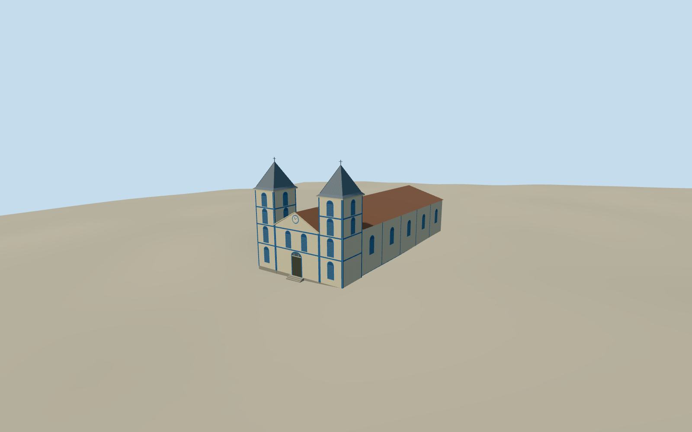

# Parish Church of Trindade

The old parish church in Trindade, Goiás, with the blue and white façade, twin pointed roofs, arched louvres and central clock gable in August 2024.

Authoring state: **review-in-qa.json**. Current completion evidence is in [qa.json](qa.json) and the [completion ledger](../../../../qualla-structures/batches/qualla-003.PROGRESS.md).

- [Parish Church of Trindade](https://qualla.com/parish-church-of-trindade/)

This is the August 2024 blue and white appearance of the old parish church. Tower heights, roof cladding, side and rear windows, and the clock dial and entrance detail are estimates.

The independent public elevation field is preserved. The low foundation, steps and exterior ground contact are approximate.

Build: `node content/worldgen/source/places/6v/6vh/parish_church_of_trindade/models/generate-trindade-parish.mjs`. Add `--check` to verify exact regeneration. 2511 triangles; 6 materials; no embedded photographs.
