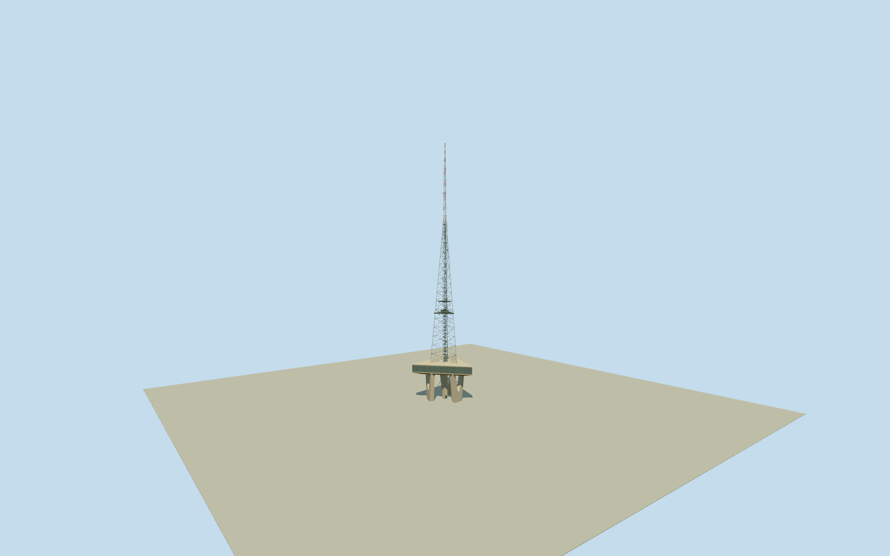

# Brasília TV Tower

Whole Brasília TV Tower exterior: three curved V-shaped concrete piers and center access/lift core; full mapped triangular glazed mezzanine with structural floor, sloping soffit and roof; open tapering triangular steel transmission lattice, center lift/stairs, observation deck at 75m and smaller service platform, complete red/white upper mast and needle to 224m. Exclude independent park, plaza, fountain, market, landscaping, paths, detached sculpture/art, barriers, signs, vehicles, people, interiors and exhibits. Antenna fixture census and hidden sections are bounded architectural estimates. Keep real V pier openings and voids between tower braces. All three sides use original native triangular orientation; do not substitute a square lattice or solid shaft. Rebuild curves/diagonals/glazed bays/antenna fixture forms as geometry. No modern sculpture/art copied from the photos.

Authoring state: **review-in-qa.json**. Current completion evidence is in [qa.json](qa.json) and the [completion ledger](../../../../qualla-structures/batches/qualla-002.PROGRESS.md).

- [Brasília TV Tower](https://qualla.com/brasilia-tv-tower/)

Exact named Q1270936 way41648342 supplies all three original triangular mezzanine vertices; unrotated east/south frame at original-vertex centroid preserves world positions. Current imported GDF tags height18.09/min_height20 conflict with one another and describe neither whole tower nor a reliable section; retained raw, not adopted. Operator confirms 224m whole tower and 75m mirante. Three CC0 views control V-pier openings, glazed triangular volume and open tapered three-chord lattice. Mezzanine floor25m/roof32m, piers, truss sections and fixtures are bounded photographic estimates, not construction plans.

Three exact2012 Daderot own CC0 originals individually inspected: already published Qualla DSC00092 first, two supplemental originals after bounded native category search. No government bare-PDM, attribution photo, stamps, copied texture or generated image used. Detached modern sculpture/art is excluded. Current structural forms represented with bounded cosmetic/equipment changes.

Full original native triangle defines mezzanine perimeter/orientation; all three V supports with curved openings, glazed volume/structural soffit/roof, center ground access core, whole open steel lattice, lift/stair cage, observation and service decks, red/white mast and needle retained. Native imported18.09m height/min20m tags conflict; not used as whole-tower height. Operator confirms224m and75m observation deck.

Mezzanine25..32m section, V curves/foot positions/thickness, main lattice top154m, upper mast199m/224m and service deck85m are photographic estimates. Hidden basement/interiors, exact antenna/dish count and current fixture alterations are not reconstructed. Optical glass is average neutral glazing; no reflected photo environment baked.

Lower detail levels reduce truss bays, supports curves, mullions and antenna fixtures while preserving triangular body, open base, narrow complete mast and principal decks. No square lattice or opaque cone substitute. Interior maintenance stairs approximate the externally visible switchback pattern.

Independent180m91x91 Terrariumfield and raw source tiles frozen before geometry; no flattened/fitted whole park ground. Model pier and access-core footings extend0.5m below datum; exact compatible live host terrain/contact unverified. Preview placement only, replaceFootprint=false. No fountain/market/plaza/landscape/paths/people/vehicles/signage/sculpture.

Build: `node packages/worldgen/scripts/generate-authored-places.mjs --ids=brasilia_tv_tower`. Add `--check` to verify exact regeneration. 13141 triangles; 4 materials; no embedded photographs.
