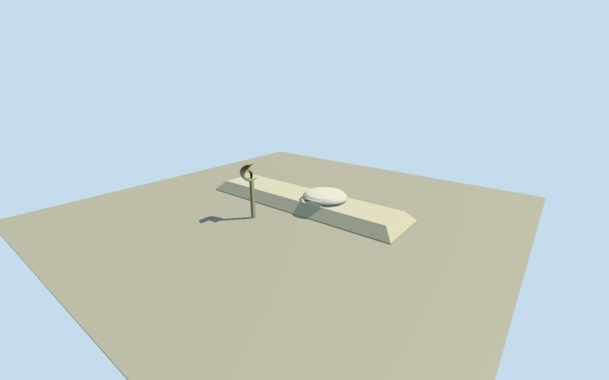

# JK Memorial

Complete JK Memorial museum exterior and intrinsic iconic monument: long low120mby32m marble-clad sloping closed museum body, shallow rounded rooftop mortuary-chamber shell with curved open undercut, square monument pedestal and broad curling concrete canopy carrying the waving bronze suited standing Juscelino figure. Below-ground rooms/approaches, pools, grounds/pavement, detachedoutbuildings, flagpoles/lamps/cars/sculptures/signage/interior excluded. Ground contact and unseen rear/roof form remain bounded estimates. Preserve open concrete curl, not a solid sphere/Cfilledboard; broad thin24?photoapproximated ribbon with open sky between figure and canopy. Use shaft20m, curl8m, standing bronze4.5m, genuine separated legs/raisedrightarm/openhand and loweredleftarm, suitlapels/tie/hair/face as mediumfi relief. Curved shallow circular rooftopchamber on actual arched undercut, not blank solid disk. No reflectingpool/slab/publicapproach or nativepoolcontainingwings. White marble bodyheight5.24m; every unseenminorsectiondetail bounded. Fixedterrainbeforegeometry.

Authoring state: **review-in-qa.json**. Current completion evidence is in [qa.json](qa.json) and the [completion ledger](../../../../qualla-structures/batches/qualla-002.PROGRESS.md).

- [JK Memorial](https://qualla.com/jk-memorial/)

Exact named nativeway84830646/Q1756676andoriginalnode4940499204identifymuseumandmonument. Original16vertexoutline includes wings overlapping separately mapped waterways549555276and550881723; those do NOT establish solid museum footprints. Original longbodytipnodes2/3/12/13control120x31m rectangle consistent with documented120x32m museum; independent front/side CC0photos show inwardsloping marble walls. Mainrectangle simplified within original tipcontrols, lower-wallbatter5m estimated, tower exactpoint[7.475074048946267,-33.543384195240456]. Heading follows long axis originalnode2tonode13, anchororiginalfulloutlineboundingmidpoint. No pool/siteextrusion. Nativeheight5.24mis museum-only, not monument. Exactnecks/roofchamber/hiddenentrypositions unsurveyed.

All seven exact Daderot2012CC0photographs inspected; no copied pixels or generated bitmap. Museum marble/concrete/roofplaster and bronze use shared procedural materials. Current cosmetic condition, actual fine marble courses, concealed rear/roof sections and portrait likeness are bounded mediumfi approximations.

Native5.24m museum-only height used. Monument shaft20m/curlto28m and4.5mnominal figure follow photographic proportions, not a surveyed dimensional section. Architect text places figure approximately30maboveground; conventional28m monument description has ambiguous height scope. No claim of exact engineering replica.

The raw native building polygon overlaps separately mapped reflectingpools and is not extruded whole. Model includes120x31m photograph-controlled sloped marble body, chamber and exact mapped monument point. No invented pool/site slab/landscape/publicapproach. Subterranean museum interiors/entries and ramps, detached outbuilding, bronze seatedcouple, flags/lamps/cars/signage excluded.

Chamber radius12m, centre[-15,-1.95], top10.25m/arched lower void, tower curl5.2mdepth and hidden back/undercuts are photograph-based estimates. Bronze standing suit/raisedright hand/separatelegs recreated as bounded faceted sculptural geometry, fine likeness/hair/eyes/fingers simplified at distant levels.

Independent original256m129x129field/terrainPNG/raw tile retained unchanged. Dry western reference[-63,-3] fixed before geometry. Precise source grade/basement/monument foot and compatible live hostterrain contact remain unverified; preview placement only and replaceFootprint=false.

Build: `node packages/worldgen/scripts/generate-authored-places.mjs --ids=jk_memorial`. Add `--check` to verify exact regeneration. 24739 triangles; 5 materials; no embedded photographs.
