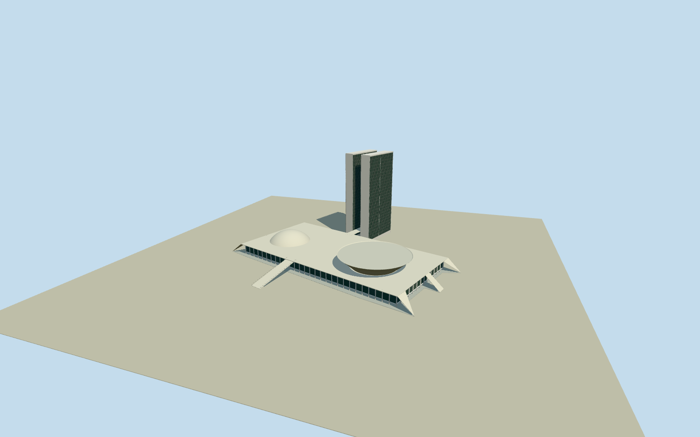

# National Congress Palace

Whole National Congress Palace/Palácio Nereu Ramos: native principal podium/glazedbody/pilotis/roofplatform, both28-storey native slabtowers with recessed longfaces, midheight bridge/lowconnection/roofconnector, Senate convex dome and Chamber inverted-bowl shell retaining all mapped contours, intrinsic whitefrontentranceramp. Published Qualla references searchedfirst; three distinct photographer-ownPD/CC0 originals inspected. Whole physical palace, no separate annexes/plaza/pools/gardens/flags/statues.

Authoring state: **review-in-qa.json**. Current completion evidence is in [qa.json](qa.json) and the [completion ledger](../../../../qualla-structures/batches/qualla-002.PROGRESS.md).

- [National Congress Palace](https://qualla.com/national-congress-palace/)

Actual11 native physical mainpalace components: principal podium/roof/glazedbody, dome/bowl contours, two towers/bridge/lowconnection. Fixedunionbboxanchor/heading0 before original independentfield/floor/sections/geometry. Separateannexes/pools/gardens excluded.

Whole11 nativephysical components/157 perimetercontrols: principalpodium124198934(22),roof825499918(16),glazedbody825499920(4),Senatefoot128360953(19),Chamberlower825499922(19)/middle825499921(32)/upperrim128360954(24),towers230844490(7)/230844491(6),bridge429913466(4),lowconnection825499919(4). All nativeXZcontrols retained physically everyLOD. NativeinstitutiontagQ949699 unchanged; actualbuildingQ4155889. Nativecupolafoot/rim controls usedfororiginal smoothboundedprofiles, not extrudedsolidcylinders. Ramps/pilotis/glazing/finecurrentroof profiles originalphoto-bounded; separateAnexoII/III/IV/pools/gardens/plaza/flags/statues/roads excluded.

Original independent512m129x12916641samples/one rawTerrariumtile/SW1062m datum/whole11componentunionbboxanchor/heading0 frozen before once-only exteriorfloor3.5946m and all verticalsections/geometry. Nativepodiumroof11m,Senatefoot11/top21,bowllower11/middle16/rim21,towers92m/28floors,bridge40–50(nativefixme acknowledged). Officialnewsrounded100m differs;92m nativephysicalroof retained, no extraheight invented. Original bounded glazedpodiumdeck2.2/glass2.4–10.5/roof11/pilotis0.15–10.55, smoothcupolaprofiles/bowlshallowinnerroof20.6,28towerfenestrationbands3.2–90.8m/close30bays,longfaceprofiles,slimroofconnector90.5–91.4m,intrinsic10mwidefrontwhiteentryramp0.15to11m fromV-97to-56.15. Hidden/currentroofdetails/support/windowcensus/fineprofiles/finish/contact are bounded estimates, not survey. No latefield/floor/sections/anchor fitting/flattening/reframe/reacquire/raising.

Qualla-first46families screened; localeligibleAnexoIV is a differentbuilding and archival mainpalace references unbound, unselected. Three distinct exact creator-ownPD/CC0 originals guide wholepalace and glazing:Alex982015CC0/AlexPereira2007PDself/MarioRobertoDuránOrtiz2006PDself. No source pixels embedded or protectedsigns/art copied.

All157 native XZ controls retained across11 physical components. Nativeendprojections interpreted as six sloped intrinsic sideaccess planes using already fixed0.15/11m ramp levels, rather than flying horizontalcanopies; centralroofplate bounded from their native inner edges. Original bounded smooth cupola profiles/closed shallow bowl innerroof/28-storey glazing groups/pilotis/windowframe census/topconnector/frontentryramp/hidden roof/currentfinish. Native92m towerroof retained; ownernews rounded100m differs. Bridge40–50/nativefixme originalbounded. No exact roof/interior/repair survey claim. SeparateAnexoII/III/IV/plaza/pools/lawns/flags/statues/roads excluded.

Original independent512mfield/floor/sections fixed beforegeometry, exactcontactunverified, preview/replacementfalse. Flatground/context neighbors are review fixtures.

Build: `node content/worldgen/source/places/6v/6vj/national_congress_palace/models/generate-national-congress-palace.mjs`. Add `--check` to verify exact regeneration. 26260 triangles; 5 materials; no embedded photographs.
