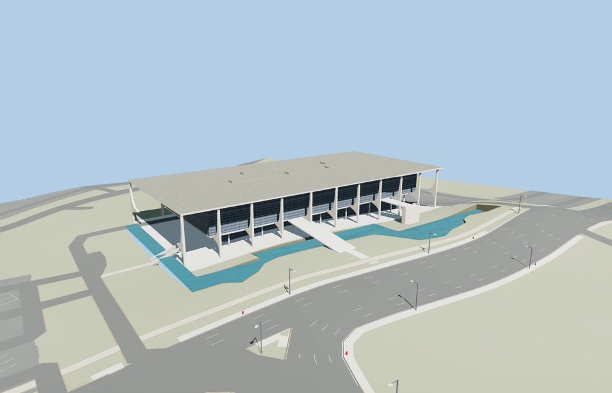

# Palácio do Planalto

Palácio do Planalto with a thin overhanging roof, two rows of curved white piers, a raised glazed volume, a long ceremonial ramp and a linked speaker platform facing Praça dos Três Poderes.

The 4,352-triangle source rebuilds byte for byte. Skyline, district, street and close-up use 982, 2,334, 2,822, 4,304 triangles. The first two tiers total 221,916 bytes. Six GLBs validated and 38 current views were inspected.

Each tier passes 22 pier contacts, six checks under the colonnade, three ramp-to-plaza joins, three ramp-to-entry checks and four ground-level approach probes. The smallest measured ramp clearance above native water is 2.58 m. The maximum sampled ramp-to-plaza difference is 0.08 m. The authored ramp replaces exactly one mapped footway. The viewer retains the original terrain, pool, other roads and independent buildings. Failed loading retains the mapped palace and footway.

The building and ramp use the mapped footprint, three ordinary exterior photos and standard Terrarium. Fifteen pier centers come from mapped parts. The seven remaining positions follow the observed regular bay spacing. Standard elevation slopes across the site, so the pier bases and apron adapt to that grade. Roof equipment and glazing are visual approximations. Physical-device timings are unmeasured.

Rebuild with `node packages/worldgen/scripts/generate-palacio-do-planalto.mjs`. Append `--check` to compare exact bytes. Use `--ids=palacio_do_planalto` for targeted import, LOD, placement and readiness.
