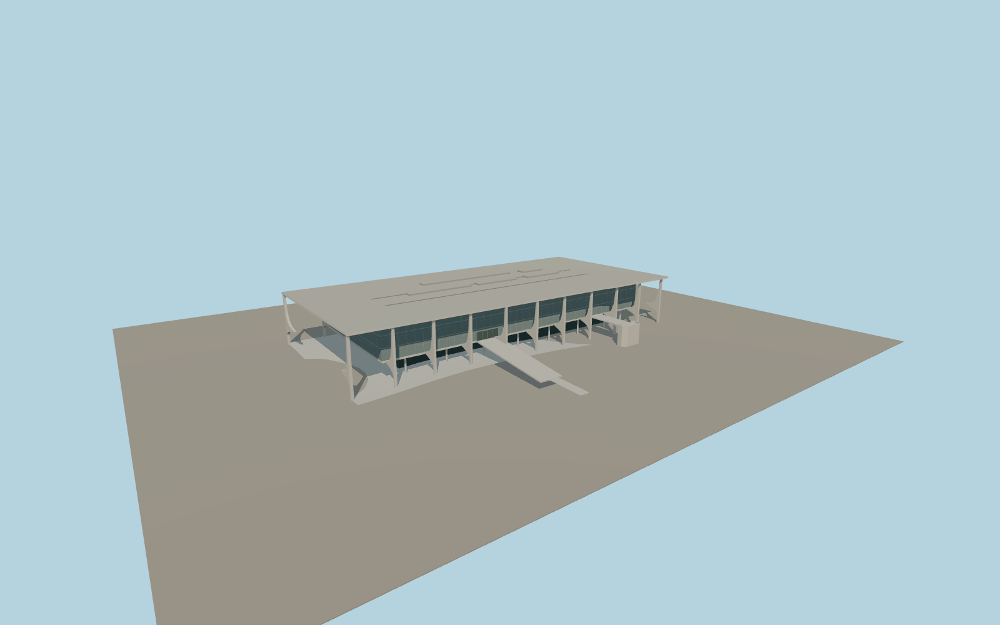

# Palácio do Planalto

Palácio do Planalto with a thin overhanging roof, two rows of curved white piers, a raised glazed volume, a long ceremonial ramp and a linked speaker platform facing Praça dos Três Poderes.

Run `node packages/worldgen/scripts/generate-palacio-do-planalto.mjs` to rebuild the source master. Append `--check` to compare the exact bytes. Use `--ids=palacio_do_planalto` for targeted import, LOD generation and placement.

Pier curves, roof fixtures, and glazing are photo-derived visual approximations. Fifteen pier centers follow mapped parts, with the continuous bay rhythm supplying the seven remaining centers.

The standard elevation grid slopes across the site. Pier bases and the low apron adapt to that grade while the upper floors remain level. The exterior model preserves the native reflecting pool and approaches.

Original geometry:repository license. Map:© OpenStreetMap contributors,ODbL-1.0;Protomaps. Standard terrain:terrain-grid.json. Ordinary pictures stay local and are not redistributed or used as textures. Current acceptance:qa.json.
